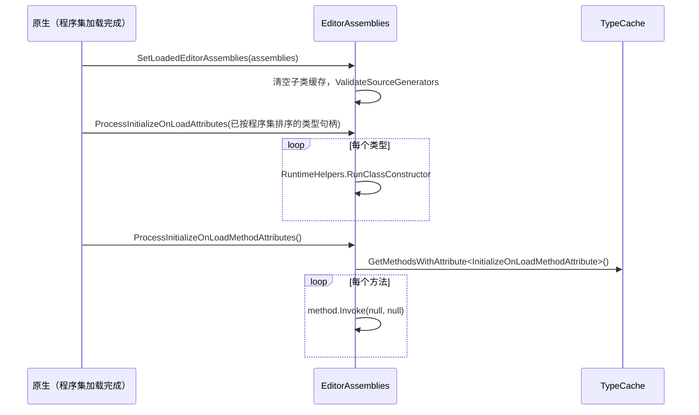

# 编辑器应用与回调

本页说明编辑器主循环在 C# 侧暴露的回调（`EditorApplication` 的各类事件），代码加载后的初始化钩子（`[InitializeOnLoad]` 系列），以及支撑大多数扩展点发现的 `TypeCache`。主循环本身在原生代码中，C# 侧只能看到“原生在某个时机调用了哪个托管方法”。

父页面：[编辑器架构](index.md) · 相关：[生命周期作用域](../runtime/lifecycle-scopes.md)、[窗口系统](window-system.md)

## 相关源码文件

- [`Editor/Mono/EditorApplication.cs`](../../Editor/Mono/EditorApplication.cs)
- [`Editor/Mono/EditorAssemblies.cs`](../../Editor/Mono/EditorAssemblies.cs)
- [`Editor/Mono/TypeCache.cs`](../../Editor/Mono/TypeCache.cs)、[`TypeCache.bindings.cs`](../../Editor/Mono/TypeCache.bindings.cs)
- [`Editor/Mono/AssemblyReloadEvents.cs`](../../Editor/Mono/AssemblyReloadEvents.cs)
- [`Editor/Mono/EventWithPerformanceTracker.cs`](../../Editor/Mono/EventWithPerformanceTracker.cs)

## 1. `EditorApplication` 事件与原生分发器

| 公共成员 | 原生调用的分发器 | 语义 | 证据 |
| --- | --- | --- | --- |
| `update`（委托字段） | `Internal_CallUpdateFunctions` | 每次被原生调用时，依次调用当前订阅者；调用频率由原生编辑器循环决定 | [`EditorApplication.cs:206-214`](../../Editor/Mono/EditorApplication.cs#L206-L214)、[`EditorApplication.cs:503-511`](../../Editor/Mono/EditorApplication.cs#L503-L511) |
| `delayCall`（委托字段） | `Internal_CallDelayFunctions` | 一次性队列：先取出并清空字段，再调用取出的委托 | [`EditorApplication.cs:245-251`](../../Editor/Mono/EditorApplication.cs#L245-L251)、[`EditorApplication.cs:519-526`](../../Editor/Mono/EditorApplication.cs#L519-L526) |
| `tick`（internal 事件） | `Internal_InvokeTickEvents` | 内部 tick；`CallDelayed` 基于它实现延时调用 | [`EditorApplication.cs:216-221`](../../Editor/Mono/EditorApplication.cs#L216-L221)、[`EditorApplication.cs:513-517`](../../Editor/Mono/EditorApplication.cs#L513-L517) |
| `wantsToQuit` | `Internal_EditorApplicationWantsToQuit` | 任一订阅者返回 `false` 就取消退出；订阅者抛异常时记录日志，交互模式下还会弹窗询问 | [`EditorApplication.cs:87-125`](../../Editor/Mono/EditorApplication.cs#L87-L125) |
| `quitting` | `Internal_EditorApplicationQuit` | 先停用版本控制，再调用订阅者 | [`EditorApplication.cs:127-135`](../../Editor/Mono/EditorApplication.cs#L127-L135) |
| `hierarchyChanged`、`projectChanged` | `Internal_CallHierarchyHasChanged`、`Internal_CallProjectHasChanged` | 层级或项目变化通知 | [`EditorApplication.cs:272-297`](../../Editor/Mono/EditorApplication.cs#L272-L297)、[`EditorApplication.cs:549-569`](../../Editor/Mono/EditorApplication.cs#L549-L569) |
| `playModeStateChanged` | `Internal_PlayModeStateChanged` | 在 `ProgressScope` 中调用订阅者；有一个针对 PlayUnfocused 的焦点特殊分支 | [`EditorApplication.cs:625-651`](../../Editor/Mono/EditorApplication.cs#L625-L651) |

### 实现细节

- **性能追踪包装**：大多数事件的后备存储是 `EventWithPerformanceTracker<T>` 或 `DelegateWithPerformanceTracker<T>`。遍历时会为每个订阅者启动编辑器性能追踪器，用于在进度弹窗中显示是哪一个回调耗时。注释说明：添加和移除订阅者是线程安全的，但调用只能发生在主线程 [`EventWithPerformanceTracker.cs:14-24`](../../Editor/Mono/EventWithPerformanceTracker.cs#L14-L24)、[`EventWithPerformanceTracker.cs:138-145`](../../Editor/Mono/EventWithPerformanceTracker.cs#L138-L145)。
- **异常处理**：`Internal_CallUpdateFunctions` 和 `Internal_CallDelayFunctions` 在 C# 侧没有对每个回调做 `try/catch` [`EditorApplication.cs:503-526`](../../Editor/Mono/EditorApplication.cs#L503-L526)。可以推断，一个回调抛出异常会中断本次分发的剩余回调，由原生侧负责记录异常；原生行为不在仓库中。对比之下，`wantsToQuit` 显式捕获了每个订阅者的异常。
- **`delayCall` 的重入**：分发前字段已被清空，所以回调执行过程中新加入的 `delayCall` 会进入下一轮，而不会在本轮执行 [`EditorApplication.cs:520-526`](../../Editor/Mono/EditorApplication.cs#L520-L526)。
- **`CallDelayed`**（仅对 Burst 和 ProjectAuditor 模块可见）：把一个包装委托挂到 `tick` 上，每次 tick 检查经过时间，满足后自行解除订阅并执行；延时为 0 时调用 `SignalTick()`。它返回一个可以取消订阅的委托 [`EditorApplication.cs:253-270`](../../Editor/Mono/EditorApplication.cs#L253-L270)。
- **代码重载清理**：`update`、`delayCall` 及各事件后备存储都标有 `[AutoStaticsCleanupOnCodeReload]`；注释说明订阅方需要通过自身生命周期重新订阅 [`EditorApplication.cs:207-251`](../../Editor/Mono/EditorApplication.cs#L207-L251)。详见 [生命周期作用域 §5](../runtime/lifecycle-scopes.md#5-自动静态清理)。

## 2. 代码加载后的初始化

### 2.1 特性

`[InitializeOnLoad]` 用于类，作用是在程序集加载或重载时执行其静态构造函数；`[InitializeOnLoadMethod]` 和 `[InitializeOnEnterPlayMode]` 用于方法 [`EditorAssemblies.cs:25-46`](../../Editor/Mono/EditorAssemblies.cs#L25-L46)。

### 2.2 执行流程

证据：

- `SetLoadedEditorAssemblies` 保存程序集列表，清空子类缓存，并检查源生成器是否被引用 [`EditorAssemblies.cs:87-96`](../../Editor/Mono/EditorAssemblies.cs#L87-L96)。
- `ProcessInitializeOnLoadAttributes` 接收原生 `InitializeOnLoadOrdering::OrderTypesByAssembly` 已排好序的类型句柄，逐个运行静态构造函数。`TypeLoadException` 和 `TypeInitializationException` 会被捕获，并记录内部异常，然后继续处理下一个类型 [`EditorAssemblies.cs:121-152`](../../Editor/Mono/EditorAssemblies.cs#L121-L152)。
- `ProcessInitializeOnLoadMethodAttributes` 通过 `TypeCache` 获取方法，逐个反射调用；任何异常都会被记录，然后继续 [`EditorAssemblies.cs:154-178`](../../Editor/Mono/EditorAssemblies.cs#L154-L178)。
- 两者都在 `ProgressScope` 中运行；诊断开关 `EnableDomainReloadTimings` 打开时，会为每个类型或方法记录带名称的 profiler marker [`EditorAssemblies.cs:118-119`](../../Editor/Mono/EditorAssemblies.cs#L118-L119)、[`EditorAssemblies.cs:128-136`](../../Editor/Mono/EditorAssemblies.cs#L128-L136)。

两个 `Process*` 方法的先后顺序，以及它们与 `[OnCodeLoaded]`、`[OnCodeInitializing]` 等生命周期回调的先后顺序，由原生决定，C# 侧无法确认。上图中的调用顺序是推断。

### 2.3 程序集重载事件

`AssemblyReloadEvents.beforeAssemblyReload`/`afterAssemblyReload` 由原生通过 `[RequiredByNativeCode]` 方法触发；没有订阅者时直接返回，否则在 `ProgressScope` 中逐个调用 [`AssemblyReloadEvents.cs:36-58`](../../Editor/Mono/AssemblyReloadEvents.cs#L36-L58)。

## 3. `TypeCache`

`TypeCache` 是编辑器发现扩展类型的统一入口：

- 公共 API 包括 `GetTypesDerivedFrom`、`GetTypesWithAttribute`、`GetMethodsWithAttribute`、`GetFieldsWithAttribute`，以及限定到单个程序集的重载 [`TypeCache.cs:40-104`](../../Editor/Mono/TypeCache.cs#L40-L104)。
- 查询结果以 `TypeCollection`、`MethodCollection` 等只读集合结构体返回 [`TypeCache.cs:112`](../../Editor/Mono/TypeCache.cs#L112)、[`TypeCache.cs:313`](../../Editor/Mono/TypeCache.cs#L313)。
- 底层查询都是原生实现，声明为 `IsThreadSafe = true`；`GetCurrentAge` 返回缓存代次 [`TypeCache.bindings.cs:22-67`](../../Editor/Mono/TypeCache.bindings.cs#L22-L67)。

因为数据由原生预先建立，编辑器各处可以在启动或重载期间频繁查询，而不必自己扫描全部程序集。这一性能动机是根据设计推断的，仓库中没有基准数据。

## 4. 与生命周期作用域的关系

`EditorApplication` 也是 EditMode 作用域的入口：`Internal_EnterEditModeLifecycleScope`/`Internal_ExitEditModeLifecycleScope` 由原生调用，并处理作用域可能已经存在或不存在的边界情况 [`EditorApplication.cs:599-623`](../../Editor/Mono/EditorApplication.cs#L599-L623)。新代码可以用 `[OnEnteringEditMode]` 等生命周期特性代替部分 `playModeStateChanged` 用法；两套机制目前并存。详见 [生命周期作用域](../runtime/lifecycle-scopes.md)。
