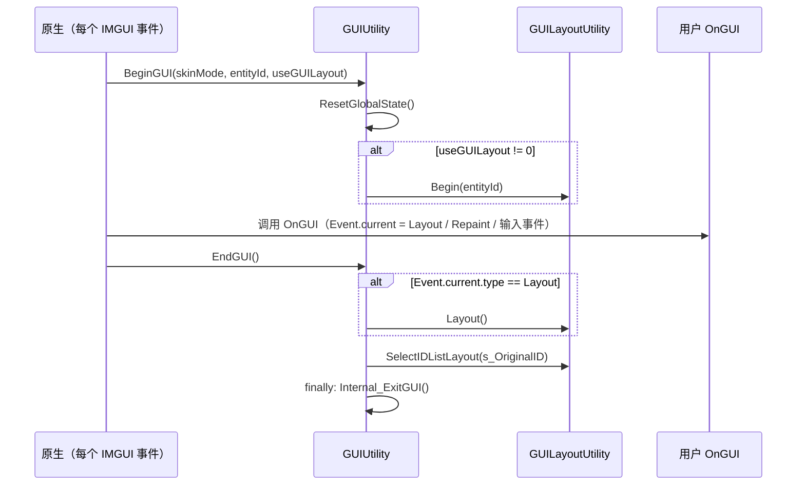

# IMGUI（即时模式 GUI）

IMGUI 是 `GUI`、`GUILayout`、`EditorGUI` 这套“每个事件都重新调用一次绘制代码”的界面框架。它主要用在大量编辑器窗口和 `OnGUI` 中，也是 UI Toolkit 中 `IMGUIContainer` 的内容。本页解释一次 IMGUI 处理周期的结构：原生如何开始和结束 GUI、`GUILayout` 的两遍布局、控件 ID 的约束，以及 IMGUI 如何嵌入 UI Toolkit。

父页面：[编辑器架构](index.md) · 相关：[窗口系统](window-system.md)、[UI Toolkit](../ui-toolkit/index.md)

代码位置：IMGUI 核心是**引擎模块** `Modules/IMGUI`，被编译进 `UnityEngine`，运行时游戏中的 `OnGUI` 也使用它；编辑器扩展控件位于 `Editor/Mono/EditorGUI.cs`、`EditorGUILayout.cs` 等文件。

## 相关源码文件

- [`Modules/IMGUI/GUIUtility.cs`](../../Modules/IMGUI/GUIUtility.cs)、[`GUIUtility.bindings.cs`](../../Modules/IMGUI/GUIUtility.bindings.cs)
- [`Modules/IMGUI/GUILayoutUtility.cs`](../../Modules/IMGUI/GUILayoutUtility.cs)、[`LayoutGroup.cs`](../../Modules/IMGUI/LayoutGroup.cs)、[`LayoutEntry.cs`](../../Modules/IMGUI/LayoutEntry.cs)
- [`Modules/IMGUI/GUI.cs`](../../Modules/IMGUI/GUI.cs)、[`GUILayout.cs`](../../Modules/IMGUI/GUILayout.cs)
- [`Modules/UIElements/Core/IMGUIContainer.cs`](../../Modules/UIElements/Core/IMGUIContainer.cs)

## 1. 一次 GUI 处理周期

证据：`BeginGUI` 记录皮肤模式和所属对象 ID，重置全局状态（皮肤、`guiIsExiting`、`GUI.changed`、滚动视图状态），并在使用布局时调用 `GUILayoutUtility.Begin` [`GUIUtility.cs:301-314`](../../Modules/IMGUI/GUIUtility.cs#L301-L314)、[`GUIUtility.cs:366-373`](../../Modules/IMGUI/GUIUtility.cs#L366-L373)。`EndGUI` 在 Layout 事件中执行布局计算，选回所属对象的布局缓存，清理 `GUIContent` 静态缓存，并在 `finally` 中退出 GUI [`GUIUtility.cs:330-347`](../../Modules/IMGUI/GUIUtility.cs#L330-L347)。“原生调用 `OnGUI`”这一步在 C# 中看不到，是推断。

异常路径：`EndGUIFromException` 退出 GUI，并由 `ShouldRethrowException` 决定是否重抛 [`GUIUtility.cs:349-356`](../../Modules/IMGUI/GUIUtility.cs#L349-L356)；`IsExitGUIException` 会剥开 `TargetInvocationException`，以识别通过反射调用时包装起来的 `ExitGUIException` [`GUIUtility.cs:375-380`](../../Modules/IMGUI/GUIUtility.cs#L375-L380)。所属对象销毁时，`DestroyGUI` 移除它的布局缓存 [`GUIUtility.cs:316-320`](../../Modules/IMGUI/GUIUtility.cs#L316-L320)。

## 2. `GUILayout` 的两遍模型

`GUILayout` 自动布局依赖同一段 `OnGUI` 代码至少运行两次：

1. **Layout 事件**：`GUILayoutUtility.Begin` 新建顶层 `GUILayoutGroup` 并清空分组栈，控件调用只登记尺寸需求。`EndGUI` 随后调用 `GUILayoutUtility.Layout()` 计算矩形 [`GUILayoutUtility.cs:153-170`](../../Modules/IMGUI/GUILayoutUtility.cs#L153-L170)。
2. **其它事件（Repaint、输入）**：`Begin` 复用缓存中的顶层分组和分组栈，控件按登记顺序取回已计算的矩形 [`GUILayoutUtility.cs:164-169`](../../Modules/IMGUI/GUILayoutUtility.cs#L164-L169)。

布局缓存按所属对象的 `EntityId` 存在 `s_StoredLayouts` 中，窗口内的 `GUILayout.Window` 则按窗口 ID 存在 `s_StoredWindows` 中 [`GUILayoutUtility.cs:86-138`](../../Modules/IMGUI/GUILayoutUtility.cs#L86-L138)。

### 控件 ID 与 `ExitGUI`

`GetControlID` 系列为控件分配 ID，可以用提示值（如 `GUIContent.hash`）帮助在不同事件之间匹配同一个控件 [`GUIUtility.cs:106-150`](../../Modules/IMGUI/GUIUtility.cs#L106-L150)。`ExitGUI` 的文档说明了核心约束：在一次 GUI 循环中，每个事件请求控件 ID 的顺序必须相同，并且事件循环不能重入。如果某个值的变化会改变接下来显示哪些控件，就应调用 `ExitGUI` 结束本轮，否则可能出现“Getting control 0's position in a group with only 0 controls”这类错误 [`GUIUtility.cs:266-276`](../../Modules/IMGUI/GUIUtility.cs#L266-L276)。

`ExitGUI` 总是抛出 `ExitGUIException`，异常构造函数会设置 `guiIsExiting = true` [`GUIUtility.cs:28-46`](../../Modules/IMGUI/GUIUtility.cs#L28-L46)。UI Toolkit 的事件分发器会捕获它，并在处理完队列后重新抛出（见 [事件分发](../ui-toolkit/events.md)）。

## 3. 在 UI Toolkit 中运行 IMGUI

`IMGUIContainer` 是一个 `VisualElement`，内部运行一段 IMGUI 代码：

- 每个容器有自己的 `GUILayoutUtility.LayoutCache` [`IMGUIContainer.cs:91-99`](../../Modules/UIElements/Core/IMGUIContainer.cs#L91-L99)。
- `DoOnGUI` 在调用处理函数前记录 `GUIClip` 数量和 `guiDepth`，用于调用后的完整性检查 [`IMGUIContainer.cs:287-300`](../../Modules/UIElements/Core/IMGUIContainer.cs#L287-L300)。
- `BeginContainerGUI` 开始容器 GUI，并通过 `GUILayoutUtility.BeginContainer(cache)` 切换到容器自己的布局缓存 [`IMGUIContainer.cs:1106-1135`](../../Modules/UIElements/Core/IMGUIContainer.cs#L1106-L1135)。`BeginContainer` 的两遍逻辑与 `Begin` 相同，只是始终使用传入的缓存 [`GUILayoutUtility.cs:172-188`](../../Modules/IMGUI/GUILayoutUtility.cs#L172-L188)。

[窗口系统](window-system.md) 中说明过，每个编辑器窗口的 `OnGUI` 都运行在面板根部的这样一个容器中。因此，编辑器中的 IMGUI 事件实际上先进入 UI Toolkit 的事件分发，再由容器转为 IMGUI 处理周期。

## 4. 局限

- `GUI.cs`（约 323 KB）和 `GUILayout.cs`（约 284 KB）包含大量控件实现，本页没有逐个分析。
- 运行时游戏中 `OnGUI` 的调度在原生侧；PlayerLoop 中有 `PreUpdate.IMGUISendQueuedEvents` 和 `PostLateUpdate.GUIClearEvents` 这样的阶段 [`PlayerLoop.bindings.cs:171`](../../Runtime/Export/PlayerLoop/PlayerLoop.bindings.cs#L171)、[`PlayerLoop.bindings.cs:316`](../../Runtime/Export/PlayerLoop/PlayerLoop.bindings.cs#L316)，但仓库中看不到它们具体如何调用 `OnGUI`。
