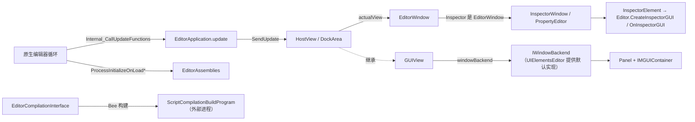

# 编辑器架构

本页是编辑器（`UnityEditor` 工程）相关页面的父页面。编辑器是一个原生应用：主循环、窗口创建、资源数据库和构建核心都在 C++ 中，C# 层提供窗口与界面框架、Inspector、各种扩展点（特性和回调接口）、脚本编译编排和大量工具窗口。

父页面：[仓库概览](../overview.md)

## 子页面

| 页面 | 回答的问题 |
| --- | --- |
| [编辑器应用与回调](editor-application.md) | 原生循环如何驱动 `EditorApplication.update`/`delayCall`，`[InitializeOnLoad]` 何时运行，`TypeCache` 如何发现类型 |
| [窗口系统](window-system.md) | `ContainerWindow`、`View`、`GUIView`、`HostView`、`DockArea`、`EditorWindow` 如何组成，UI 后端如何接入 |
| [IMGUI](imgui.md) | `GUI`/`GUILayout` 的 Layout/Repaint 两遍流程、控件 ID 与 `ExitGUI` |
| [Inspector](inspector.md) | 自定义编辑器如何解析，Inspector 如何构建 UI，`SerializedObject` 在其中的角色 |
| [脚本编译](script-compilation.md) | 预定义程序集与 asmdef 规则、Bee 驱动的异步编译、MSBuild 分支 |
| [资源导入](asset-pipeline.md) | `AssetPostprocessor` 回调分发、`ScriptedImporter` 注册 |
| [播放器构建](build-pipeline.md) | `BuildPipeline.BuildPlayer` 校验、构建回调发现与调用 |
| [包管理器](package-manager.md) | UPM 客户端请求模型与包管理器窗口的服务容器 |

## 1. `Editor/Mono` 的组织

`Editor/Mono` 有 1520 个文件。根目录直接放置了大量核心类型，例如 `EditorApplication.cs`、`EditorWindow.cs`、`HostView.cs`、`GUIView.cs`、`ContainerWindow.cs`、`AssetPostprocessor.cs`、`TypeCache.cs`、`SerializedObject.bindings.cs`。按文件数较多的子目录如下（计数来自目录统计）：

| 子目录 | 文件数 | 主题 |
| --- | --- | --- |
| `Inspector` | 228 | Inspector 窗口、`Editor` 基类、内置组件编辑器、属性绘制器 |
| `GUI` | 123 | `DockArea`、`SplitView`、`MainView`、编辑器 GUI 控件 |
| `Scripting` | 91 | 脚本编译（`ScriptCompilation`）、API 更新器、受限 API 校验 |
| `UIElements` | 63 | 编辑器侧 UI Toolkit 集成，例如 `InspectorElement`、样式表导入器 |
| `Overlays` | 45 | 场景视图覆盖层 |
| `Audio` | 45 | 音频编辑器工具 |
| `BuildPipeline` | 43 | 播放器构建 API 与回调 |
| `Animation` | 40 | 动画编辑器 |
| `BuildProfile` | 39 | 构建配置 |
| `VersionControl` | 37 | 版本控制集成 |
| `AssetPipeline` | 29 | 各类导入器的 C# 侧 |
| `Utils` | 29 | 工具类 |
| `Handles` | 27 | 场景视图手柄 |

另有约 100 个以 `Editor` 结尾或属于编辑器的模块（如 `UIElementsEditor`、`QuickSearch`、`ProfilerEditor`、`PackageManagerUI`），见 [模块目录](../module-catalog.md)。

## 2. 组件关系

图中证据：`Internal_CallUpdateFunctions` [`EditorApplication.cs:503-511`](../../Editor/Mono/EditorApplication.cs#L503-L511)；`ProcessInitializeOnLoadAttributes` [`EditorAssemblies.cs:121-152`](../../Editor/Mono/EditorAssemblies.cs#L121-L152)；`HostView` 注册 `SendUpdate` [`HostView.cs:617-632`](../../Editor/Mono/HostView.cs#L617-L632)；`HostView : GUIView` [`HostView.cs:23`](../../Editor/Mono/HostView.cs#L23)；`GUIView.windowBackend` 由 `EditorWindowBackendManager.GetBackend` 提供 [`GUIView.cs:229-268`](../../Editor/Mono/GUIView.cs#L229-L268)；默认后端由 `RetainedMode` 设置 [`RetainedMode.cs:43`](../../Modules/UIElementsEditor/RetainedMode.cs#L43)；`InspectorWindow : PropertyEditor`，`PropertyEditor : EditorWindow` [`InspectorWindow.cs:19`](../../Editor/Mono/Inspector/Core/InspectorWindow.cs#L19)、[`PropertyEditor.cs:54`](../../Editor/Mono/Inspector/Core/PropertyEditor.cs#L54)；`InspectorElement` 的构建 [`InspectorElement.cs:713-740`](../../Editor/Mono/UIElements/Inspector/InspectorElement.cs#L713-L740)；编译启动 Bee 构建 [`EditorCompilation.cs:879-972`](../../Editor/Mono/Scripting/ScriptCompilation/EditorCompilation.cs#L879-L972)。

## 3. 编辑器扩展点的共同模式

编辑器 C# 层几乎所有用户扩展都遵循“**特性或接口 → `TypeCache` 发现 → 在固定时机由托管分发器调用**”的模式。下表中多数分发入口标有 `[RequiredByNativeCode]`，由原生调用；属性绘制器的查询则由 Inspector 的托管代码发起。

| 扩展点 | 发现方式 | 分发或查询入口 |
| --- | --- | --- |
| `[InitializeOnLoad]`/`[InitializeOnLoadMethod]` | 原生排序类型句柄；`TypeCache.GetMethodsWithAttribute` | `EditorAssemblies.ProcessInitializeOnLoad*` [`EditorAssemblies.cs:121-178`](../../Editor/Mono/EditorAssemblies.cs#L121-L178) |
| `[CustomEditor]` | `TypeCache.GetTypesWithAttribute<CustomEditor>` | `CustomEditorAttributes.FindCustomEditorType*` [`CustomEditorAttributes.bindings.cs:12-22`](../../Editor/Mono/CustomEditorAttributes.bindings.cs#L12-L22) |
| `[CustomPropertyDrawer]` | `TypeCache.GetTypesDerivedFrom<GUIDrawer>`，再读取特性，构建“属性类型 → 绘制器”字典 | `ScriptAttributeUtility.GetDrawerTypeForType` [`ScriptAttributeUtility.cs:145-184`](../../Editor/Mono/Inspector/Core/ScriptAttributeGUI/ScriptAttributeUtility.cs#L145-L184) |
| `AssetPostprocessor` 子类 | 排序后的回调集合 | `AssetPostprocessor.PostprocessAllAssets` 等 [`AssetPostprocessor.cs:340-374`](../../Editor/Mono/AssetPostprocessor.cs#L340-L374) |
| `[ScriptedImporter]` | `TypeCache.GetTypesWithAttribute<ScriptedImporterAttribute>` | `ScriptedImporter.RegisterScriptedImporters` [`ScriptedImporter.cs:60-138`](../../Modules/AssetPipelineEditor/Public/ScriptedImporter.cs#L60-L138) |
| 构建回调接口（`IOrderedCallback` 派生） | `TypeCache.GetTypesDerivedFrom<IOrderedCallback>` | `BuildPipelineInterfaces.InitializeBuildCallbacks`、`OnBuildPreProcess` 等 [`BuildPipelineInterfaces.cs:878-904`](../../Editor/Mono/BuildPipeline/BuildPipelineInterfaces.cs#L878-L904) |

`TypeCache` 本身的查询由原生实现，并标为线程安全 [`TypeCache.bindings.cs:22-65`](../../Editor/Mono/TypeCache.bindings.cs#L22-L65)。

## 4. 编辑器级不变量

| 不变量 | 证据 |
| --- | --- |
| `EditorApplication.delayCall` 是一次性队列：每次分发前取出并清空，回调要再次执行必须重新加入 | [`EditorApplication.cs:245-249`](../../Editor/Mono/EditorApplication.cs#L245-L249)、[`EditorApplication.cs:519-526`](../../Editor/Mono/EditorApplication.cs#L519-L526) |
| 静态事件订阅会在代码重载时被清空，订阅方需要在重载后重新订阅 | [`EditorApplication.cs:207-211`](../../Editor/Mono/EditorApplication.cs#L207-L211)，见 [生命周期作用域](../runtime/lifecycle-scopes.md) |
| 自定义编辑器解析先做常规匹配，再做 `isFallback` 匹配，并沿基类链向上查找 | [`CustomEditorAttributes.cs:57-85`](../../Editor/Mono/CustomEditorAttributes.cs#L57-L85) |
| 已有构建在进行时，脚本 API `BuildPipeline.BuildPlayer(BuildPlayerOptions)` 会抛出异常；UI 入口 `BuildPlayerFromUI` 本身不包含这项检查，它的调用方是否检查没有追踪 | [`BuildPipeline.bindings.cs:199-202`](../../Editor/Mono/BuildPipeline/BuildPipeline.bindings.cs#L199-L202)、[`BuildPipeline.bindings.cs:299-312`](../../Editor/Mono/BuildPipeline/BuildPipeline.bindings.cs#L299-L312) |
