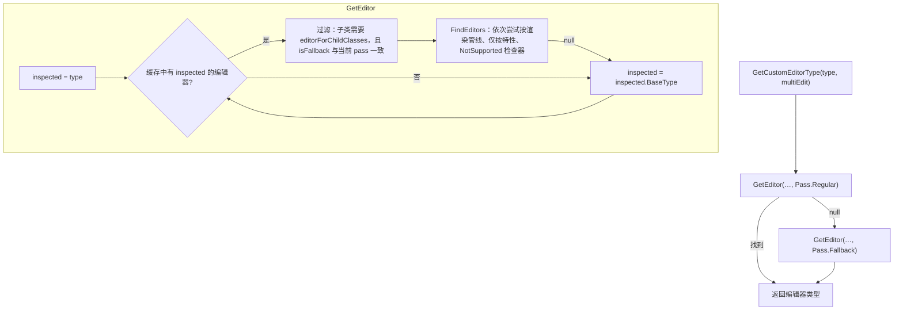

# Inspector

Inspector 根据当前选中对象生成可编辑界面。它要解决三个问题：为每个目标对象选择哪个 `Editor` 类（自定义编辑器或默认编辑器），用 UI Toolkit 还是 IMGUI 构建界面，以及每个序列化字段用哪个属性绘制器。本页按这三层说明实现。

父页面：[编辑器架构](index.md) · 相关：[序列化 §3](../runtime/serialization.md#3-编辑器侧serializedobject-与-serializedproperty)、[窗口系统](window-system.md)、[IMGUI](imgui.md)

## 相关源码文件

- [`Editor/Mono/Inspector/Core/InspectorWindow.cs`](../../Editor/Mono/Inspector/Core/InspectorWindow.cs)、[`PropertyEditor.cs`](../../Editor/Mono/Inspector/Core/PropertyEditor.cs)
- [`Editor/Mono/CustomEditorAttributes.cs`](../../Editor/Mono/CustomEditorAttributes.cs)、[`CustomEditorAttributes.bindings.cs`](../../Editor/Mono/CustomEditorAttributes.bindings.cs)
- [`Editor/Mono/Inspector/Editor.cs`](../../Editor/Mono/Inspector/Editor.cs)
- [`Editor/Mono/UIElements/Inspector/InspectorElement.cs`](../../Editor/Mono/UIElements/Inspector/InspectorElement.cs)
- [`Editor/Mono/Inspector/Core/ScriptAttributeGUI/ScriptAttributeUtility.cs`](../../Editor/Mono/Inspector/Core/ScriptAttributeGUI/ScriptAttributeUtility.cs)
- [`Editor/Mono/Selection/ActiveEditorTracker.bindings.cs`](../../Editor/Mono/Selection/ActiveEditorTracker.bindings.cs)

## 1. 窗口与追踪器

`InspectorWindow` 继承 `PropertyEditor`，后者是一个 `EditorWindow` [`InspectorWindow.cs:19`](../../Editor/Mono/Inspector/Core/InspectorWindow.cs#L19)、[`PropertyEditor.cs:54`](../../Editor/Mono/Inspector/Core/PropertyEditor.cs#L54)。它持有一个 `ActiveEditorTracker`；追踪器维护当前选中对象对应的 `Editor` 实例列表，并标记是否需要重建（`isDirty`），实现在原生侧。

`PropertyEditor` 的三个消息方法分工如下：

| 方法 | 行为 | 证据 |
| --- | --- | --- |
| `OnInspectorUpdate` | 检查是否有脚本修改但未调用 SetDirty；追踪器为 dirty 且可以重绘时，更新标题并 `Repaint` | [`PropertyEditor.cs:511-532`](../../Editor/Mono/Inspector/Core/PropertyEditor.cs#L511-L532) |
| `OnGUI` | 首次初始化时调用 `RebuildContentsContainers` | [`PropertyEditor.cs:534-541`](../../Editor/Mono/Inspector/Core/PropertyEditor.cs#L534-L541) |
| `Update` | 有编辑器要求持续重绘时，最多每 33ms 重绘一次；每帧最多花 5ms **增量创建**尚未构建的 Inspector 元素 | [`PropertyEditor.cs:546-565`](../../Editor/Mono/Inspector/Core/PropertyEditor.cs#L546-L565) |

`RebuildContentsContainers` 保存滚动位置，清理旧内容，读取 `tracker.activeEditors` 并调用 `DrawEditors` [`PropertyEditor.cs:1186-1239`](../../Editor/Mono/Inspector/Core/PropertyEditor.cs#L1186-L1239)。首次构建时，先在不触发布局的情况下强制创建 2 个 Inspector 元素，再继续创建直到填满视口；需要恢复滚动位置时，会额外创建足够多的元素，使保存的偏移仍可到达。其余元素由 `Update` 在后续帧按每帧 5ms 的预算继续创建 [`PropertyEditor.cs:95-102`](../../Editor/Mono/Inspector/Core/PropertyEditor.cs#L95-L102)、[`PropertyEditor.cs:1304-1328`](../../Editor/Mono/Inspector/Core/PropertyEditor.cs#L1304-L1328)。从设计上看，这样可以减少选中大量组件时的界面卡顿；仓库中没有相关性能数据。

## 2. 选择 `Editor` 类型

原生追踪器通过 `[RequiredByNativeCode]` 方法询问托管侧应该使用哪个编辑器类型 [`CustomEditorAttributes.bindings.cs:12-22`](../../Editor/Mono/CustomEditorAttributes.bindings.cs#L12-L22)。解析过程如下：

图中证据：两遍解析 [`CustomEditorAttributes.cs:57-64`](../../Editor/Mono/CustomEditorAttributes.cs#L57-L64)；沿基类链向上查找并过滤 [`CustomEditorAttributes.cs:66-85`](../../Editor/Mono/CustomEditorAttributes.cs#L66-L85)、[`CustomEditorAttributes.cs:154-162`](../../Editor/Mono/CustomEditorAttributes.cs#L154-L162)；`FindEditors` 的策略列表依赖当前是否启用了可编程渲染管线（SRP）[`CustomEditorAttributes.cs:37-50`](../../Editor/Mono/CustomEditorAttributes.cs#L37-L50)、[`CustomEditorAttributes.cs:87-101`](../../Editor/Mono/CustomEditorAttributes.cs#L87-L101)。

缓存来源：`Initialize` 用 `TypeCache.GetTypesWithAttribute<CustomEditor>()` 收集所有带特性的类型。被检查类型为 null 时记录日志；类型不继承 `Editor` 时发出警告；`SupportedOnRenderPipeline` 特性无效时报错并跳过 [`CustomEditorAttributes.cs:164-200`](../../Editor/Mono/CustomEditorAttributes.cs#L164-L200)。缓存在 `[OnCodeUnloading]` 时清空 [`CustomEditorAttributes.cs:23-33`](../../Editor/Mono/CustomEditorAttributes.cs#L23-L33)。

## 3. 构建 Inspector 界面

### 3.1 `Editor` 基类的两套入口

- `CreateInspectorGUI()` 默认返回 `null` [`Editor.cs:919-922`](../../Editor/Mono/Inspector/Editor.cs#L919-L922)。
- `OnInspectorGUI()` 默认调用 `DrawDefaultInspector()` [`Editor.cs:913-916`](../../Editor/Mono/Inspector/Editor.cs#L913-L916)、[`Editor.cs:857-860`](../../Editor/Mono/Inspector/Editor.cs#L857-L860)。
- `serializedObject` 按需用 `targets` 和上下文对象创建；在 `OnSceneGUI`/`OnPreviewGUI` 中访问会报错 [`Editor.cs:586-595`](../../Editor/Mono/Inspector/Editor.cs#L586-L595)、[`Editor.cs:710-720`](../../Editor/Mono/Inspector/Editor.cs#L710-L720)。

### 3.2 `InspectorElement` 的选择逻辑

- **自定义编辑器**：先尝试 UI Toolkit（`CreateInspectorGUI`），返回 `null` 时回退到 IMGUI [`InspectorElement.cs:733-734`](../../Editor/Mono/UIElements/Inspector/InspectorElement.cs#L733-L734)。成功时，根据是否为 `GenericInspector` 添加不同的 USS 类 [`InspectorElement.cs:777-811`](../../Editor/Mono/UIElements/Inspector/InspectorElement.cs#L777-L811)。
- **默认编辑器**：由 `EditorSettings.inspectorUseIMGUIDefaultInspector` 决定使用 IMGUI 还是 UI Toolkit [`InspectorElement.cs:124`](../../Editor/Mono/UIElements/Inspector/InspectorElement.cs#L124)。
- **防止无限嵌套**：构建栈深度超过上限时，拒绝构建并显示错误 `HelpBox`。如果同一编辑器类型对同一组目标重复出现，错误信息会提示改用 `InspectorElement.FillDefaultInspector` [`InspectorElement.cs:708-740`](../../Editor/Mono/UIElements/Inspector/InspectorElement.cs#L708-L740)。目标比较使用 `EntityId`，因为已销毁的目标会表现为 null，但 ID 不变 [`InspectorElement.cs:760-775`](../../Editor/Mono/UIElements/Inspector/InspectorElement.cs#L760-L775)。

## 4. 属性绘制器解析

默认 Inspector 为每个 `SerializedProperty` 寻找 `PropertyDrawer`：

1. 首次访问时构建“属性类型 → 绘制器容器数组”字典：遍历 `TypeCache.GetTypesDerivedFrom<GUIDrawer>()`，读取 `[CustomPropertyDrawer]` 与 `[SupportedOnRenderPipeline]`，并按渲染管线排序；同时订阅渲染管线创建和销毁事件，以便重置缓存 [`ScriptAttributeUtility.cs:144-171`](../../Editor/Mono/Inspector/Core/ScriptAttributeGUI/ScriptAttributeUtility.cs#L144-L171)。
2. `GetDrawerTypeForType` 先查静态结果缓存；然后从属性类型开始沿基类链查找，泛型类型先检查具体类型再检查泛型定义；随后按继承层级和名称排序，检查类型实现的接口，并跳过基类已经实现的接口 [`ScriptAttributeUtility.cs:184-253`](../../Editor/Mono/Inspector/Core/ScriptAttributeGUI/ScriptAttributeUtility.cs#L184-L253)。

## 5. 局限

- `ActiveEditorTracker` 的重建条件和编辑器实例化在原生侧。
- `PropertyHandler`、装饰器绘制器、多对象编辑和预设集成没有逐一分析。
- `Editor/Mono/Inspector` 中的 200 多个内置组件编辑器（如 `TransformInspector.cs`、`CameraEditor.cs`）只作为扩展示例，没有分析。
