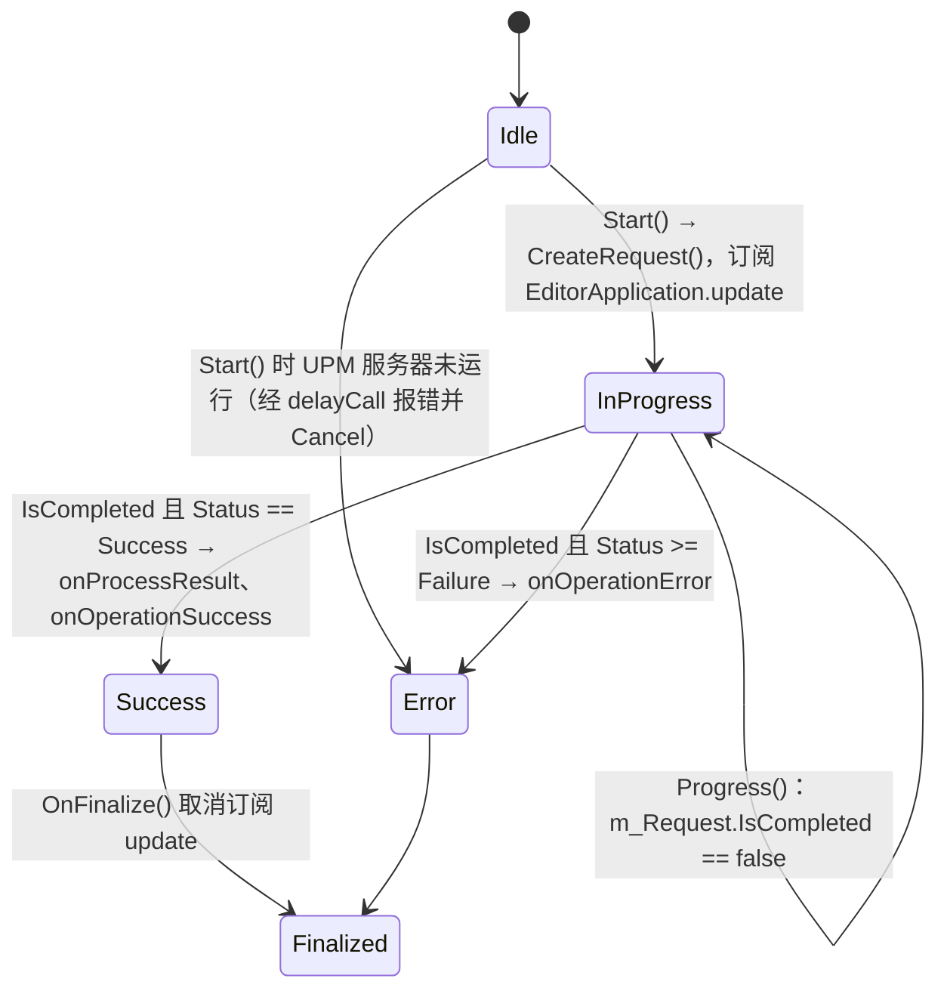

# 包管理器

包管理器分为两层：`Modules/PackageManager` 提供公共脚本 API `UnityEditor.PackageManager.Client`，它是对原生 UPM 操作的轮询式包装；`Modules/PackageManagerUI` 实现“Package Manager”窗口，用一个手写的服务容器组织数十个服务。本页说明请求模型和 UI 侧的服务组织方式。

父页面：[编辑器架构](index.md) · 相关：[编辑器应用与回调](editor-application.md)、[序列化](../runtime/serialization.md)

## 相关源码文件

- [`Modules/PackageManager/Editor/Managed/Client.cs`](../../Modules/PackageManager/Editor/Managed/Client.cs)、[`PackageManager.bindings.cs`](../../Modules/PackageManager/Editor/Managed/PackageManager.bindings.cs)
- [`Modules/PackageManager/Editor/Managed/Requests/Request.cs`](../../Modules/PackageManager/Editor/Managed/Requests/Request.cs)
- [`Modules/PackageManagerUI/Editor/Services/ServicesContainer.cs`](../../Modules/PackageManagerUI/Editor/Services/ServicesContainer.cs)
- [`Modules/PackageManagerUI/Editor/Services/Upm/UpmBaseOperation.cs`](../../Modules/PackageManagerUI/Editor/Services/Upm/UpmBaseOperation.cs)
- [`Modules/PackageManagerUI/Editor/UI/MainWindow/PackageManagerWindow.cs`](../../Modules/PackageManagerUI/Editor/UI/MainWindow/PackageManagerWindow.cs)

## 1. 客户端 API：启动操作并轮询

`Client` 的每个方法都调用一个私有 `extern`，即原生 `PackageManager::<Op>::StartOperation`，取得 `operationId` 和初始状态，然后包装成对应的 `Request` 子类返回 [`Client.cs:14-39`](../../Modules/PackageManager/Editor/Managed/Client.cs#L14-L39)、[`PackageManager.bindings.cs:11-33`](../../Modules/PackageManager/Editor/Managed/PackageManager.bindings.cs#L11-L33)。参数为空或只含空白时，在 C# 侧抛出 `ArgumentException`。

`Request` 的状态模型 [`Request.cs:13-160`](../../Modules/PackageManager/Editor/Managed/Requests/Request.cs#L13-L160)：

| 成员 | 行为 |
| --- | --- |
| `NativeStatus` | 未完成时每次读取都调用原生 `GetOperationStatus(Id)` 刷新；完成后不再查询 |
| `Status`、`IsCompleted` | 由 `NativeStatus` 转换而来 |
| `Error` | 失败时按需从原生获取一次；原生没有返回错误时，根据状态生成 `NotFound` 或 `Unknown` 错误 |
| 构造函数断言 | 状态为 `Error` 时 ID 必须为 0，否则 ID 必须大于 0 |
| 终结器 | 不在序列化过程中时，调用 `ReleaseCompletedOperation(Id)` 释放原生操作记录 |

`Request<T>.Result` 只在状态为 Success 时调用 `GetResult()` 获取一次并缓存 [`Request.cs:166-190`](../../Modules/PackageManager/Editor/Managed/Requests/Request.cs#L166-L190)。

### 域重载

`Request` 实现了 `ISerializationCallbackReceiver`，状态字段都带 `[SerializeField]`。终结器注释说明，它可能在对象不再被引用时运行，也可能在域重载时运行；后一种情况下不能销毁原生请求，所以用 `m_Serializing` 标志区分 [`Request.cs:124-143`](../../Modules/PackageManager/Editor/Managed/Requests/Request.cs#L124-L143)。这表明请求对象可以随持有它的 `ScriptableObject` 一起序列化，在重载后继续轮询同一个原生操作。

## 2. 包管理器窗口：服务容器

### 2.1 手写依赖注入

`ServicesContainer` 是 `ScriptableSingleton<ServicesContainer>`。`Reload()` 中按依赖顺序 `new` 出所有服务，并通过构造函数传入依赖，然后 `Register`，例如 `UpmClient` 依赖缓存、获取状态追踪器、IO、客户端代理、应用代理等 [`ServicesContainer.cs:114-165`](../../Modules/PackageManagerUI/Editor/Services/ServicesContainer.cs#L114-L165)。服务通过接口类型查找：`Resolve<T>()` 从按类型注册的字典中取出服务；如果服务尚未启用，会用队列连同它的依赖一起启用 [`ServicesContainer.cs:238-246`](../../Modules/PackageManagerUI/Editor/Services/ServicesContainer.cs#L238-L246)。

容器中有一组 `[SerializeField]` 字段，指向需要保留状态的服务，例如 `UpmCache`、`PackageDatabase`、`PageManager` [`ServicesContainer.cs:67-108`](../../Modules/PackageManagerUI/Editor/Services/ServicesContainer.cs#L67-L108)。结合 `ScriptableSingleton` 的用途可以推断，这些服务的状态会跨域重载保存，例如已获取的包列表。窗口和 UI 元素通过 `ServicesContainer.instance.Resolve<...>()` 获取依赖：`PackageManagerWindow` 在多个方法中直接解析服务 [`PackageManagerWindow.cs:47-94`](../../Modules/PackageManagerUI/Editor/UI/MainWindow/PackageManagerWindow.cs#L47-L94)；`DetailsArea` 的无参构造函数解析全部依赖后，转交给可注入的构造函数 [`DetailsArea.cs:32-38`](../../Modules/PackageManagerUI/Editor/UI/Details/DetailsArea.cs#L32-L38)。

### 2.2 UPM 操作的轮询

UI 侧的 `UpmBaseOperation<T>` 把一次 `Request` 变成带事件的操作 [`UpmBaseOperation.cs:103-200`](../../Modules/PackageManagerUI/Editor/Services/Upm/UpmBaseOperation.cs#L103-L200)：

图中证据：正在进行时重复 `Start` 会记录错误并返回；UPM 服务器未运行时延迟报错 [`UpmBaseOperation.cs:103-121`](../../Modules/PackageManagerUI/Editor/Services/Upm/UpmBaseOperation.cs#L103-L121)；创建请求并订阅 `update` [`UpmBaseOperation.cs:123-134`](../../Modules/PackageManagerUI/Editor/Services/Upm/UpmBaseOperation.cs#L123-L134)；`Progress` 的分支 [`UpmBaseOperation.cs:142-156`](../../Modules/PackageManagerUI/Editor/Services/Upm/UpmBaseOperation.cs#L142-L156)；`OnFinalize` 取消订阅，并把事件重置为空委托 [`UpmBaseOperation.cs:192-200`](../../Modules/PackageManagerUI/Editor/Services/Upm/UpmBaseOperation.cs#L192-L200)。服务端错误（`operationErrorCode` 为 5xx）会在控制台消息中附加“请稍后重试”的提示 [`UpmBaseOperation.cs:164-183`](../../Modules/PackageManagerUI/Editor/Services/Upm/UpmBaseOperation.cs#L164-L183)。

域重载后，`RestoreProgress()` 会在操作仍在进行时重新订阅 `update` [`UpmBaseOperation.cs:158-162`](../../Modules/PackageManagerUI/Editor/Services/Upm/UpmBaseOperation.cs#L158-L162)。这与上面“请求随序列化存活”的设计相互配合；`UpmClient` 中有恢复调用 [`UpmClient.cs:485-491`](../../Modules/PackageManagerUI/Editor/Services/Upm/UpmClient.cs#L485-L491)。

## 3. 局限

- PackageManagerUI 共 395 个文件，涵盖 Asset Store 客户端、示例导入、页面与筛选、多选操作等，本页只分析了服务容器和 UPM 操作基类。
- UPM 服务端（解析、下载、缓存）是独立进程或原生组件，不在仓库中。
