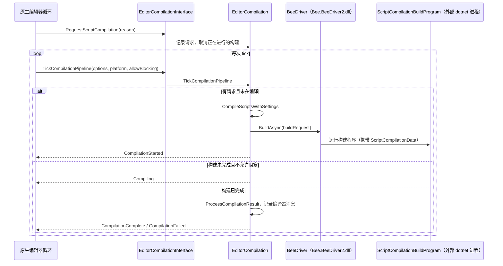

# 脚本编译管线

用户修改 `.cs` 或 `.asmdef` 后，编辑器需要决定有哪些程序集、每个文件属于哪个程序集、用哪些宏和引用，然后在不阻塞界面的情况下编译，最后重载代码。本页说明 C# 侧如何完成前几步：数据从原生流入，形成程序集图，交给外部 Bee 构建程序异步执行，并轮询结果。

父页面：[编辑器架构](index.md) · 相关：[物理组织 §6](../physical-layout.md#6-incrementalbuildpipeline-数据契约)、[生命周期作用域](../runtime/lifecycle-scopes.md)

## 相关源码文件

- [`Editor/Mono/Scripting/ScriptCompilation/EditorCompilationInterface.cs`](../../Editor/Mono/Scripting/ScriptCompilation/EditorCompilationInterface.cs)：原生入口
- [`EditorCompilation.cs`](../../Editor/Mono/Scripting/ScriptCompilation/EditorCompilation.cs)：核心状态与编译启动、轮询
- [`EditorBuildRules.cs`](../../Editor/Mono/Scripting/ScriptCompilation/EditorBuildRules.cs)：预定义程序集与路径规则
- [`CustomScriptAssembly.cs`](../../Editor/Mono/Scripting/ScriptCompilation/CustomScriptAssembly.cs)：asmdef 数据模型
- [`BeeDriver/`](../../Editor/Mono/Scripting/ScriptCompilation/BeeDriver/)：`UnityBeeDriver`、`BeeScriptCompilation`、脚本更新器
- [`MsBuild/`](../../Editor/Mono/Scripting/ScriptCompilation/MsBuild/)：MSBuild 编译路径
- [`CompilationPipeline.cs`](../../Editor/Mono/Scripting/ScriptCompilation/CompilationPipeline.cs)：公共 API
- [`Editor/IncrementalBuildPipeline/ScriptCompilationBuildProgram.Data/Data.cs`](../../Editor/IncrementalBuildPipeline/ScriptCompilationBuildProgram.Data/Data.cs)：交给构建程序的数据契约

## 1. 输入：原生推送项目状态

`EditorCompilationInterface` 是静态门面，持有一个按需创建的 `EditorCompilation` 单例。该单例会在代码重载时被清理，下次访问时重新创建 [`EditorCompilationInterface.cs:20-39`](../../Editor/Mono/Scripting/ScriptCompilation/EditorCompilationInterface.cs#L20-L39)。原生通过一组 `[RequiredByNativeCode]` 方法把项目状态推给它 [`EditorCompilationInterface.cs:77-157`](../../Editor/Mono/Scripting/ScriptCompilation/EditorCompilationInterface.cs#L77-L157)：

| 方法 | 推送的数据 |
| --- | --- |
| `SetAllScripts` | 所有脚本路径 |
| `SetAllCustomScriptAssemblyJsonContents(paths, contents, guids)` | 所有 asmdef 的**原始 JSON 文本** |
| `SetAllCustomScriptAssemblyReferenceJsons` | 所有 asmref |
| `SetAllUnityAssemblies` | 引擎和编辑器的预编译程序集 |
| `SetAssetPathsMetaData`、`SetAdditionalVersionMetaDatas` | 包路径和版本元数据，用于版本宏 |
| `SetCompileScriptsOutputDirectory` | 输出目录 |
| `RequestScriptCompilation(reason)` | 请求编译 |

异常处理因入口而异。门面提供 `LogException`、`EmitExceptionsAsErrors`、`EmitExceptionAsError` 三个辅助方法：先交给 `CompilationSetupErrorsTracker` 处理，未处理的再记录日志 [`EditorCompilationInterface.cs:41-69`](../../Editor/Mono/Scripting/ScriptCompilation/EditorCompilationInterface.cs#L41-L69)。asmdef/asmref 解析把错误作为异常集合**返回**并转为错误日志；`CompileScripts` 和 `GetCompileScriptsOutputDirectory` 捕获异常后返回默认值；但 `SetAllScripts`、`RequestScriptCompilation` 等简单入口只是直接转发，没有捕获异常 [`EditorCompilationInterface.cs:89-154`](../../Editor/Mono/Scripting/ScriptCompilation/EditorCompilationInterface.cs#L89-L154)、[`EditorCompilationInterface.cs:194-199`](../../Editor/Mono/Scripting/ScriptCompilation/EditorCompilationInterface.cs#L194-L199)。

## 2. 程序集模型

### 2.1 预定义程序集与特殊目录

没有被 asmdef 覆盖的脚本会进入四个预定义程序集 [`EditorBuildRules.cs:701-784`](../../Editor/Mono/Scripting/ScriptCompilation/EditorBuildRules.cs#L701-L784)：

| 程序集 | 标志 | 路径过滤 | 引用 |
| --- | --- | --- | --- |
| `Assembly-CSharp-firstpass.dll` | FirstPass | `/assets/plugins/`、`/assets/standard assets/`、`/assets/pro standard assets/`、`/assets/iphone standard assets/` | — |
| `Assembly-CSharp.dll` | — | 无（兜底） | 运行时 firstpass |
| `Assembly-CSharp-Editor-firstpass.dll` | EditorOnly、FirstPass | firstpass 目录下的 `/editor/` | 运行时 firstpass |
| `Assembly-CSharp-Editor.dll` | EditorOnly | 任意 `/editor/` 段 | 前三者全部 |

一个脚本属于哪个预定义程序集，由各过滤器返回的“匹配深度”决定：不匹配返回 -1，没有过滤器的 `Assembly-CSharp` 视为 0，深度严格更大的程序集胜出 [`EditorBuildRules.cs:861-888`](../../Editor/Mono/Scripting/ScriptCompilation/EditorBuildRules.cs#L861-L888)。过滤器实现见 [`EditorBuildRules.cs:890-929`](../../Editor/Mono/Scripting/ScriptCompilation/EditorBuildRules.cs#L890-L929)。路径会先转为小写再比较。

边界情况：对于 `Assets/Plugins/Editor/X.cs`，`Editor-firstpass` 和 `Editor` 两个过滤器返回相同深度，都是 `/editor/` 段之后的位置。由于比较条件是严格大于，先遍历到的程序集胜出。按 `CreatePredefinedTargetAssemblies` 的插入顺序，`Editor-firstpass` 在前 [`EditorBuildRules.cs:757-760`](../../Editor/Mono/Scripting/ScriptCompilation/EditorBuildRules.cs#L757-L760)。这一结论依赖 `Dictionary` 在没有删除操作时按插入顺序枚举的实现细节，因此是推断。

### 2.2 asmdef

asmdef JSON 被反序列化为 `CustomScriptAssemblyData`，字段包括 `name`、`rootNamespace`、`references`、`includePlatforms`/`excludePlatforms`、`allowUnsafeCode`、`overrideReferences`、`autoReferenced`、`defineConstraints`、`versionDefines`、`noEngineReferences` 等 [`CustomScriptAssembly.cs:72-86`](../../Editor/Mono/Scripting/ScriptCompilation/CustomScriptAssembly.cs#L72-L86)。校验规则包括：必须有 `name`；不能同时设置包含平台和排除平台；CodeGen 程序集不能被自动引用 [`CustomScriptAssembly.cs:123-135`](../../Editor/Mono/Scripting/ScriptCompilation/CustomScriptAssembly.cs#L123-L135)。

## 3. 编译：启动、轮询与完成

图中证据：

- `RequestScriptCompilation`：辅助编辑器进程（如独立 Profiler）不会编译；其它情况下记录请求选项并取消正在进行的构建 [`EditorCompilation.cs:206-222`](../../Editor/Mono/Scripting/ScriptCompilation/EditorCompilation.cs#L206-L222)。
- `TickCompilationPipeline`：旧式 `AssemblyBuilder` 还在编译时返回 `Compiling`；有请求且没有任务时开始编译，`allowBlocking` 时递归等待；构建未完成时更新进度并返回，或在允许阻塞时边泵消息边等待；完成后清理状态并处理结果 [`EditorCompilation.cs:1156-1265`](../../Editor/Mono/Scripting/ScriptCompilation/EditorCompilation.cs#L1156-L1265)。
- `CompileScriptsWithSettings`：处理清理构建请求，删除不再使用的程序集，收集脚本程序集；存在设置错误时返回 `Idle`，**不启动编译**；创建 Bee 构建请求，设置 `DeferDagVerification` 和 `ContinueBuildingAfterFirstFailure`，用回调延迟生成 `ScriptCompilationData`；调用 `BeeDriver.BuildAsync`，保存进行中的状态和进度条，然后返回 `CompilationStarted` [`EditorCompilation.cs:879-972`](../../Editor/Mono/Scripting/ScriptCompilation/EditorCompilation.cs#L879-L972)。
- 构建程序由编辑器自带的 dotnet 运行 `ScriptCompilationBuildProgram.exe` [`EditorCompilation.cs:974-982`](../../Editor/Mono/Scripting/ScriptCompilation/EditorCompilation.cs#L974-L982)。

### 3.1 状态枚举与缓存隔离

`CompileStatus` 有五个值：`Idle`、`Compiling`、`CompilationStarted`、`CompilationFailed`、`CompilationComplete` [`EditorCompilation.cs:52-59`](../../Editor/Mono/Scripting/ScriptCompilation/EditorCompilation.cs#L52-L59)。

Bee 的 DAG 名称由输出目录哈希前缀和多个标志组成：`E`/`P` 表示编辑器或播放器，另有 `Dev`、`Dbg`、`Chk`、`Ins`、`SkipCompile`。注释说明，把输出目录哈希进名称，是为了避免构建到不同目录时 Bee 删除另一个目录中的产物 [`EditorCompilation.cs:917-929`](../../Editor/Mono/Scripting/ScriptCompilation/EditorCompilation.cs#L917-L929)。清理构建时会删除 `Library/Bee` 下的内容，但保留 `TundraBuildState.state` 和 `bee_backend.info`，这样仍能删除过期的输出文件 [`EditorCompilation.cs:224-245`](../../Editor/Mono/Scripting/ScriptCompilation/EditorCompilation.cs#L224-L245)。

### 3.2 编译器消息

编辑器编译和播放器编译使用不同的日志标识，以便分别清除上一轮消息；`Information` 级消息不会输出到控制台；批处理模式下不查询资源 ID [`EditorCompilation.cs:1243-1299`](../../Editor/Mono/Scripting/ScriptCompilation/EditorCompilation.cs#L1243-L1299)。

### 3.3 “开始编译”与“正在编译”的区别

`IsCompilationInProgress` 只在编译实际开始后返回 `true`，已请求但尚未开始时返回 `false`。注释说明这是为了允许常见的“修改宏定义 → 构建播放器”脚本流程：已请求编译时只发出警告，仍允许开始播放器构建 [`EditorCompilationInterface.cs:213-223`](../../Editor/Mono/Scripting/ScriptCompilation/EditorCompilationInterface.cs#L213-L223)。

## 4. MSBuild 分支

`CompilationPipeline.IsUsingMSBuild()` 是原生 `extern` [`CompilationPipeline.bindings.cs:33`](../../Editor/Mono/CompilationPipeline.bindings.cs#L33)。启用后，`IsCompiling` 改为查询 `MsBuildCompilationInterface` [`EditorCompilationInterface.cs:225-229`](../../Editor/Mono/Scripting/ScriptCompilation/EditorCompilationInterface.cs#L225-L229)，原生也可以通过 `RequestMsBuildScriptCompilation` 请求 MSBuild 编译 [`MsBuildCompilationInterface.cs:38-44`](../../Editor/Mono/Scripting/ScriptCompilation/MsBuild/MsBuildCompilationInterface.cs#L38-L44)。Burst 编辑器模块也会根据这个开关改变行为 [`BurstLoader.cs:129`](../../Modules/BurstEditor/Managed/Runtime/BurstLoader.cs#L129)。启用条件和 MSBuild 路径的完整流程（`MsBuildCompilation.cs` 约 30 KB）没有在本页分析。

## 5. 公共 API

`UnityEditor.Compilation.CompilationPipeline` 暴露 `compilationStarted`、`compilationFinished`、`assemblyCompilationFinished` 等事件，以及 `GetAssemblies`、asmdef 查询方法和 `RequestScriptCompilation` [`CompilationPipeline.cs:242-254`](../../Editor/Mono/Scripting/ScriptCompilation/CompilationPipeline.cs#L242-L254)、[`CompilationPipeline.cs:774-775`](../../Editor/Mono/Scripting/ScriptCompilation/CompilationPipeline.cs#L774-L775)。公共 `RequestScriptCompilation` 使用固定原因字符串转发给内部实现。

## 6. 编译之后

编译完成后，域重载或代码重载由原生发起，C# 侧通过 [生命周期作用域](../runtime/lifecycle-scopes.md) 和 `[InitializeOnLoad]`（见 [编辑器应用与回调](editor-application.md)）感知。`ScriptCompilationData.ExtractRuntimeInitializeOnLoads` 字段表明，`[RuntimeInitializeOnLoadMethod]` 的提取也在构建程序中完成 [`Data.cs:26`](../../Editor/IncrementalBuildPipeline/ScriptCompilationBuildProgram.Data/Data.cs#L26)。

## 7. 局限

- 构建程序 `ScriptCompilationBuildProgram` 和 Bee 驱动的源码都不在仓库中，只有 DLL。
- API 更新器（`Scripting/APIUpdater`、`BeeDriver/UnityScriptUpdater.cs`）、IL 后处理（`ILPostProcessingProgram.cs`）、Roslyn 分析器配置（`RoslynAnalyzers.cs`）和程序集图校验（`AssemblyGraphBuilder.cs`）没有展开分析。
