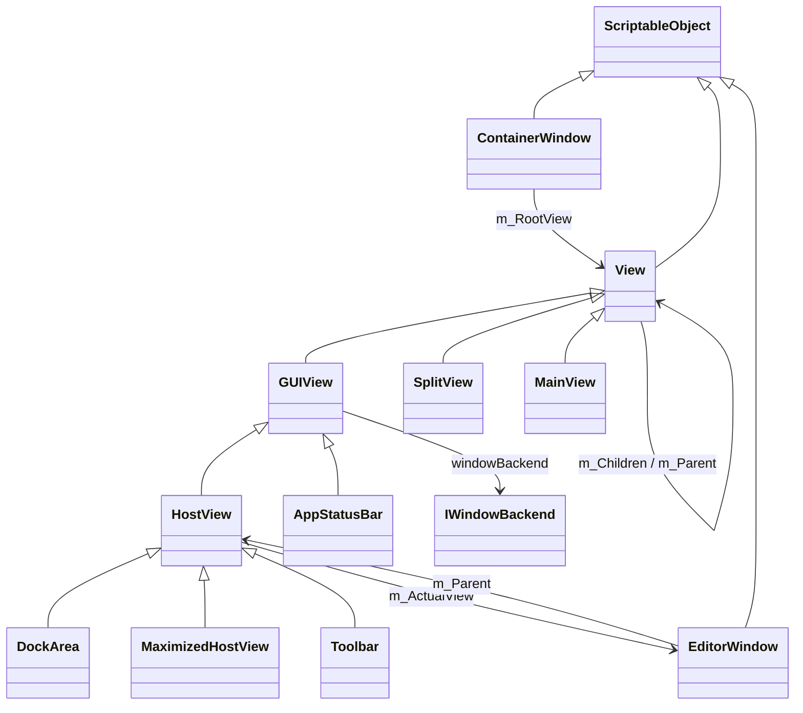
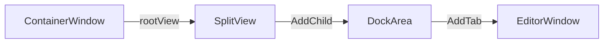
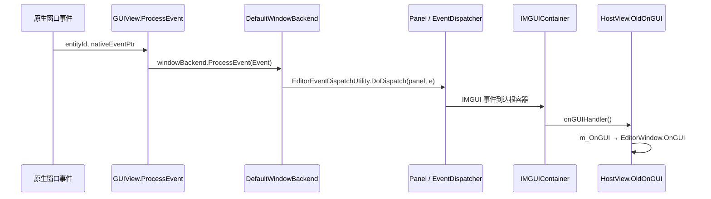

# 窗口系统

编辑器的每个可见区域，例如停靠的 Inspector 标签页、浮动工具窗口和主窗口工具栏，都由一组 C# 视图对象组织，并映射到原生窗口。本页解释这些对象的层级、`EditorWindow` 如何被托管，以及视图如何通过“窗口后端”接入 UI Toolkit 面板。

父页面：[编辑器架构](index.md) · 相关：[编辑器应用与回调](editor-application.md)、[IMGUI](imgui.md)、[UI Toolkit](../ui-toolkit/index.md)

## 相关源码文件

- [`Editor/Mono/View.cs`](../../Editor/Mono/View.cs)、[`ContainerWindow.cs`](../../Editor/Mono/ContainerWindow.cs)、[`GUIView.cs`](../../Editor/Mono/GUIView.cs)、[`HostView.cs`](../../Editor/Mono/HostView.cs)
- [`Editor/Mono/GUI/DockArea.cs`](../../Editor/Mono/GUI/DockArea.cs)、[`GUI/SplitView.cs`](../../Editor/Mono/GUI/SplitView.cs)、[`GUI/MainView.cs`](../../Editor/Mono/GUI/MainView.cs)
- [`Editor/Mono/EditorWindow.cs`](../../Editor/Mono/EditorWindow.cs)
- [`Editor/Mono/WindowBackendManager.cs`](../../Editor/Mono/WindowBackendManager.cs)
- [`Modules/UIElementsEditor/WindowBackends/`](../../Modules/UIElementsEditor/WindowBackends/)、[`Modules/UIElementsEditor/RetainedMode.cs`](../../Modules/UIElementsEditor/RetainedMode.cs)

## 1. 类型层级

证据：`ContainerWindow : ScriptableObject` 并持有 `m_RootView` [`ContainerWindow.cs:21-33`](../../Editor/Mono/ContainerWindow.cs#L21-L33)；`View : ScriptableObject`，带子视图数组和父视图 [`View.cs:22`](../../Editor/Mono/View.cs#L22)、[`View.cs:58-60`](../../Editor/Mono/View.cs#L58-L60)；`GUIView : View, IWindowModel` [`GUIView.cs:19`](../../Editor/Mono/GUIView.cs#L19)；`HostView : GUIView` [`HostView.cs:23`](../../Editor/Mono/HostView.cs#L23)；`DockArea : HostView`、`MaximizedHostView : HostView` [`DockArea.cs:29`](../../Editor/Mono/GUI/DockArea.cs#L29)、[`DockArea.cs:1316`](../../Editor/Mono/GUI/DockArea.cs#L1316)；`SplitView : View` [`SplitView.cs:12`](../../Editor/Mono/GUI/SplitView.cs#L12)；`MainView : View` [`MainView.cs:9`](../../Editor/Mono/GUI/MainView.cs#L9)；`AppStatusBar : GUIView` [`AppStatusBar.cs:15`](../../Editor/Mono/GUI/AppStatusBar.cs#L15)；`Toolbar : HostView` [`Toolbar.cs:348`](../../Editor/Mono/GUI/Toolbars/Toolbar.cs#L348)；`EditorWindow.m_Parent` [`EditorWindow.cs:196`](../../Editor/Mono/EditorWindow.cs#L196)；`HostView.m_ActualView` [`HostView.cs:99`](../../Editor/Mono/HostView.cs#L99)。

| 类型 | 职责 |
| --- | --- |
| `ContainerWindow` | 一个原生操作系统窗口；通过 `m_WindowPtr` 持有原生句柄，`m_RootView` 是根视图 [`ContainerWindow.cs:21-36`](../../Editor/Mono/ContainerWindow.cs#L21-L36) |
| `View` | 视图树节点，有父子关系；位置分别以父视图坐标、窗口坐标和屏幕坐标表示 [`View.cs:117-164`](../../Editor/Mono/View.cs#L117-L164) |
| `GUIView` | 可绘制、可接收事件的视图；拥有 `IWindowBackend` |
| `HostView` | 托管一个 `EditorWindow`，把窗口的消息方法桥接给编辑器事件 |
| `DockArea` | 可停靠的标签页区域，可以托管多个 `EditorWindow` |
| `SplitView` | 把子视图按水平或垂直方向分割 |

这些类型都是 `ScriptableObject`，大量状态带有 `[SerializeField]`，例如 `ContainerWindow` 的 `m_PixelRect`、`m_ShowMode`、`m_RootView` [`ContainerWindow.cs:29-36`](../../Editor/Mono/ContainerWindow.cs#L29-L36)。这表明窗口布局通过 Unity 序列化保存和恢复，也能跨域重载存活；布局文件的读写在原生侧，本页没有追踪。

## 2. `EditorWindow` 如何被托管

### 2.1 打开窗口

`EditorWindow.Show()` 在窗口还没有父视图时，调用 `CreateNewWindowForEditorWindow` [`EditorWindow.cs:735-746`](../../Editor/Mono/EditorWindow.cs#L735-L746)。该方法依次创建 `ContainerWindow`、`SplitView`、`DockArea`，把窗口添加为标签页，然后显示原生窗口 [`EditorWindow.cs:1459-1475`](../../Editor/Mono/EditorWindow.cs#L1459-L1475)：

弹出窗口和工具窗口走 `ShowWithMode`/`ShowPopupWithMode`，直接用一个 `HostView` 作为根视图，不经过 `SplitView` 和 `DockArea`。代码注释强调了顺序：先设置容器矩形，再设置根视图，然后应用设置，最后显示 [`EditorWindow.cs:626-671`](../../Editor/Mono/EditorWindow.cs#L626-L671)。

窗口属性（标题、最小和最大尺寸、事件兴趣、深度缓冲等）通过 `MakeParentsSettingsMatchMe` 推送到父视图 [`EditorWindow.cs:554-571`](../../Editor/Mono/EditorWindow.cs#L554-L571)。

### 2.2 消息方法的桥接

`EditorWindow` 的 `OnGUI`、`Update`、`OnFocus`、`OnSelectionChange` 等不是虚方法，而是由 `HostView` 按名称反射查找，并创建为委托：

- 切换当前视图时，`SetActualViewInternal` 先注销旧窗口，再为新窗口创建委托并注册 [`HostView.cs:137-151`](../../Editor/Mono/HostView.cs#L137-L151)。
- `CreateDelegates` 为 `OnGUI`、`OnFocus`、`OnLostFocus`、`OnProjectChange`、`OnSelectionChange`、`OnDidOpenScene`、`OnInspectorUpdate`、`OnHierarchyChange`、`OnBecameVisible`、`OnBecameInvisible`、`Update`、`ModifierKeysChanged` 创建委托 [`HostView.cs:154-167`](../../Editor/Mono/HostView.cs#L154-L167)。`CreateDelegate` 沿类型链查找方法，找到后用 `Delegate.CreateDelegate` 绑定 [`HostView.cs:493-515`](../../Editor/Mono/HostView.cs#L493-L515)。
- `RegisterSelectedPane`：校验窗口后端，只有窗口声明了 `Update` 时才把 `SendUpdate` 挂到 `EditorApplication.update`；需要时发送 `OnBecameVisible` 和 `OnFocus` [`HostView.cs:617-665`](../../Editor/Mono/HostView.cs#L617-L665)。
- `DeregisterSelectedPane`：执行反向操作；切换标签页时推入新的 UI Toolkit 事件分发上下文，以便失焦事件生效（UUM-57083）[`HostView.cs:667-700`](../../Editor/Mono/HostView.cs#L667-L700)。
- 即时模式绘制：`HostView.OldOnGUI` 重置 GUI 状态，设置播放模式着色，并在垂直布局中调用 `m_OnGUI` [`HostView.cs:328-350`](../../Editor/Mono/HostView.cs#L328-L350)。

因为 `Update` 是按名称发现的，没有声明 `Update` 方法的窗口不会为了 `Update` 订阅 `EditorApplication.update`。不过，设置了淡出时间（`m_FadeoutTime != 0`）的窗口仍会订阅 `CheckForWindowRepaint` [`HostView.cs:642-646`](../../Editor/Mono/HostView.cs#L642-L646)。

## 3. 窗口后端：接入 UI Toolkit

### 3.1 接口

`WindowBackendManager.cs` 定义了视图（模型）与渲染后端之间的契约 [`WindowBackendManager.cs:15-76`](../../Editor/Mono/WindowBackendManager.cs#L15-L76)：

| 接口 | 提供方 | 内容 |
| --- | --- | --- |
| `IWindowModel` | `GUIView` | 尺寸、事件兴趣、`onGUIHandler`、`windowBackend` |
| `IEditorWindowModel` | `HostView` | 额外提供 `EditorWindow`、边距、通知可见性等 |
| `IWindowBackend` | 后端 | `OnCreate`/`OnDestroy`、`visualTree`、尺寸变化、`ProcessEvent` |
| `IEditorWindowBackend` | 后端 | 焦点、注册/注销窗口、覆盖层 GUI 等 |
| `IEditorWindowBackendSystem` | 可插拔系统 | 为某个模型提供后端，并判断兼容性 |

`EditorWindowBackendManager.GetBackend` 从**最后注册**的系统开始依次询问，都不提供时使用 `defaultWindowBackend` [`WindowBackendManager.cs:77-130`](../../Editor/Mono/WindowBackendManager.cs#L77-L130)。`GUIView.OnEnable` 获取后端；替换后端时先对旧后端调用 `OnDestroy`，再对新后端调用 `OnCreate` [`GUIView.cs:229-270`](../../Editor/Mono/GUIView.cs#L229-L270)。

### 3.2 默认后端由 UIElementsEditor 模块注入

`Editor/Mono` 中只有后端接口和管理器，没有默认后端的具体实现。实现位于 `Modules/UIElementsEditor`，并在运行时注入：`RetainedMode.cs` 在每次 `[OnCodeLoaded]` 时设置 `defaultWindowBackend`，编辑器窗口模型使用 `DefaultEditorWindowBackend`，其它模型使用 `DefaultWindowBackend`；同时还设置了 IMGUI 容器回调、面板资源加载、绑定实现等 [`RetainedMode.cs:21-53`](../../Modules/UIElementsEditor/RetainedMode.cs#L21-L53)。注释说明，之所以不用静态构造函数，是因为这些槽位在每次代码重载时都会被清空。

`DefaultWindowBackend.OnCreate` 为视图查找或创建一个编辑器 `Panel`，再把一个包装 `onGUIHandler`（即 `OldOnGUI`）的 `IMGUIContainer` 插入面板根部，作为根 IMGUI 容器 [`DefaultWindowBackend.cs:23-41`](../../Modules/UIElementsEditor/WindowBackends/DefaultWindowBackend.cs#L23-L41)。因此，即使是纯 IMGUI 窗口，实际上也运行在 UI Toolkit 面板中的一个 `IMGUIContainer` 里。

`DefaultEditorWindowBackend` 还会添加通知和覆盖层两个 `IMGUIContainer`，并在合适时机对 `EditorWindow` 反射调用一次 `CreateGUI`。如果当前正处于 `EditorApplication.isUpdating`，就推迟到面板调度器中执行，并通过根元素上的属性防止重复调用 [`DefaultEditorWindowBackend.cs:345-369`](../../Modules/UIElementsEditor/WindowBackends/DefaultEditorWindowBackend.cs#L345-L369)。

### 3.3 事件进入

原生把事件交给 `GUIView.ProcessEvent(entityId, nativeEventPtr)`：先把原生事件复制到静态 `Event`，触发 `beforeEventProcessed`，然后按 ID 找到面板，交给面板所有者的 `windowBackend.ProcessEvent` [`GUIView.cs:76-97`](../../Editor/Mono/GUIView.cs#L76-L97)。之后的分发见 [UI Toolkit 事件分发](../ui-toolkit/events.md)。

图中证据：`DefaultWindowBackend.ProcessEvent` 调用 `EditorEventDispatchUtility.DoDispatch(panel, e)` [`DefaultWindowBackend.cs:118-122`](../../Modules/UIElementsEditor/WindowBackends/DefaultWindowBackend.cs#L118-L122)。`P → IC → HV` 这一段根据面板根部 `IMGUIContainer` 的结构和 [事件分发](../ui-toolkit/events.md) 推断，`DoDispatch` 内部没有逐行追踪。
