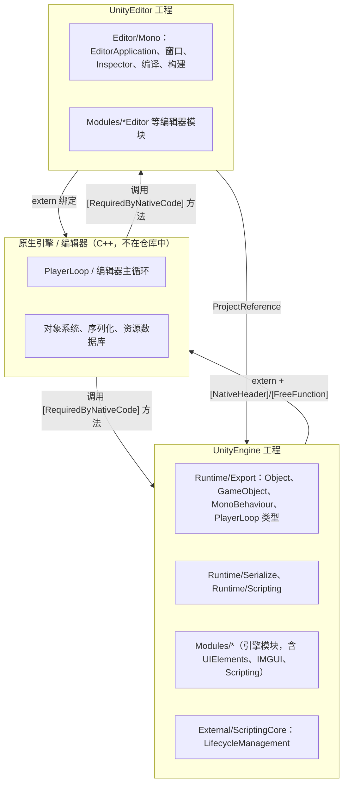

# 仓库概览：Unity C# 参考源码

本页说明这个仓库是什么、不是什么，以及它的整体形态。阅读其它页面前建议先读本页，因为本仓库只包含 Unity 的 **C# 一侧**，大量行为发生在仓库中不存在的原生（C++）代码里，这直接决定了“能从源码中确认什么”。

相关页面：[物理组织](physical-layout.md) · [阅读与导航指南](getting-started.md) · [运行时架构](runtime/index.md) · [编辑器架构](editor/index.md) · [UI Toolkit](ui-toolkit/index.md)

## 1. 用途与使用限制

- 仓库是 Unity 6000.7.0b7 引擎和编辑器的 C# 部分，仅供参考 [`README.md:1-4`](../README.md#L1-L4)。
- 使用条款不允许修改或再分发这些 C# 代码，Unity 也不接受 PR [`README.md:12-17`](../README.md#L12-L17)。
- 唯一的解决方案文件是 `Projects/CSharp/UnityReferenceSource.sln` [`README.md:27`](../README.md#L27)；目录布局与 Unity 内部源码树一致，且会随版本变化 [`README.md:29-31`](../README.md#L29-L31)。
- 分析快照：提交 `6974f873c0dd24dd88840492397e3a7ce3b817ab`，提交信息为 “Unity 6000.7.0b7 C# reference source code”（`git log -1` 输出）。

因此，本 Wiki 的读者定位是：需要理解 Unity 某个 C# API 背后如何运作、如何跨越托管/原生边界，以及编辑器各子系统如何协作的引擎/工具开发者。它不是 Unity 使用教程。

## 2. 仓库形态

| 维度 | 观察 | 证据 |
| --- | --- | --- |
| 语言 | 8692 个 `.cs` 文件，另有 12 个预编译 `.dll`、5 个 `.csproj`、1 个 `.sln` | 按扩展名统计的命令输出（见 [audit.md](audit.md)） |
| 主要工程 | `UnityEngine` 与 `UnityEditor` 两个工程，加 3 个 IncrementalBuildPipeline 数据工程 | [`UnityReferenceSource.sln:6-15`](../Projects/CSharp/UnityReferenceSource.sln#L6-L15) |
| 目标框架 | 两个主工程都是 `netstandard2.1`、`LangVersion 14.0` | [`UnityEngine.csproj:8-14`](../Projects/CSharp/UnityEngine.csproj#L8-L14) |
| 编辑器配置 | `UnityEngine.csproj` 的预定义符号包含 `UNITY_EDITOR`、`COMBINED_ASSEMBLIES` 等 | [`UnityEngine.csproj:13`](../Projects/CSharp/UnityEngine.csproj#L13) |
| 测试 | 仓库内没有测试工程或 `[Test]` 用例；文档注释引用的 `Tests/...` 路径不在仓库中 | 搜索结果见 [audit.md](audit.md) |

形态分类：这是一个**大型框架库的源码镜像**（引擎运行时 API + 编辑器应用的托管层），不是可独立运行的应用。入口点不是 `Main`，而是数以百计标有 `[RequiredByNativeCode]`、由原生代码按名称调用的方法，其中大多是静态方法（见 [托管/原生绑定层](runtime/bindings.md)）。

## 3. 三个关键阅读前提

### 3.1 原生代码缺席

C# 声明大量使用 `extern` 方法，并通过 `[NativeHeader]`、`[FreeFunction]` 等特性指向 C++ 实现，例如 `GameObject.CreatePrimitive` 指向 `GameObjectBindings::CreatePrimitive` [`GameObject.bindings.cs:24-28`](../Runtime/Export/Scripting/GameObject.bindings.cs#L24-L28)。这些 C++ 文件和绑定生成器都不在仓库中。凡是 Wiki 描述“原生侧做了什么”的地方，都只是根据 C# 侧名称和注释作出的**推断**，并会这样标注。

### 3.2 源码已按编辑器配置预处理（推断）

在 8692 个 `.cs` 文件中搜索 `#if` 预处理指令，结果为 0 条；而工程预定义符号中包含 `UNITY_EDITOR` [`UnityEngine.csproj:13`](../Projects/CSharp/UnityEngine.csproj#L13)。一个佐证是 `Object.IsNativeObjectAlive`：注释说资源“复活”检测“只在编辑器中支持”，代码却无条件调用 `DoesObjectWithInstanceIDExist` [`UnityEngineObject.bindings.cs:341-359`](../Runtime/Export/Scripting/UnityEngineObject.bindings.cs#L341-L359)。

这表明发布时已用编辑器配置展开了条件编译，**播放器（Player）专用分支可能已被剥离**。阅读运行时代码时，应假定你看到的是“在编辑器内运行时”的版本。这是推断：仓库中没有说明预处理流程的文档。

### 3.3 模块化构建被合并成两个程序集

真实的 Unity 构建按模块生成多个程序集（如 `UnityEngine.CoreModule`、`UnityEngine.PhysicsModule`），这可以从生成的 `InternalsVisibleTo` 列表中看出 [`InternalsVisibleTo.cs:7-25`](../artifacts/MonolithicEditorDlls/InternalsVisibleTo.cs#L7-L25)。共享的 `AssemblyInfo.cs` 注明构建系统会把它包含进“所有模块” [`AssemblyInfo.cs:5`](../Runtime/Export/AssemblyInfo.cs#L5)。参考工程则用 `COMBINED_ASSEMBLIES` 把它们合并为 `UnityEngine` 与 `UnityEditor` 两个工程。详见 [物理组织](physical-layout.md)。

## 4. 高层架构

图中证据：工程依赖 `UnityEditor → UnityEngine` 来自 [`UnityEditor.csproj:18061`](../Projects/CSharp/UnityEditor.csproj#L18061)；各目录归属哪个工程来自两个 `.csproj` 的 `Compile Include` 统计（[物理组织](physical-layout.md)）；“原生调用托管”的例子是 `UnitySynchronizationContext.ExecuteTasks` [`UnitySynchronizationContext.cs:106-114`](../Runtime/Export/Scripting/UnitySynchronizationContext.cs#L106-L114)；“托管调用原生”的例子是上文 `GameObject` 绑定。

## 5. 主要能力地图

| 领域 | 解决的问题 | 入口代码 | Wiki 页面 |
| --- | --- | --- | --- |
| 托管/原生互操作 | C# API 如何映射到 C++，异常与对象如何封送 | `Modules/Scripting`、`*.bindings.cs` | [绑定层](runtime/bindings.md) |
| 对象模型 | `UnityEngine.Object` 的身份、空值语义、实例化与销毁 | `UnityEngineObject.bindings.cs` | [对象模型](runtime/object-model.md) |
| 代码加载生命周期 | 程序集加载/代码重载/播放模式的作用域与静态清理 | `External/ScriptingCore`、`Runtime/Scripting` | [生命周期作用域](runtime/lifecycle-scopes.md) |
| 帧循环与异步 | PlayerLoop、协程、`Awaitable`、同步上下文 | `Runtime/Export/PlayerLoop`、`Runtime/Export/Scripting` | [PlayerLoop 与异步](runtime/player-loop-and-async.md) |
| 序列化 | 序列化特性、托管序列化 V2 执行器 | `Runtime/Serialize`、`Runtime/Export/Serialization` | [序列化](runtime/serialization.md) |
| Jobs 与原生容器 | `IJob` 调度、`NativeArray` 安全检查 | `Modules/ManagedKernel` | [Jobs 与原生容器](runtime/jobs-and-collections.md) |
| 编辑器主循环 | `EditorApplication` 回调、`InitializeOnLoad`、`TypeCache` | `Editor/Mono/EditorApplication.cs` 等 | [编辑器应用与回调](editor/editor-application.md) |
| 窗口系统 | 原生窗口、停靠区、`EditorWindow` 与 UI 后端 | `ContainerWindow`、`HostView`、`DockArea` | [窗口系统](editor/window-system.md) |
| 即时模式 GUI | `GUI`/`GUILayout`/`GUIUtility` 的布局与事件循环 | `Modules/IMGUI` | [IMGUI](editor/imgui.md) |
| Inspector | 自定义编辑器解析、Inspector 构建、`SerializedObject` | `Editor/Mono/Inspector` | [Inspector](editor/inspector.md) |
| 脚本编译 | asmdef、预定义程序集、Bee 驱动编译 | `Editor/Mono/Scripting/ScriptCompilation` | [脚本编译](editor/script-compilation.md) |
| 资源导入 | `AssetPostprocessor`、`ScriptedImporter` | `Editor/Mono/AssetPostprocessor.cs` 等 | [资源导入](editor/asset-pipeline.md) |
| 播放器构建 | `BuildPipeline.BuildPlayer` 与构建回调 | `Editor/Mono/BuildPipeline` | [播放器构建](editor/build-pipeline.md) |
| 包管理 | UPM 客户端 API 与包管理器窗口 | `Modules/PackageManager*` | [包管理器](editor/package-manager.md) |
| UI Toolkit | VisualElement、面板更新阶段、事件、样式、布局、渲染 | `Modules/UIElements`、`Modules/UIElementsEditor` | [UI Toolkit](ui-toolkit/index.md) |

其余约 170 个模块的归属与粗略职责见 [模块目录](module-catalog.md)。

## 6. 下一步

- 想在本地浏览代码：读 [阅读与导航指南](getting-started.md)。
- 想理解某个 API 如何落到 C++：从 [绑定层](runtime/bindings.md) 开始。
- 想理解编辑器为何在脚本修改后“重载”：读 [生命周期作用域](runtime/lifecycle-scopes.md) 与 [脚本编译](editor/script-compilation.md)。
