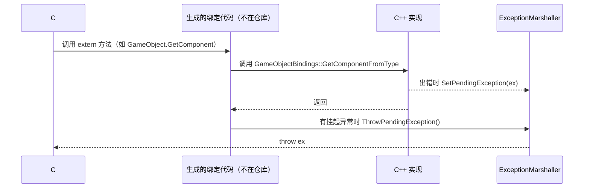

# 托管/原生绑定层

Unity 的公共 C# API 大多只是原生（C++）功能的外壳。本页说明这些外壳如何声明，原生代码如何回调托管代码，以及对象、字符串和异常如何跨越边界。它是阅读其余运行时和编辑器页面的基础。

父页面：[运行时架构](index.md) · 相关：[对象模型](object-model.md)、[阅读与导航指南](../getting-started.md)

## 相关源码文件

- [`Modules/Scripting/Attributes/BindingsAttributes.cs`](../../Modules/Scripting/Attributes/BindingsAttributes.cs)：托管 → 原生方向的绑定特性
- [`Modules/Scripting/Attributes/Attributes.cs`](../../Modules/Scripting/Attributes/Attributes.cs)：`RequiredByNativeCode`、`UsedByNativeCode`、`NativeClass`
- [`Modules/Scripting/Scripting/Marshalling/`](../../Modules/Scripting/Scripting/Marshalling/)：字符串、数组、GCHandle、异常封送
- [`Runtime/Export/Scripting/UnityEngineObject.bindings.cs`](../../Runtime/Export/Scripting/UnityEngineObject.bindings.cs)：`UnityEngine.Object` 的封送
- [`Runtime/Export/Scripting/GameObject.bindings.cs`](../../Runtime/Export/Scripting/GameObject.bindings.cs)：典型绑定文件

## 1. 规模与约定

按文件名和特性统计（命令见 [audit.md](../audit.md)）：仓库中有 869 个 `*.bindings.cs`、27 个 `*.binding.cs`；902 个文件使用 `[NativeHeader(...)]`；555 个文件出现 `RequiredByNativeCode`。

`*.bindings.cs` 是约定而不是强制：普通 `.cs` 文件也可以包含 `extern` 绑定，例如 `Awaitable.DelayedCall.cs` 声明了多个 `[FreeFunction]` 方法 [`Awaitable.DelayedCall.cs:222-233`](../../Runtime/Export/Scripting/Awaitable.DelayedCall.cs#L222-L233)。

## 2. 托管 → 原生：绑定特性

绑定特性是“覆盖绑定生成器默认约定”的指令集合 [`BindingsAttributes.cs:28-29`](../../Modules/Scripting/Attributes/BindingsAttributes.cs#L28-L29)。生成器本身不在仓库中。

| 特性 | 作用 | 证据 |
| --- | --- | --- |
| `NativeHeader(header)` | 声明生成的 C++ 胶水代码需要包含的头文件；可多次使用 | [`BindingsAttributes.cs:62-75`](../../Modules/Scripting/Attributes/BindingsAttributes.cs#L62-L75) |
| `NativeMethod` | 指定 C++ 函数名，以及 `IsThreadSafe`、`IsFreeFunction`、`ThrowsException`、`HasExplicitThis` | [`BindingsAttributes.cs:96-132`](../../Modules/Scripting/Attributes/BindingsAttributes.cs#L96-L132) |
| `NativeProperty` | 属性版本，`TargetType` 区分映射到函数还是字段 | [`BindingsAttributes.cs:134-169`](../../Modules/Scripting/Attributes/BindingsAttributes.cs#L134-L169) |
| `FreeFunction` | `IsFreeFunction=true` 的 `NativeMethod` | [`BindingsAttributes.cs:232-248`](../../Modules/Scripting/Attributes/BindingsAttributes.cs#L232-L248) |
| `StaticAccessor` | 指定访问原生单例的表达式和运算符（`.`、`->`、`::`） | [`BindingsAttributes.cs:250-286`](../../Modules/Scripting/Attributes/BindingsAttributes.cs#L250-L286) |
| `NativeType` | 控制结构体或类在原生侧的中间表示和代码生成选项 | [`BindingsAttributes.cs:185-207`](../../Modules/Scripting/Attributes/BindingsAttributes.cs#L185-L207) |
| `NativeConditional` | 只在给定原生宏条件下生成调用，否则返回桩值 | [`BindingsAttributes.cs:32-59`](../../Modules/Scripting/Attributes/BindingsAttributes.cs#L32-L59) |
| `NotNull` | 参数非空约束 | [`BindingsAttributes.cs:209-213`](../../Modules/Scripting/Attributes/BindingsAttributes.cs#L209-L213) |
| `UnityMarshalAs` | 覆盖默认封送：`ScriptingObjectPtr`、`GCHandle`、自定义封送器或按其它类型封送 | [`BindingsAttributes.cs:351-425`](../../Modules/Scripting/Attributes/BindingsAttributes.cs#L351-L425) |
| `Ignore` | 封送时忽略字段，可用于联合体尺寸计算 | [`BindingsAttributes.cs:289-302`](../../Modules/Scripting/Attributes/BindingsAttributes.cs#L289-L302) |

已废弃的写法会直接编译报错，便于迁移：`Unmarshalled` 被标为 `Obsolete(error: true)`，注释说明出于 GC 安全不再支持 [`BindingsAttributes.cs:215-230`](../../Modules/Scripting/Attributes/BindingsAttributes.cs#L215-L230)；`ThreadSafe` 和 `NativeThrows` 已被 `IsThreadSafe`、`ThrowsException` 参数取代 [`BindingsAttributes.cs:451-470`](../../Modules/Scripting/Attributes/BindingsAttributes.cs#L451-L470)。

### 2.1 一个典型绑定文件

`GameObject` 展示了几种常见形式 [`GameObject.bindings.cs:22-60`](../../Runtime/Export/Scripting/GameObject.bindings.cs#L22-L60)：

- 类型级：`[UsedByNativeCode]`、`[NativeHeader("Runtime/Export/Scripting/GameObject.bindings.h")]`。
- 静态自由函数：`[FreeFunction("GameObjectBindings::CreatePrimitive")] public extern static GameObject CreatePrimitive(...)`。
- 带显式 `this` 的自由函数：`GetComponent` 使用 `HasExplicitThis = true, ThrowsException = true`。
- 成员方法：`SetActive` 使用 `[NativeMethod(Name = "SetSelfActive")]` 映射到 C++ 成员函数 [`GameObject.bindings.cs:298-299`](../../Runtime/Export/Scripting/GameObject.bindings.cs#L298-L299)。

### 2.2 `extern` 方法体由构建期工具改写

仓库中的 `extern` 方法只是声明。托管序列化后端的注释说明了构建期如何处理它们：`[MethodImpl(InternalCall)]` 只在“绑定 IL 注入器不运行”的场景下需要；生产构建中，IL 注入器会去掉这个标志并**改写方法体** [`SerializationBackendManagedCommands.bindings.cs:111-118`](../../Runtime/Export/Serialization/ManagedCommands/SerializationBackendManagedCommands.bindings.cs#L111-L118)。全仓库只有这一个文件使用 `MethodImplOptions.InternalCall`。

这表明，从源码看到的 `extern` 声明与运行时实际执行的 IL 不同。绑定生成器和 IL 注入器都不在仓库中，具体改写结果无法确认。

### 2.3 类型专属封送器

许多托管包装类型内部嵌套一个 `BindingsMarshaller` 静态类（全仓库 144 处），提供 `ConvertToNative` 等方法。例如 `Coroutine` 把自身转换为原生指针 `m_Ptr` [`Coroutine.bindings.cs:31-34`](../../Runtime/Export/Scripting/Coroutine.bindings.cs#L31-L34)。结合命名可以推断，绑定生成器会按约定查找这个嵌套类型；生成器代码不在仓库中，无法直接验证。

## 3. 原生 → 托管：入口特性

| 特性 | 含义 | 证据 |
| --- | --- | --- |
| `RequiredByNativeCode` | 原生代码会按名称查找并调用此成员；带 `Name`、`Optional`、`GenerateProxy` 参数 | [`Attributes.cs:27-54`](../../Modules/Scripting/Attributes/Attributes.cs#L27-L54) |
| `UsedByNativeCode` | 原生代码会使用此类型或成员，但语义上比 `RequiredByNativeCode` 宽松 | [`Attributes.cs:11-25`](../../Modules/Scripting/Attributes/Attributes.cs#L11-L25) |
| `NativeClass` | 与 C++ 类注册对应，携带持久类型 ID | [`Attributes.cs:115-135`](../../Modules/Scripting/Attributes/Attributes.cs#L115-L135) |

`RequiredByNativeCode` 方法的形态必须在各脚本后端之间保持一致。协程辅助类 `SetupCoroutine` 的注释说明，某些桩方法存在的原因正是“标了 `[RequiredByNativeCode]` 的方法必须在脚本后端之间匹配” [`Coroutines.cs:30-41`](../../Runtime/Export/Scripting/Coroutines.cs#L30-L41)。

可选入口使用 `Optional = true`，例如 UI Toolkit 的托管初始化入口 `InitializeUIElementsManaged` [`UIElementsInitialization.cs:19-21`](../../Modules/UIElements/Core/UIElementsInitialization.cs#L19-L21)。从命名推断，原生侧找不到可选入口时不会报错。

## 4. 封送辅助

### 4.1 字符串

`StringMarshaller` 区分 `null` 和空字符串：`null` 被封送为默认（空指针）span；空字符串被封送为指向地址 `1`、长度为 0 的 span，以确保原生侧收到非空指针 [`StringMarshalling.cs:14-29`](../../Modules/Scripting/Scripting/Marshalling/StringMarshalling.cs#L14-L29)。需要复制时，通过 `BindingsAllocator.Malloc` 分配原生内存，并只释放标记为 `TempAllocated` 的数据 [`StringMarshalling.cs:54-71`](../../Modules/Scripting/Scripting/Marshalling/StringMarshalling.cs#L54-L71)。

### 4.2 异常：挂起-重抛模型

原生代码不会直接跨边界抛出托管异常，而是先调用 `ExceptionMarshaller.SetPendingException` 存入线程静态字段；生成的绑定代码在返回后调用 `ThrowPendingException` 重新抛出 [`ExceptionMarshaller.cs:14-57`](../../Modules/Scripting/Scripting/Marshalling/ExceptionMarshaller.cs#L14-L57)。Burst 直接调用路径因为不知道是否有挂起异常，所以使用 `CheckPendingException`。代码卸载时，`[OnCodeUnloading]` 会清空该字段，以免用户异常类型把旧的 AssemblyLoadContext 固定在内存中 [`ExceptionMarshaller.cs:59-64`](../../Modules/Scripting/Scripting/Marshalling/ExceptionMarshaller.cs#L59-L64)。

图中证据：`GetComponent` 的绑定声明 [`GameObject.bindings.cs:42-43`](../../Runtime/Export/Scripting/GameObject.bindings.cs#L42-L43)；`SetPendingException` 和 `ThrowPendingException` 的注释与实现 [`ExceptionMarshaller.cs:34-57`](../../Modules/Scripting/Scripting/Marshalling/ExceptionMarshaller.cs#L34-L57)。“生成的绑定代码”这一参与者是根据注释推断的。

### 4.3 `UnityEngine.Object` 参数

`Object.MarshalledUnityObject` 把托管对象转换为原生指针 [`UnityEngineObject.bindings.cs:1046-1086`](../../Runtime/Export/Scripting/UnityEngineObject.bindings.cs#L1046-L1086)：

1. 引用为 `null` 时返回 `IntPtr.Zero`。这里刻意不使用会触发 icall 的 `==`，因为该路径可能在 AppDomain 关闭期间执行。
2. 已缓存 `m_CachedPtr` 时直接返回。
3. 否则通过 `m_EntityId` 查询原生指针。如果原生对象是 MonoBehaviour 实例，只有当托管对象的运行时类型就是 `Object`、`MonoBehaviour`、`ScriptableObject` 或其基类时才返回指针，以防多个派生类 C# 对象指向同一个 C++ 对象后状态失步 [`UnityEngineObject.bindings.cs:1088-1103`](../../Runtime/Export/Scripting/UnityEngineObject.bindings.cs#L1088-L1103)。

对象已被销毁时，`TryThrowEditorNullExceptionObject` 会抛出带说明的 `MissingReferenceException` [`UnityEngineObject.bindings.cs:1128-1140`](../../Runtime/Export/Scripting/UnityEngineObject.bindings.cs#L1128-L1140)。

## 5. 线程约束

绑定默认受原生侧线程检查约束，`IsThreadSafe = true` 用于显式声明可在其它线程调用，例如 `CurrentThreadIsMainThread` [`UnityEngineObject.bindings.cs:981-982`](../../Runtime/Export/Scripting/UnityEngineObject.bindings.cs#L981-L982)，以及 Jobs 调度 API [`Jobs.bindings.cs:116-117`](../../Modules/ManagedKernel/Managed/Jobs/Jobs.bindings.cs#L116-L117)。序列化后端注释中提到 `IsThreadSafe` 会关闭默认的“序列化线程守卫” [`SerializationBackendManagedCommands.bindings.cs:111-112`](../../Runtime/Export/Serialization/ManagedCommands/SerializationBackendManagedCommands.bindings.cs#L111-L112)。守卫本身在原生侧，规则细节无法从仓库确认。

## 6. 局限

- 绑定生成器、IL 注入器、全部 `.h/.cpp` 文件都不在仓库中，本页对“生成代码”的描述基于特性定义和注释。
- 仓库没有测试；`Modules/Marshalling` 中有封送测试用的绑定和辅助类，但没有调用它们的测试，例如 [`InvokeTests.cs:15-33`](../../Modules/Marshalling/InvokeTests.cs#L15-L33)。
