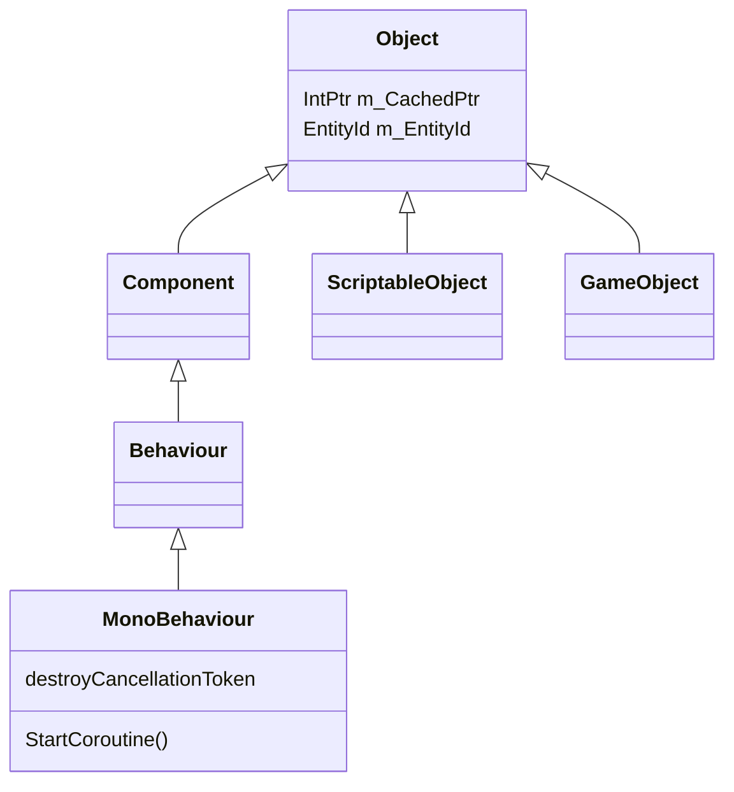

# 运行时架构

本页是运行时（`UnityEngine` 工程）相关页面的父页面。它建立核心术语，说明 `Runtime/` 与引擎模块如何分工，并引导到各机制的详细页面。

父页面：[仓库概览](../overview.md)

## 子页面

| 页面 | 回答的问题 |
| --- | --- |
| [托管/原生绑定层](bindings.md) | C# 声明如何对应到 C++ 实现，原生如何回调托管，异常和字符串如何封送 |
| [对象模型](object-model.md) | `UnityEngine.Object` 的身份、空值语义、创建与销毁 |
| [代码加载生命周期作用域](lifecycle-scopes.md) | 程序集加载、代码重载、播放模式的作用域状态机，以及静态字段清理 |
| [PlayerLoop、协程与异步](player-loop-and-async.md) | 帧循环结构、`StartCoroutine`、`Awaitable`、`UnitySynchronizationContext` |
| [序列化](serialization.md) | 序列化特性、`SerializedObject`，以及托管序列化 V2 命令执行器 |
| [Jobs 与原生容器](jobs-and-collections.md) | `IJob` 调度路径、`NativeArray` 的安全句柄 |

## 1. 代码在哪里

| 位置 | 职责 | 代表文件 |
| --- | --- | --- |
| `Runtime/Export/Scripting` | 核心对象类型与脚本运行时：`Object`、`GameObject`、`MonoBehaviour`、协程、`Awaitable` | [`UnityEngineObject.bindings.cs`](../../Runtime/Export/Scripting/UnityEngineObject.bindings.cs) |
| `Runtime/Export/PlayerLoop` | PlayerLoop 阶段标记类型与读写 API | [`PlayerLoop.bindings.cs`](../../Runtime/Export/PlayerLoop/PlayerLoop.bindings.cs) |
| `Runtime/Export/*`（其余 60 余个子目录） | 图形、相机、数学、场景管理、渲染管线等公共 API | 例如 `Runtime/Export/Graphics`（66 个文件） |
| `Runtime/Serialize` | 托管序列化 V2 的命令定义与执行器 | [`WriteExecutor.cs`](../../Runtime/Serialize/Managed/Core/WriteExecutor.cs) |
| `Runtime/Scripting` | 生命周期管理与 Mono/IL2CPP 的集成 | [`DomainReloadLifecycleController.cs`](../../Runtime/Scripting/LifecycleManagement/DomainReloadLifecycleController.cs) |
| `Modules/Scripting` | 绑定特性、封送辅助类型、`RuntimeInitializeOnLoadMethodAttribute` | [`BindingsAttributes.cs`](../../Modules/Scripting/Attributes/BindingsAttributes.cs) |
| `Modules/ManagedKernel` | `Unity.Collections`、Jobs、`NativeArray` | [`NativeArray.cs`](../../Modules/ManagedKernel/Managed/NativeArray/NativeArray.cs) |
| `External/ScriptingCore` | 与引擎模块无关的生命周期作用域基础设施 | [`LifecycleController.cs`](../../External/ScriptingCore/Unity.Scripting/LifecycleManagement/LifecycleController.cs) |
| 其它引擎模块 | Physics、Animation、Audio、UIElements 等，见 [模块目录](../module-catalog.md) | — |

## 2. 核心类型关系

证据：`Object` 的字段 [`UnityEngineObject.bindings.cs:254-260`](../../Runtime/Export/Scripting/UnityEngineObject.bindings.cs#L254-L260)；`Component : Object` [`Component.bindings.cs:18-20`](../../Runtime/Export/Scripting/Component.bindings.cs#L18-L20)；`Behaviour : Component` [`Behaviour.bindings.cs:12-14`](../../Runtime/Export/Scripting/Behaviour.bindings.cs#L12-L14)；`MonoBehaviour : Behaviour` [`MonoBehaviour.bindings.cs:16-21`](../../Runtime/Export/Scripting/MonoBehaviour.bindings.cs#L16-L21)；`ScriptableObject : Object` [`ScriptableObject.bindings.cs:16-19`](../../Runtime/Export/Scripting/ScriptableObject.bindings.cs#L16-L19)；`GameObject : Object` [`GameObject.bindings.cs:25`](../../Runtime/Export/Scripting/GameObject.bindings.cs#L25)。

`[NativeClass]` 把 C# 类型与 C++ 类注册对应起来，并携带与 `IMPLEMENT_REGISTER_CLASS` 一致的持久类型 ID [`Attributes.cs:115-135`](../../Modules/Scripting/Attributes/Attributes.cs#L115-L135)。例如 `Component` 的 ID 是 2，`Behaviour` 是 8，`MonoBehaviour` 是 114（见上面的引用）。`MonoBehaviour` 和 `ScriptableObject` 还带有 `[ExtensionOfNativeClass]`，表示用户类可以继承它们来“扩展”原生类 [`ExtensionOfNativeClassAttribute.cs:12-17`](../../Runtime/Export/Scripting/ExtensionOfNativeClassAttribute.cs#L12-L17)。

## 3. 两个方向的边界

所有运行时机制都依赖同一个边界模型：

- **托管 → 原生**：`extern` 方法加绑定特性，由不在仓库中的生成器生成胶水代码。
- **原生 → 托管**：原生在固定时机调用标有 `[RequiredByNativeCode]` 的托管方法，例如代码加载、帧循环中的任务执行和序列化。

细节见 [绑定层](bindings.md)。理解这一点后，可以把运行时 C# 代码分成三类：

1. 纯声明：类型、字段布局和 `extern` 入口，例如大部分 `GameObject` API。
2. 托管侧逻辑：参数校验、包装、池化和调度，例如 `Object.Instantiate` 的空值检查 [`UnityEngineObject.bindings.cs:581-590`](../../Runtime/Export/Scripting/UnityEngineObject.bindings.cs#L581-L590)，以及 `Awaitable` 的对象池。
3. 被原生驱动的回调：例如 `UnitySynchronizationContext.ExecuteTasks` [`UnitySynchronizationContext.cs:106-114`](../../Runtime/Export/Scripting/UnitySynchronizationContext.cs#L106-L114)。

## 4. 系统级不变量

| 不变量 | 证据 | 详见 |
| --- | --- | --- |
| `UnityEngine.Object` 的相等与真值判断取决于原生对象是否存活，不只取决于 C# 引用 | [`UnityEngineObject.bindings.cs:318-360`](../../Runtime/Export/Scripting/UnityEngineObject.bindings.cs#L318-L360) | [对象模型](object-model.md) |
| 生命周期作用域转换只能在主线程发起 | [`LifecycleController.cs:214-237`](../../External/ScriptingCore/Unity.Scripting/LifecycleManagement/LifecycleController.cs#L214-L237) | [生命周期作用域](lifecycle-scopes.md) |
| 通过 `UnitySynchronizationContext.Post` 投递的工作在主线程的帧循环中执行 | [`UnitySynchronizationContext.cs:58-114`](../../Runtime/Export/Scripting/UnitySynchronizationContext.cs#L58-L114) | [PlayerLoop 与异步](player-loop-and-async.md) |
| 一个 `Awaitable` 只能被 await 一次，并且会被池化复用 | 设计注释 [`Awaitable.cs:17-37`](../../Runtime/Export/Scripting/Awaitable.cs#L17-L37) | [PlayerLoop 与异步](player-loop-and-async.md) |
