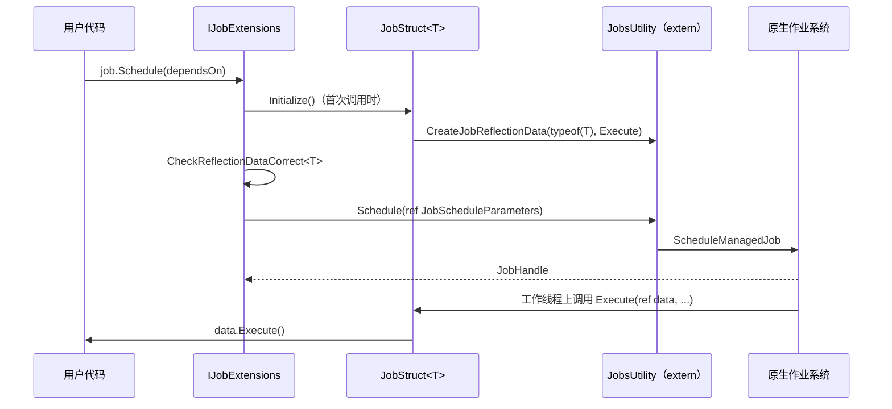

# Jobs 与原生容器

C# Job System 让用户以值类型结构体描述任务，由原生作业系统在工作线程上执行；`NativeArray<T>` 等原生容器提供可在任务之间共享的非托管内存，并通过安全句柄检测数据竞争和泄漏。本页说明 `IJob` 从调度到执行的托管侧路径，以及 `NativeArray<T>` 的分配、访问检查和释放规则。

父页面：[运行时架构](index.md) · 相关：[绑定层](bindings.md)

## 相关源码文件

- [`Modules/ManagedKernel/Managed/Jobs/IJob.cs`](../../Modules/ManagedKernel/Managed/Jobs/IJob.cs)
- [`Modules/ManagedKernel/Managed/Jobs/Jobs.bindings.cs`](../../Modules/ManagedKernel/Managed/Jobs/Jobs.bindings.cs)
- [`Modules/ManagedKernel/Managed/NativeArray/NativeArray.cs`](../../Modules/ManagedKernel/Managed/NativeArray/NativeArray.cs)
- [`Modules/ManagedKernel/Managed/Jobs/AtomicSafetyHandle.bindings.cs`](../../Modules/ManagedKernel/Managed/Jobs/AtomicSafetyHandle.bindings.cs)

`Modules/ManagedKernel` 共 93 个文件，命名空间以 `Unity.Collections` 和 `Unity.Collections.LowLevel.Unsafe` 为主，其中 `Managed/Collections` 有 68 个文件，`Managed/Jobs` 有 7 个文件。本页只覆盖 `IJob` 和 `NativeArray` 这两条代表性路径。

## 1. `IJob` 的调度路径

证据：

- `IJob` 通过 `[JobProducerType(typeof(IJobExtensions.JobStruct<>))]` 关联生产者类型 [`IJob.cs:47-55`](../../Modules/ManagedKernel/Managed/Jobs/IJob.cs#L47-L55)。
- `JobStruct<T>` 把反射数据保存在 `SharedStatic<IntPtr>` 中，并在首次初始化时用托管 `Execute` 委托创建；`Execute` 只调用 `data.Execute()` [`IJob.cs:65-82`](../../Modules/ManagedKernel/Managed/Jobs/IJob.cs#L65-L82)。
- `Schedule`/`Run` 用作业数据的地址、反射数据、依赖和 `ScheduleMode` 构造参数，然后调用 `JobsUtility.Schedule`；`Run` 使用 `ScheduleMode.Run`，并传入空依赖 [`IJob.cs:99-156`](../../Modules/ManagedKernel/Managed/Jobs/IJob.cs#L99-L156)。
- `JobsUtility.Schedule` 绑定到原生 `ScheduleManagedJob`，标为线程安全且可能抛出异常 [`Jobs.bindings.cs:75-117`](../../Modules/ManagedKernel/Managed/Jobs/Jobs.bindings.cs#L75-L117)。

图中“工作线程上调用 `Execute`”的时序由原生决定，属于推断。

### 要点

- **为什么用 `SharedStatic`**：从名称和用法看，它使 Burst 编译代码也能读到反射数据。`EarlyJobInit` 的文档说明，提前初始化可以避免调度时的懒加载开销，并让 Burst 代码可以调度作业，因为反射部分已经完成 [`IJob.cs:84-97`](../../Modules/ManagedKernel/Managed/Jobs/IJob.cs#L84-L97)。
- **泛型作业必须显式注册**：反射数据为空时，校验会抛异常，提示加上 `[assembly: RegisterGenericJobType(...)]` [`IJob.cs:14-35`](../../Modules/ManagedKernel/Managed/Jobs/IJob.cs#L14-L35)。这些校验带 `[Conditional("ENABLE_UNITY_COLLECTIONS_CHECKS")]`，所以只在启用集合检查时编译。
- **`ScheduleMode`**：`Run=0`、`Parallel=1`（`Batched` 是它的已废弃别名）、`Single=2` [`Jobs.bindings.cs:51-62`](../../Modules/ManagedKernel/Managed/Jobs/Jobs.bindings.cs#L51-L62)。并行作业使用 `ScheduleParallelFor`，或使用延迟到运行时才确定数组长度的版本 [`Jobs.bindings.cs:121-127`](../../Modules/ManagedKernel/Managed/Jobs/Jobs.bindings.cs#L121-L127)。

## 2. `NativeArray<T>`

### 2.1 结构

`NativeArray<T>` 是带 `[NativeContainer]` 等标记的 `unsafe struct`，字段包括 `m_Buffer`、`m_Length`、用于并行写范围限制的 `m_MinIndex`/`m_MaxIndex`、`AtomicSafetyHandle m_Safety` 和 `m_AllocatorLabel` [`NativeArray.cs:37-80`](../../Modules/ManagedKernel/Managed/NativeArray/NativeArray.cs#L37-L80)。`T` 必须是非托管类型，分配时会检查 [`NativeArray.cs:168-186`](../../Modules/ManagedKernel/Managed/NativeArray/NativeArray.cs#L168-L186)。

### 2.2 生命周期

| 阶段 | 行为 | 证据 |
| --- | --- | --- |
| 分配 | 拒绝自定义分配器（`>= FirstUserIndex`）和负长度；通过 `MallocTracked` 分配；创建安全句柄并初始化静态安全 ID | [`NativeArray.cs:160-186`](../../Modules/ManagedKernel/Managed/NativeArray/NativeArray.cs#L160-L186) |
| 读写 | 索引器先检查索引是否在 `[m_MinIndex, m_MaxIndex]` 内，再检查安全句柄的读或写权限；这些检查只在 `ENABLE_UNITY_COLLECTIONS_CHECKS` 下编译 | [`NativeArray.cs:218-256`](../../Modules/ManagedKernel/Managed/NativeArray/NativeArray.cs#L218-L256) |
| 释放 | 检查句柄仍然存在；未创建时直接返回；无效分配器或自定义分配器抛出异常；否则释放句柄和内存，并把分配器标为 `Invalid` | [`NativeArray.cs:268-299`](../../Modules/ManagedKernel/Managed/NativeArray/NativeArray.cs#L268-L299) |

边界行为：`IsCreated` 只判断 `m_Buffer != null` [`NativeArray.cs:258-263`](../../Modules/ManagedKernel/Managed/NativeArray/NativeArray.cs#L258-L263)。因为 `NativeArray` 是结构体，复制后再对其中一个副本调用 `Dispose`，另一个副本的 `IsCreated` 仍然为 `true`；只有安全检查开启时，这个副本的后续访问才会被 `AtomicSafetyHandle` 拦截。这是根据值类型语义和上述代码得出的推论。

## 3. 局限

- 作业系统调度、依赖图、工作窃取都在原生侧。
- `Unity.Collections` 的其余 60 多个容器与工具类型、Burst 模块（`Modules/Burst`，52 个文件）以及 `IJobParallelForTransform`（[`Runtime/Jobs/Managed/IJobParallelForTransform.cs`](../../Runtime/Jobs/Managed/IJobParallelForTransform.cs)）没有逐一分析。
