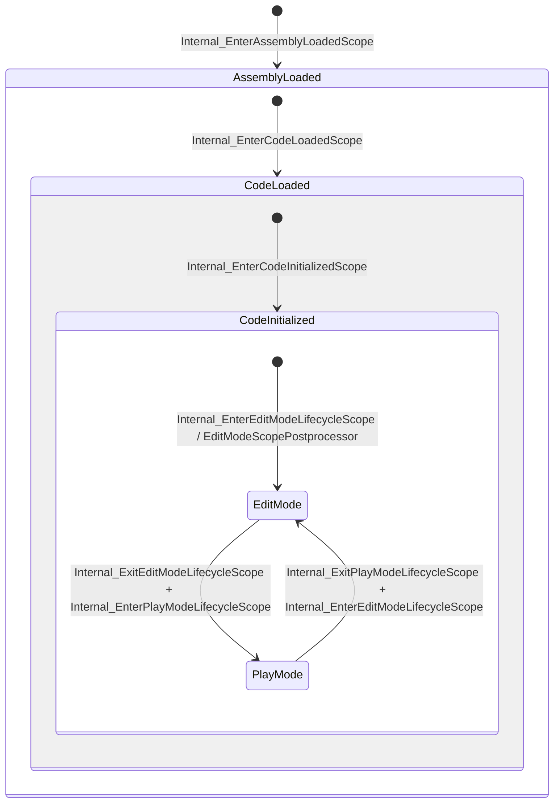

# 代码加载生命周期作用域（LifecycleManagement）

Unity 编辑器会反复卸载和重新加载用户代码（脚本修改、进入播放模式等）。静态字段、事件订阅和异步任务如果跨越重载继续存活，就会导致泄漏或访问已卸载的代码。`External/ScriptingCore` 中的 LifecycleManagement 把这些时刻建模为**嵌套的作用域**，并让代码用特性声明“进入/退出某作用域时执行什么”。本页说明作用域层级、驱动入口、回调注册方式，以及自动静态清理。

父页面：[运行时架构](index.md) · 相关：[编辑器应用与回调](../editor/editor-application.md)、[PlayerLoop 与异步](player-loop-and-async.md)

## 相关源码文件

- [`External/ScriptingCore/Unity.Scripting/LifecycleManagement/`](../../External/ScriptingCore/Unity.Scripting/LifecycleManagement/)：控制器、作用域、特性、方法注册表
- [`Runtime/Scripting/LifecycleManagement/DomainReloadLifecycleController.cs`](../../Runtime/Scripting/LifecycleManagement/DomainReloadLifecycleController.cs)：Mono/IL2CPP 集成
- [`Runtime/Scripting/LifecycleManagement/UnityLifecycleInternal.cs`](../../Runtime/Scripting/LifecycleManagement/UnityLifecycleInternal.cs)
- [`Runtime/Export/Application/Application.cs`](../../Runtime/Export/Application/Application.cs)：PlayMode 作用域入口
- [`Editor/Mono/Scripting/EditModeScope.cs`](../../Editor/Mono/Scripting/EditModeScope.cs)、[`EditModeScopePostprocessor.cs`](../../Editor/Mono/Scripting/EditModeScopePostprocessor.cs)

## 1. 作用域层级

每个作用域在构造时声明自己必需的外层作用域：

| 作用域 | 必需外层 | 进入时执行 | 退出时执行（逆序） | 证据 |
| --- | --- | --- | --- | --- |
| `AssemblyLoaded`（带程序集列表上下文） | — | `[OnAssemblyLoaded]` | `[OnAssemblyUnloading]` | [`AssemblyLoadedScopeBase.cs:5-49`](../../External/ScriptingCore/Unity.Scripting/LifecycleManagement/AssemblyLoadedScopeBase.cs#L5-L49) |
| `CodeLoaded` | `AssemblyLoaded`；隐式外层 `BurstScope`、`UDMScope` | `[OnCodeLoaded]` | `[OnCodeUnloading]` | [`CodeLoadedScope.cs:64-83`](../../External/ScriptingCore/Unity.Scripting/LifecycleManagement/CodeLoadedScope.cs#L64-L83) |
| `CodeInitialized` | `CodeLoaded` | `[OnCodeInitializing]` | `[OnCodeDeinitializing]` | [`CodeInitializedScope.cs:24-42`](../../External/ScriptingCore/Unity.Scripting/LifecycleManagement/CodeInitializedScope.cs#L24-L42) |
| `PlayMode` | `CodeInitialized` | `[OnEnteringPlayMode]` | `[OnExitingPlayMode]` | [`PlayModeScope.cs:20-38`](../../External/ScriptingCore/Unity.Scripting/LifecycleManagement/PlayModeScope.cs#L20-L38) |
| `EditMode`（仅编辑器） | `CodeInitialized`；`PlayMode` 存在时，`Enter` 报错并直接返回，不执行进入回调 | `[OnEnteringEditMode]` | `[OnExitingEditMode]` | [`EditModeScope.cs:20-47`](../../Editor/Mono/Scripting/EditModeScope.cs#L20-L47) |

图中证据：嵌套关系来自上表各作用域的 `ExplicitRequiredOuterScopes`；转换入口来自 [`DomainReloadLifecycleController.cs:88-145`](../../Runtime/Scripting/LifecycleManagement/DomainReloadLifecycleController.cs#L88-L145)、[`UnityLifecycleInternal.cs:14-40`](../../Runtime/Scripting/LifecycleManagement/UnityLifecycleInternal.cs#L14-L40)、[`Application.cs:399-419`](../../Runtime/Export/Application/Application.cs#L399-L419)、[`EditorApplication.cs:599-623`](../../Editor/Mono/EditorApplication.cs#L599-L623)、[`EditModeScopePostprocessor.cs:12-25`](../../Editor/Mono/Scripting/EditModeScopePostprocessor.cs#L12-L25)。EditMode 与 PlayMode 的切换顺序由原生代码决定，上图只表示两种转换都存在。

## 2. 谁驱动转换

转换主要由原生调用 `[RequiredByNativeCode]` 静态方法触发；也有少数由托管回调发起，例如在 `[OnCodeInitializing]` 中重新进入 PlayMode，以及在资源后处理器中进入 EditMode：

- **Mono/IL2CPP 集成**：`DomainReloadLifecycleController` 先初始化控制器并注入 `DependencyOrderedNativeCallbackProvider`，然后进入或退出 `AssemblyLoaded`、`CodeLoaded`；每个入口都捕获异常并上报 [`DomainReloadLifecycleController.cs:71-145`](../../Runtime/Scripting/LifecycleManagement/DomainReloadLifecycleController.cs#L71-L145)。类注释说明，这是 `AssemblyLoader` 在 LifecycleManagement 职责上的替代实现 [`DomainReloadLifecycleController.cs:15-22`](../../Runtime/Scripting/LifecycleManagement/DomainReloadLifecycleController.cs#L15-L22)。
- **代码初始化**：`UnityLifecycleInternal.Internal_Enter/ExitCodeInitializedScope` [`UnityLifecycleInternal.cs:14-40`](../../Runtime/Scripting/LifecycleManagement/UnityLifecycleInternal.cs#L14-L40)。
- **播放模式**：`Application.Internal_EnterPlayModeLifecycleScope` 断言 `CodeInitialized` 已存在。如果在播放模式中发生代码重载，`PlayMode` 会被退出，`[OnCodeInitializing]` 回调 `Internal_CodeReloadInPlayModeReEnterScope` 会在 `isPlaying` 时重新进入 [`Application.cs:399-432`](../../Runtime/Export/Application/Application.cs#L399-L432)。
- **编辑模式**：`EditorApplication.Internal_EnterEditModeLifecycleScope` 在作用域已存在时跳过。注释解释了这种情况为什么会发生：“播放结束后重编译”的设置会导致在 `EnteredEditMode` 通知前同步执行一次域重载，而重载后 `EditModeScopePostprocessor` 已重新进入 EditMode [`EditorApplication.cs:599-613`](../../Editor/Mono/EditorApplication.cs#L599-L613)。`EditModeScopePostprocessor` 在“发生过域重载、未准备进入播放模式、且 EditMode 不存在”时进入 EditMode [`EditModeScopePostprocessor.cs:14-25`](../../Editor/Mono/Scripting/EditModeScopePostprocessor.cs#L14-L25)。

## 3. `LifecycleController`

`LifecycleController` 是进程级单例，持有方法注册表、作用域转换辅助器和活动作用域追踪器 [`LifecycleController.cs:13-49`](../../External/ScriptingCore/Unity.Scripting/LifecycleManagement/LifecycleController.cs#L13-L49)。关键规则：

- **只能在主线程转换**：`EnterScope`/`ExitScope` 先检查调用线程是否等于构造时记录的主线程 ID；不满足时报告错误并直接返回 [`LifecycleController.cs:214-237`](../../External/ScriptingCore/Unity.Scripting/LifecycleManagement/LifecycleController.cs#L214-L237)。
- **请求可能延迟处理**：`EnterScope`/`ExitScope` 返回 `void`，因为如果已有排队的转换，请求会在之后才处理，并且可能失败。需要结果的调用方应稍后用 `IsScopePresent` 检查 [`LifecycleController.cs:239-243`](../../External/ScriptingCore/Unity.Scripting/LifecycleManagement/LifecycleController.cs#L239-L243)。
- **查询在锁内执行**：`IsScopePresent` 等查询方法都先获取 `_lock` [`LifecycleController.cs:125-176`](../../External/ScriptingCore/Unity.Scripting/LifecycleManagement/LifecycleController.cs#L125-L176)。
- **程序集加载时运行模块初始化器**：对每个已加载程序集查找 `__UnityModuleInitialization.Initialize`（静态、非公有）并调用 [`LifecycleController.cs:51-80`](../../External/ScriptingCore/Unity.Scripting/LifecycleManagement/LifecycleController.cs#L51-L80)。

### 回调如何注册

生命周期方法**不是**在转换时通过反射扫描得到的。`ScopeTransitionHelper` 从 `LifecycleMethodRegistry` 读取已注册的回调 [`ScopeTransitionHelper.cs:34-37`](../../External/ScriptingCore/Unity.Scripting/LifecycleManagement/ScopeTransitionHelper.cs#L34-L37)，回调则由代码生成产物通过公开的 `LifecycleMethodRegistration.Register` 注册 [`LifecycleMethodRegistration.cs:6-20`](../../External/ScriptingCore/Unity.Scripting/LifecycleManagement/CodeGen/LifecycleMethodRegistration.cs#L6-L20)。结合上一节可以推断：源生成器为每个程序集生成 `__UnityModuleInitialization.Initialize`，并在其中注册该程序集的生命周期方法。

编辑器会检查这个前提：如果一个程序集包含生命周期方法但没有初始化方法，就报错，提示需要引用 `Unity.Analyzers.Common.dll` [`EditorAssemblies.cs:98-116`](../../Editor/Mono/EditorAssemblies.cs#L98-L116)。

回调按程序集顺序执行，退出时逆序执行。单个回调抛出的异常会被捕获并报告，**不会中断**其余回调 [`ScopeTransitionHelper.cs:70-103`](../../External/ScriptingCore/Unity.Scripting/LifecycleManagement/ScopeTransitionHelper.cs#L70-L103)。

## 4. 代码加载“代次”与取消

`CodeLoadedScope` 维护一个代次计数器和一个 `CancellationToken` [`CodeLoadedScope.cs:29-62`](../../External/ScriptingCore/Unity.Scripting/LifecycleManagement/CodeLoadedScope.cs#L29-L62)：

- 进入或退出 `CodeLoaded` 之前，都会先递增代次，并取消、回收旧的 `CancellationTokenSource` [`CodeLoadedScope.cs:71-92`](../../External/ScriptingCore/Unity.Scripting/LifecycleManagement/CodeLoadedScope.cs#L71-L92)。
- `CancelIfNotInGeneration(generation)` 在代次不匹配时抛出 `OperationCanceledException`，提示“属于上一个 CodeLoaded 作用域的异步代码必须在重载前取消”。
- `Awaitable` 在创建时记录代次，并在结果被取走时调用 `CancelIfNotInGeneration`，所以跨越重载的 await 会被取消 [`Awaitable.cs:73-78`](../../Runtime/Export/Scripting/Awaitable.cs#L73-L78)、[`Awaitable.cs:238-245`](../../Runtime/Export/Scripting/Awaitable.cs#L238-L245)。

## 5. 自动静态清理

代码重载时，静态字段需要被重置。`StaticsCleanupAttributes.cs` 定义了这套声明式规则 [`StaticsCleanupAttributes.cs:7-98`](../../External/ScriptingCore/Unity.Scripting/LifecycleManagement/StaticsCleanupAttributes.cs#L7-L98)：

| 特性 | 作用 |
| --- | --- |
| `[AutoStaticsCleanup]` | 用于类型或成员；指定触发清理的作用域（默认 PlayMode）、进入还是退出时清理、清理策略 |
| `[AutoStaticsCleanupOnCodeReload]`（internal） | 在代码重载时清理 |
| `[NoAutoStaticsCleanup]` | 不清理 |
| `[IgnoreForUAL0015(reason)]` | 让分析规则 UAL0015 忽略该符号，并要求写明理由 |

清理策略包括 `Auto`、`Clear`、`CaptureInitializationExpression`、`ResetToDefaultValue`；事件始终会移除全部处理器 [`StaticsCleanupAttributes.cs:18-29`](../../External/ScriptingCore/Unity.Scripting/LifecycleManagement/StaticsCleanupAttributes.cs#L18-L29)。

编辑器 API 中的典型用法：`EditorApplication.update` 在代码重载时被清空，注释说明订阅者会通过自己的生命周期重新订阅 [`EditorApplication.cs:207-211`](../../Editor/Mono/EditorApplication.cs#L207-L211)；`AssemblyReloadEvents` 的事件存储也是如此 [`AssemblyReloadEvents.cs:18-34`](../../Editor/Mono/AssemblyReloadEvents.cs#L18-L34)。

**参考工程中的例外：** `UnityEngine.csproj` 设置了 `UnityEnableAutoStaticsCleanupCodeGen=false` [`UnityEngine.csproj:24`](../../Projects/CSharp/UnityEngine.csproj#L24)。`ExceptionMarshaller` 的注释也说明，字段级自动清理代码生成“不能在此程序集中运行”，所以它改用手写的 `[OnCodeUnloading]` 方法 [`ExceptionMarshaller.cs:14-19`](../../Modules/Scripting/Scripting/Marshalling/ExceptionMarshaller.cs#L14-L19)、[`ExceptionMarshaller.cs:59-64`](../../Modules/Scripting/Scripting/Marshalling/ExceptionMarshaller.cs#L59-L64)。因此，特性声明的清理在核心程序集中是否真正生效，取决于真实构建是否启用生成器，本仓库无法确认。

## 6. 与旧 API 的关系

较早的 `AssemblyReloadEvents.beforeAssemblyReload`/`afterAssemblyReload` 仍然存在，由原生通过 `[RequiredByNativeCode]` 触发 [`AssemblyReloadEvents.cs:36-58`](../../Editor/Mono/AssemblyReloadEvents.cs#L36-L58)。UI Toolkit 编辑器集成同时使用两者：用 `[OnCodeLoaded]` 重新接线，用 `beforeAssemblyReload` 停止记录样式表卸载 [`RetainedMode.cs:21-60`](../../Modules/UIElementsEditor/RetainedMode.cs#L21-L60)。

## 7. 局限

- 作用域转换的排队与依赖解析逻辑在 `ActiveLifecycleScopesTracker.cs` 中（约 34 KB），本页没有逐行分析。
- 原生调用这些入口的确切时序（例如域重载时 `ExitCodeInitialized` 与 `beforeAssemblyReload` 的先后）不在仓库中。
