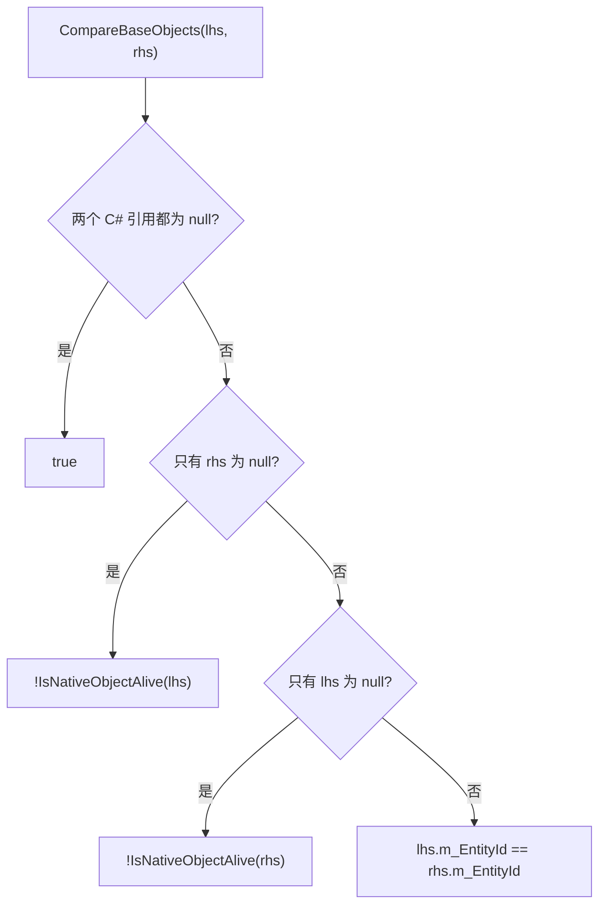

# 对象模型：`UnityEngine.Object`

GameObject、组件、`ScriptableObject` 和各类资源都继承自 `UnityEngine.Object`，它们是 Unity 原生对象系统中的对象（普通 C# 类即使被 `[SerializeReference]` 序列化，也不属于这一类）。这类 C# 对象只是原生对象的“包装器”，两者的生命周期并不相同。本页解释包装器如何绑定原生对象、为什么 `== null` 的结果可能和 C# 直觉不同，以及创建、克隆和销毁如何进入原生代码。

父页面：[运行时架构](index.md) · 相关：[绑定层](bindings.md)、[序列化](serialization.md)

## 相关源码文件

- [`Runtime/Export/Scripting/UnityEngineObject.bindings.cs`](../../Runtime/Export/Scripting/UnityEngineObject.bindings.cs)
- [`Runtime/Export/Scripting/GameObject.bindings.cs`](../../Runtime/Export/Scripting/GameObject.bindings.cs)
- [`Runtime/Export/Scripting/ScriptableObject.bindings.cs`](../../Runtime/Export/Scripting/ScriptableObject.bindings.cs)
- [`Runtime/Export/Scripting/MonoBehaviour.bindings.cs`](../../Runtime/Export/Scripting/MonoBehaviour.bindings.cs)

## 1. 包装器的三个字段

`Object` 是顺序布局的类，标记为 `[RequiredByNativeCode(GenerateProxy = false)]`，并持有三个字段 [`UnityEngineObject.bindings.cs:248-263`](../../Runtime/Export/Scripting/UnityEngineObject.bindings.cs#L248-L263)：

| 字段 | 含义 |
| --- | --- |
| `IntPtr m_CachedPtr` | 缓存的原生对象指针；非零表示托管包装器当前已绑定到存活的原生对象 |
| `EntityId m_EntityId` | 对象的稳定标识，用于相等比较、哈希，以及在指针缺失时重新查找原生对象 |
| `string m_UnityRuntimeErrorString` | 原生侧写入的错误标记，例如反序列化时引用类型不匹配 |

这些字段由原生代码通过一组 `[RequiredByNativeCode]` 静态方法读写，例如 `BindNativeObject(obj, cachedPtr, entityId)` 一次性设置指针和 ID，并清除错误字符串 [`UnityEngineObject.bindings.cs:362-424`](../../Runtime/Export/Scripting/UnityEngineObject.bindings.cs#L362-L424)。这些方法用 `UnsafeUtility.As` 把 `System.Object` 参数重新解释为 `UnityEngine.Object`；注释说明，在代理生成支持直接传 GC 句柄之前，参数类型暂时保持为 `System.Object`。

### `EntityId`

`EntityId` 是 8 字节结构体，内部是一个 `ulong m_rawData`，`None` 等于 0 [`UnityEngineObject.bindings.cs:135-156`](../../Runtime/Export/Scripting/UnityEngineObject.bindings.cs#L135-L156)。旧的 `GetInstanceID()` 已被标为编译错误级的 `Obsolete`，它只返回原始数据的低 32 位 [`UnityEngineObject.bindings.cs:293-295`](../../Runtime/Export/Scripting/UnityEngineObject.bindings.cs#L293-L295)。

## 2. 相等与“假 null”

`==`、`!=`、`Equals` 和隐式 `bool` 转换都委托给 `CompareBaseObjects` [`UnityEngineObject.bindings.cs:305-334`](../../Runtime/Export/Scripting/UnityEngineObject.bindings.cs#L305-L334)、[`UnityEngineObject.bindings.cs:974-976`](../../Runtime/Export/Scripting/UnityEngineObject.bindings.cs#L974-L976)：

`IsNativeObjectAlive` 的判断顺序 [`UnityEngineObject.bindings.cs:336-360`](../../Runtime/Export/Scripting/UnityEngineObject.bindings.cs#L336-L360)：

1. `m_CachedPtr` 非零，判定为存活。
2. 否则，如果对象是 `MonoBehaviour` 或 `ScriptableObject`，判定为已死亡。这类资源“就是” C# 对象本身，旧包装器不能假装指向重新创建的新对象。
3. 否则调用原生 `DoesObjectWithInstanceIDExist(entityId)`。这样，被移走又移回、并保留相同 ID 的资源，其旧包装器仍然“有效”。

代码注释说明，第 3 步原本只计划在编辑器中支持，因为它会让所有 `operator==` 变慢 [`UnityEngineObject.bindings.cs:341-348`](../../Runtime/Export/Scripting/UnityEngineObject.bindings.cs#L341-L348)。本仓库中该调用是无条件的，这与源码已按编辑器配置预处理的推断一致（见 [仓库概览 §3.2](../overview.md#32-源码已按编辑器配置预处理推断)）。播放器中的实际行为无法从本仓库确认。

推论：

- 已销毁的对象在 C# 中仍然是非 null 引用，但 `obj == null` 为 `true`、`if (obj)` 为 `false`。对它调用绑定方法时，封送层会抛出 `MissingReferenceException`（见 [绑定层 §4.3](bindings.md#43-unityengineobject-参数)）。
- `GetHashCode` 基于 `m_EntityId`。注释说明，在编辑器中可能出现多个 C# 对象指向同一个 C++ 对象的情况，这时希望它们在哈希和相等上被视为同一个对象 [`UnityEngineObject.bindings.cs:297-303`](../../Runtime/Export/Scripting/UnityEngineObject.bindings.cs#L297-L303)。
- `Equals` 不会把非 `UnityEngine.Object` 类型视为相等 [`UnityEngineObject.bindings.cs:305-315`](../../Runtime/Export/Scripting/UnityEngineObject.bindings.cs#L305-L315)。

## 3. 创建

| 路径 | 行为 | 证据 |
| --- | --- | --- |
| `new GameObject(name)` | 构造函数把 `this`（标为 `[Writable]`）传给原生 `GameObjectBindings::Internal_CreateGameObject`，由原生创建对象并绑定包装器 | [`GameObject.bindings.cs:405-413`](../../Runtime/Export/Scripting/GameObject.bindings.cs#L405-L413)、[`GameObject.bindings.cs:422-423`](../../Runtime/Export/Scripting/GameObject.bindings.cs#L422-L423) |
| `new ScriptableObject()` 派生类构造 | 构造函数调用 `CreateScriptableObject(this)` | [`ScriptableObject.bindings.cs:21-24`](../../Runtime/Export/Scripting/ScriptableObject.bindings.cs#L21-L24) |
| `ScriptableObject.CreateInstance(type)` | 调用原生 `CreateScriptableObjectInstanceFromType(type, applyDefaultsAndReset: true)` | [`ScriptableObject.bindings.cs:37-39`](../../Runtime/Export/Scripting/ScriptableObject.bindings.cs#L37-L39) |
| `MonoBehaviour` 构造 | 构造函数执行 `ConstructorCheck(this)`；组件实际由 `AddComponent` 在原生侧创建 | [`MonoBehaviour.bindings.cs:23-26`](../../Runtime/Export/Scripting/MonoBehaviour.bindings.cs#L23-L26)、[`GameObject.bindings.cs:246-250`](../../Runtime/Export/Scripting/GameObject.bindings.cs#L246-L250) |

`ConstructorCheck` 的实现不在本文件中，从名称推断它会校验 MonoBehaviour 是否经由合法路径构造。

## 4. 克隆（Instantiate）

`Object.Instantiate(original)` 先做 C# 侧空引用检查（注意它检查的是 C# 引用，不是“假 null”），然后调用原生 `CloneObject`；如果返回 `null`，就抛出 `UnityException`，说明克隆体在创建过程中被销毁，例如在 `Awake` 中调用了 `DestroyImmediate` [`UnityEngineObject.bindings.cs:269-270`](../../Runtime/Export/Scripting/UnityEngineObject.bindings.cs#L269-L270)、[`UnityEngineObject.bindings.cs:579-590`](../../Runtime/Export/Scripting/UnityEngineObject.bindings.cs#L579-L590)、[`UnityEngineObject.bindings.cs:984-985`](../../Runtime/Export/Scripting/UnityEngineObject.bindings.cs#L984-L985)。带场景、父节点和参数的重载使用各自的 `Internal_CloneSingle*` 原生入口 [`UnityEngineObject.bindings.cs:985-996`](../../Runtime/Export/Scripting/UnityEngineObject.bindings.cs#L985-L996)。

`MemberwiseClone` 被 `new` 覆盖并标为编译错误，因为它会产生损坏的对象 [`UnityEngineObject.bindings.cs:287-291`](../../Runtime/Export/Scripting/UnityEngineObject.bindings.cs#L287-L291)。

## 5. 销毁与跨场景保留

- `Destroy(obj, t)` 和 `DestroyImmediate(obj, allowDestroyingAssets)` 都是原生自由函数 [`UnityEngineObject.bindings.cs:691-711`](../../Runtime/Export/Scripting/UnityEngineObject.bindings.cs#L691-L711)。“延迟到帧末销毁”等时序由原生实现决定，C# 侧看不到。
- `DontDestroyOnLoad` 转发到 `GetSceneManager().DontDestroyOnLoad` [`UnityEngineObject.bindings.cs:787-789`](../../Runtime/Export/Scripting/UnityEngineObject.bindings.cs#L787-L789)。
- `MonoBehaviour.destroyCancellationToken` 按需创建 `CancellationTokenSource`，并通过 `OnCancellationTokenCreated` 通知原生；原生在销毁时调用 `[RequiredByNativeCode] RaiseCancellation()` 取消该令牌。对已经销毁的对象读取这个属性会抛出 `MissingReferenceException` [`MonoBehaviour.bindings.cs:29-49`](../../Runtime/Export/Scripting/MonoBehaviour.bindings.cs#L29-L49)、[`MonoBehaviour.bindings.cs:204`](../../Runtime/Export/Scripting/MonoBehaviour.bindings.cs#L204)。

## 6. 约束与边界行为

- `Object.MarshalledUnityObject.Marshal` 刻意不使用 `==`，因为它可能在关闭期间被调用，而 `==` 会触发 icall [`UnityEngineObject.bindings.cs:1049-1059`](../../Runtime/Export/Scripting/UnityEngineObject.bindings.cs#L1049-L1059)。在自己的封送或关闭路径代码中，应使用 `ReferenceEquals` 判断 C# 引用。
- `FindObjectsOfType` 已被 `FindObjectsByType` 取代。注释给出的理由是按 InstanceID 排序占用了大部分耗时，新 API 让调用方自己决定是否排序 [`UnityEngineObject.bindings.cs:713-720`](../../Runtime/Export/Scripting/UnityEngineObject.bindings.cs#L713-L720)。
