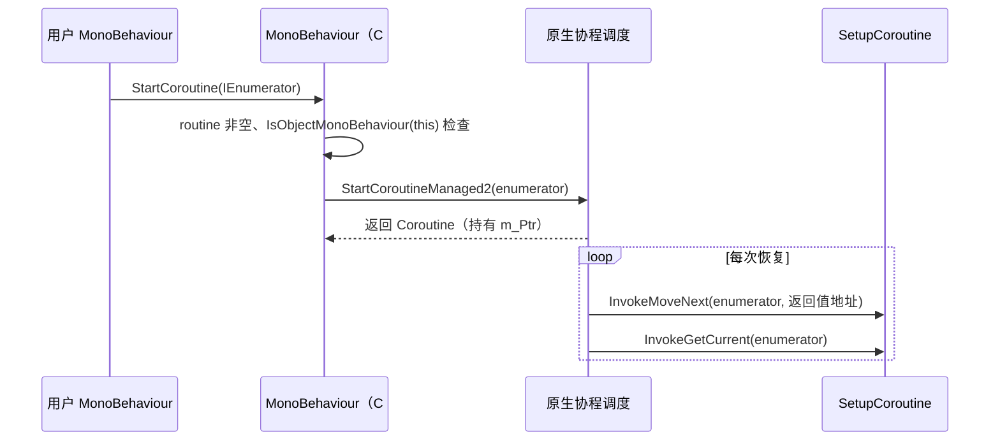

# PlayerLoop、协程与异步

本页说明运行时帧循环在 C# 侧如何表示和修改，以及用户代码可用的三种“跨帧”机制：协程、`UnitySynchronizationContext`（支撑 `async/await` 回到主线程）和 Unity 自有的 `Awaitable`。帧循环本身由原生代码执行；C# 侧负责描述结构，并提供会被原生在固定时机调用的回调。

父页面：[运行时架构](index.md) · 相关：[生命周期作用域](lifecycle-scopes.md)、[UI Toolkit](../ui-toolkit/index.md)

## 相关源码文件

- [`Runtime/Export/PlayerLoop/PlayerLoop.bindings.cs`](../../Runtime/Export/PlayerLoop/PlayerLoop.bindings.cs)
- [`Runtime/Export/Scripting/MonoBehaviour.bindings.cs`](../../Runtime/Export/Scripting/MonoBehaviour.bindings.cs)、[`Coroutines.cs`](../../Runtime/Export/Scripting/Coroutines.cs)、[`Coroutine.bindings.cs`](../../Runtime/Export/Scripting/Coroutine.bindings.cs)
- [`Runtime/Export/Scripting/UnitySynchronizationContext.cs`](../../Runtime/Export/Scripting/UnitySynchronizationContext.cs)
- [`Runtime/Export/Scripting/Awaitable*.cs`](../../Runtime/Export/Scripting/)

## 1. PlayerLoop 的 C# 表示

### 1.1 阶段标记类型

`UnityEngine.PlayerLoop` 命名空间中的嵌套空结构体**只作为类型标记**，用于在循环树中识别各个系统。每个结构体都带 `[RequiredByNativeCode]`，原生侧按类型名把它们映射到实际更新函数 [`PlayerLoop.bindings.cs:11-346`](../../Runtime/Export/PlayerLoop/PlayerLoop.bindings.cs#L11-L346)。顶层分类和一些与本 Wiki 相关的子系统如下：

| 顶层分类 | 与脚本/UI 相关的子系统（节选） | 证据 |
| --- | --- | --- |
| `TimeUpdate` | `WaitForLastPresentationAndUpdateTime` | [`PlayerLoop.bindings.cs:13-20`](../../Runtime/Export/PlayerLoop/PlayerLoop.bindings.cs#L13-L20) |
| `Initialization` | `ProfilerStartFrame`、`SynchronizeInputs` | [`PlayerLoop.bindings.cs:22-42`](../../Runtime/Export/PlayerLoop/PlayerLoop.bindings.cs#L22-L42) |
| `EarlyUpdate` | `ExecuteMainThreadJobs`、`UpdateAsyncInstantiate`、`ScriptRunDelayedStartupFrame` | [`PlayerLoop.bindings.cs:44-122`](../../Runtime/Export/PlayerLoop/PlayerLoop.bindings.cs#L44-L122) |
| `FixedUpdate` | `ScriptRunBehaviourFixedUpdate`、`PhysicsFixedUpdate`、`ScriptRunDelayedFixedFrameRate` | [`PlayerLoop.bindings.cs:123-155`](../../Runtime/Export/PlayerLoop/PlayerLoop.bindings.cs#L123-L155) |
| `PreUpdate` | `IMGUISendQueuedEvents`、`InputForUIUpdate`、`UIElementsPreparePanelRenderers` | [`PlayerLoop.bindings.cs:156-187`](../../Runtime/Export/PlayerLoop/PlayerLoop.bindings.cs#L156-L187) |
| `Update` | `ScriptRunBehaviourUpdate`、`ScriptRunDelayedDynamicFrameRate`、`ScriptRunDelayedTasks` | [`PlayerLoop.bindings.cs:188-200`](../../Runtime/Export/PlayerLoop/PlayerLoop.bindings.cs#L188-L200) |
| `PreLateUpdate` | `UIElementsUpdatePanels`、`ScriptRunBehaviourLateUpdate` | [`PlayerLoop.bindings.cs:201-237`](../../Runtime/Export/PlayerLoop/PlayerLoop.bindings.cs#L201-L237) |
| `PostLateUpdate` | `UIElementsRepaintPanels`（internal）、`TriggerEndOfFrameCallbacks`、`PlayerSendFrameComplete` | [`PlayerLoop.bindings.cs:238-345`](../../Runtime/Export/PlayerLoop/PlayerLoop.bindings.cs#L238-L345) |

C# 文件中的声明顺序不一定等于运行时的执行顺序。默认顺序只能在运行时通过 `PlayerLoop.GetDefaultPlayerLoop()` 获取。

### 1.2 读取与替换

`PlayerLoopSystem` 是一棵树，包含 `type`、`subSystemList`、托管 `updateDelegate`，以及原生 `updateFunction` 和 `loopConditionFunction` 指针 [`PlayerLoop.bindings.cs:362-374`](../../Runtime/Export/PlayerLoop/PlayerLoop.bindings.cs#L362-L374)。跨越边界时，这棵树被拍平成 `PlayerLoopSystemInternal[]` [`PlayerLoop.bindings.cs:350-360`](../../Runtime/Export/PlayerLoop/PlayerLoop.bindings.cs#L350-L360)：

- `SetPlayerLoop` 以前序遍历方式拍平。注意 `numSubSystems` 记录的是**全部后代数量**，不是直接子节点数量：每次递归调用返回“自身后代数 + 1”，再累加到父节点 [`PlayerLoop.bindings.cs:393-421`](../../Runtime/Export/PlayerLoop/PlayerLoop.bindings.cs#L393-L421)。
- `InternalToPlayerLoopSystem` 用 `offset <= idx + numSubSystems` 判断子树边界并重建树 [`PlayerLoop.bindings.cs:423-444`](../../Runtime/Export/PlayerLoop/PlayerLoop.bindings.cs#L423-L444)。
- 三个原生入口：`GetDefaultPlayerLoopInternal`、`GetCurrentPlayerLoopInternal`、`SetPlayerLoopInternal` [`PlayerLoop.bindings.cs:446-451`](../../Runtime/Export/PlayerLoop/PlayerLoop.bindings.cs#L446-L451)。

自定义循环时，可以在树中加入只设置 `updateDelegate` 的节点，由原生在相应位置回调托管委托。原生如何处理没有 `updateFunction` 的节点不在仓库中，这里依据字段定义推断。

## 2. 协程

证据：`StartCoroutine` 的参数校验和原生调用 [`MonoBehaviour.bindings.cs:108-118`](../../Runtime/Export/Scripting/MonoBehaviour.bindings.cs#L108-L118)、[`MonoBehaviour.bindings.cs:189-196`](../../Runtime/Export/Scripting/MonoBehaviour.bindings.cs#L189-L196)；`SetupCoroutine.InvokeMoveNext`/`InvokeGetCurrent` 是原生调用的托管入口 [`Coroutines.cs:12-28`](../../Runtime/Export/Scripting/Coroutines.cs#L12-L28)。按字符串名启动的协程通过 `InvokeMember` 反射调用目标方法 [`Coroutines.cs:30-41`](../../Runtime/Export/Scripting/Coroutines.cs#L30-L41)。何时调用 `MoveNext`、如何解释 `yield return` 的值（如 `WaitForSeconds`）都由原生决定，图中的循环部分是推断。

其它要点：

- 参数为 `null` 时抛出的是 `NullReferenceException`，不是 `ArgumentNullException` [`MonoBehaviour.bindings.cs:111-112`](../../Runtime/Export/Scripting/MonoBehaviour.bindings.cs#L111-L112)。
- `Coroutine` 句柄在终结器中调用 `Coroutine::CleanupCoroutineGC` 释放原生资源 [`Coroutine.bindings.cs:16-29`](../../Runtime/Export/Scripting/Coroutine.bindings.cs#L16-L29)。

## 3. `UnitySynchronizationContext`

它让 `await` 之后的续体回到 Unity 主线程执行 [`UnitySynchronizationContext.cs:12-140`](../../Runtime/Export/Scripting/UnitySynchronizationContext.cs#L12-L140)：

| 操作 | 行为 |
| --- | --- |
| `Post` | 加锁后把工作项加入 `m_AsyncWorkQueue`，立即返回 |
| `Send` | 如果当前就在主线程，直接执行；否则入队，并在 `ManualResetEvent` 上阻塞，直到主线程处理完成 |
| `CreateCopy` | 返回共享**同一个队列**的新实例 |
| `Exec` | 加锁，把队列整体移到 `m_CurrentFrameWork` 后解锁；然后逐个取出并执行，避免同一工作被执行两次 |
| `InitializeSynchronizationContext`（原生调用） | 在初次加载和每次域重载时创建实例，设为 `SynchronizationContext.Current`，并交给 `Awaitable` |
| `ExecuteTasks`（原生调用） | 对当前上下文调用 `Exec`；注释指向 `PlayerLoopCallbacks.h` 中的 `ScriptRunDelayedTasks` |
| `ExecutePendingTasks(timeout)`（原生调用） | 在超时前循环执行 `Exec` 并 `Sleep(1)`，直到队列和跟踪计数都为 0 |

边界行为：

- `Exec` 只处理调用开始时已经入队的工作；执行期间新 `Post` 的工作要等下一次 `Exec`，因为它会进入已被清空的 `m_AsyncWorkQueue` [`UnitySynchronizationContext.cs:74-89`](../../Runtime/Export/Scripting/UnitySynchronizationContext.cs#L74-L89)。
- 在主线程以外调用 `Send` 时，如果主线程也在等待这个线程，就会死锁。这是由上述阻塞语义推出的结论。

## 4. `Awaitable`

### 4.1 设计约定

`Awaitable` 的类头注释列出了它与 `Task` 的差异 [`Awaitable.cs:17-37`](../../Runtime/Export/Scripting/Awaitable.cs#L17-L37)：

- 只能被 await 一次，重复 await 是未定义行为。
- 从不捕获 `ExecutionContext`，也不捕获同步上下文；续体同步运行在触发完成的代码中，通常就是 Unity 主循环。
- `GetResult` 在完成前调用是未定义行为。
- 对象会被池化。
- 可以由托管代码实现，也可以由原生代码实现，后者通过原生 `Scripting::Awaitables::Awaitable` 基类接入。

### 4.2 实现结构

- **池化**：每个线程有一个 `ObjectPool<Awaitable>`，创建时从池中取出 [`Awaitable.cs:56-59`](../../Runtime/Export/Scripting/Awaitable.cs#L56-L59)。`Awaiter.GetResult` 调用 `PropagateExceptionAndRelease` [`Awaitable.Awaiter.cs:31`](../../Runtime/Export/Scripting/Awaitable.Awaiter.cs#L31)。该方法重置全部状态，递增 `_poolGeneration`，释放原生句柄，归还到池中，然后重抛保存的异常，并检查代码加载代次 [`Awaitable.cs:217-254`](../../Runtime/Export/Scripting/Awaitable.cs#L217-L254)。
- **句柄**：`_handle` 为 `-1` 表示纯托管实现，非零的其它值表示原生 awaitable 指针 [`Awaitable.cs:41-52`](../../Runtime/Export/Scripting/Awaitable.cs#L41-L52)。原生 awaitable 通过 `GCHandle` 反向引用托管对象 [`Awaitable.cs:81-96`](../../Runtime/Export/Scripting/Awaitable.cs#L81-L96)。
- **取消**：注册 `CancellationToken` 时会抑制 `ExecutionContext` 流动 [`Awaitable.cs:98-124`](../../Runtime/Export/Scripting/Awaitable.cs#L98-L124)。

### 4.3 各工厂方法

| API | 实现方式 | 证据 |
| --- | --- | --- |
| `NextFrameAsync` | 托管：加入 `_nextFrameAwaitables`，目标帧为 `Time.frameCount + 1`；原生调用 `[RequiredByNativeCode] OnUpdate` → `SwapAndComplete` 完成到期项（调用时机在原生侧） | [`Awaitable.DelayedCall.cs:28-43`](../../Runtime/Export/Scripting/Awaitable.DelayedCall.cs#L28-L43)、[`Awaitable.DelayedCall.cs:210-214`](../../Runtime/Export/Scripting/Awaitable.DelayedCall.cs#L210-L214) |
| `EndOfFrameAsync` | 托管：加入 `_endOfFrameAwaitables`（帧号 `-1`，表示下次触发就完成）；由 `OnEndOfFrame` 完成 | [`Awaitable.DelayedCall.cs:63-78`](../../Runtime/Export/Scripting/Awaitable.DelayedCall.cs#L63-L78)、[`Awaitable.DelayedCall.cs:216-220`](../../Runtime/Export/Scripting/Awaitable.DelayedCall.cs#L216-L220) |
| `WaitForSecondsAsync`、`FixedUpdateAsync` | 原生 awaitable | [`Awaitable.DelayedCall.cs:45-61`](../../Runtime/Export/Scripting/Awaitable.DelayedCall.cs#L45-L61) |
| `MainThreadAsync` | 已在主线程时 `IsCompleted=true`；否则通过同步上下文 `Post` 续体 | [`Awaitable.Threading.cs:25-28`](../../Runtime/Export/Scripting/Awaitable.Threading.cs#L25-L28)、[`Awaitable.Threading.cs:37-62`](../../Runtime/Export/Scripting/Awaitable.Threading.cs#L37-L62) |
| `BackgroundThreadAsync` | 不在主线程时 `IsCompleted=true`；否则 `Task.Run(continuation)` | [`Awaitable.Threading.cs:66-86`](../../Runtime/Export/Scripting/Awaitable.Threading.cs#L66-L86) |

以上帧相关工厂方法都要求在主线程调用，否则抛出 `InvalidOperationException` [`Awaitable.DelayedCall.cs:19-26`](../../Runtime/Export/Scripting/Awaitable.DelayedCall.cs#L19-L26)。

`SwapAndComplete` 先交换双缓冲列表再遍历，这样完成回调中新加入的 awaitable 会留到下一轮；它还通过 `_poolGeneration` 跳过本轮中已被取消并回收的项 [`Awaitable.DelayedCall.cs:158-191`](../../Runtime/Export/Scripting/Awaitable.DelayedCall.cs#L158-L191)。在编辑模式下，PlayerLoop 只按需运行，所以 `_nextFrameAwaitables` 会把待处理数量通知给原生，让编辑器保持循环运行；该通知只在主线程发送 [`Awaitable.DelayedCall.cs:142-156`](../../Runtime/Export/Scripting/Awaitable.DelayedCall.cs#L142-L156)。

应用退出或延迟调用管理器被清空时，`OnDelayedCallManagerCleared` 会清空两个列表；接线标志 `_nextFrameAndEndOfFrameWiredUp` 在代码重载时自动重置 [`Awaitable.DelayedCall.cs:81-108`](../../Runtime/Export/Scripting/Awaitable.DelayedCall.cs#L81-L108)。代码重载对进行中的 `Awaitable` 的影响见 [生命周期作用域 §4](lifecycle-scopes.md#4-代码加载代次与取消)。
