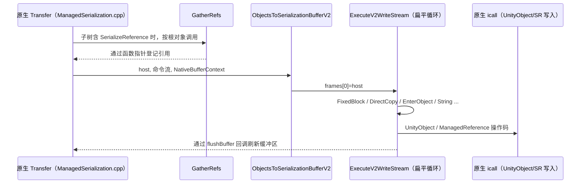

# 序列化

Unity 的序列化由原生代码主导：哪些字段会被序列化、如何写进资源文件或用于克隆，都由原生的类型树和传输（Transfer）系统决定。本仓库中能看到三部分：面向用户的特性和回调接口、一个由原生驱动的**托管序列化 V2 命令执行器**，以及编辑器侧的 `SerializedObject`/`SerializedProperty` 包装。

父页面：[运行时架构](index.md) · 相关：[绑定层](bindings.md)、[对象模型](object-model.md)、[Inspector](../editor/inspector.md)

## 相关源码文件

- [`Runtime/Export/Serialization/Serialization.cs`](../../Runtime/Export/Serialization/Serialization.cs)、[`Modules/Scripting/Attributes/SerializeFieldAttribute.cs`](../../Modules/Scripting/Attributes/SerializeFieldAttribute.cs)
- [`Runtime/Serialize/Managed/Core/`](../../Runtime/Serialize/Managed/Core/)：`Commands.cs`、`WriteExecutor.cs`、`ReadExecutor.cs`、`WireFormat.cs` 等
- [`Runtime/Serialize/Managed/Extensions/`](../../Runtime/Serialize/Managed/Extensions/)：字典、`UnityEngine.Object` 引用、`[SerializeReference]` 等扩展
- [`Runtime/Export/Serialization/ManagedCommands/`](../../Runtime/Export/Serialization/ManagedCommands/)：共享上下文结构、icall、Gather 遍历
- [`Editor/Mono/SerializedObject.bindings.cs`](../../Editor/Mono/SerializedObject.bindings.cs)、[`Editor/Mono/SerializedProperty.bindings.cs`](../../Editor/Mono/SerializedProperty.bindings.cs)

## 1. 面向用户的契约

| 类型 | 语义 | 证据 |
| --- | --- | --- |
| `[SerializeField]` | 标记要序列化的字段，带 `[RequiredByNativeCode]`，说明原生会按名称识别它 | [`SerializeFieldAttribute.cs:10-14`](../../Modules/Scripting/Attributes/SerializeFieldAttribute.cs#L10-L14) |
| `[SerializeReference]` | 按引用而不是按值序列化字段；注释列出三个动机：多态、图结构、表达 null | [`Serialization.cs:52-66`](../../Runtime/Export/Serialization/Serialization.cs#L52-L66) |
| `ISerializationCallbackReceiver` | 序列化前调用 `OnBeforeSerialize`，反序列化后调用 `OnAfterDeserialize` | [`Serialization.cs:74-82`](../../Runtime/Export/Serialization/Serialization.cs#L74-L82) |
| `[assembly: MakeSerializable(type)]` | 让指定类型可被序列化；构造时拒绝 `null`、值类型和接口 | [`Serialization.cs:14-50`](../../Runtime/Export/Serialization/Serialization.cs#L14-L50) |
| `[PreferBinarySerialization]` | 类级标记，从名称看是偏好二进制格式 | [`Serialization.cs:68-72`](../../Runtime/Export/Serialization/Serialization.cs#L68-L72) |

字段可序列化的完整规则（例如可见性、泛型、类型限制）由原生实现，不在仓库中。

## 2. 托管序列化 V2：原生编排、托管执行

### 2.1 设计

V2 的核心是：**原生侧为每个类型生成并缓存一条命令流，C# 侧执行器逐条解释命令，直接读写托管对象的字段内存**。

- 写执行器注释说明，命令流“在原生侧按类型组合并缓存”，产生的字节与 v1 后端相同 [`WriteExecutor.cs:12-17`](../../Runtime/Serialize/Managed/Core/WriteExecutor.cs#L12-L17)。
- 执行模型是“一个扁平循环，没有递归”；`EnterObject`/`ExitObject` 在帧栈中原地切换基址；宿主对象不被 pin，字段访问都通过受 GC 跟踪的 `ref byte` 完成，只有在内部指针逃逸到原生时才 pin [`WriteExecutor.cs:19-31`](../../Runtime/Serialize/Managed/Core/WriteExecutor.cs#L19-L31)。
- 读执行器复用同一套与方向无关的模板，通过 `NativeReadBufferContext` 按需拉取字节 [`ReadExecutor.cs:12-24`](../../Runtime/Serialize/Managed/Core/ReadExecutor.cs#L12-L24)。
- `Commands.cs` 是原生 `Commands.h` 的 C# 镜像，两者必须在同一提交中同步修改 [`Commands.cs:11-19`](../../Runtime/Serialize/Managed/Core/Commands.cs#L11-L19)。

### 2.2 入口

| 入口（均为 `[RequiredByNativeCode]`） | 用途 | 证据 |
| --- | --- | --- |
| `ObjectsToSerializationBufferV2(host, streamStart, bufferContext)` | 把托管对象写入缓冲区 | [`WriteExecutor.cs:39-85`](../../Runtime/Serialize/Managed/Core/WriteExecutor.cs#L39-L85) |
| `ObjectsToSerializationBufferV2Unmanaged(...)` | 非托管基址版本，用于可证明安全的模板 | [`WriteExecutor.cs:87-91`](../../Runtime/Serialize/Managed/Core/WriteExecutor.cs#L87-L91) |
| `SerializationBufferToObjectsV2(host, streamStart, readContext)` | 从缓冲区读入托管对象 | [`ReadExecutor.cs:30-68`](../../Runtime/Serialize/Managed/Core/ReadExecutor.cs#L30-L68) |
| `GatherRefs(rootInstance, ...)` | 写之前遍历对象，收集 `[SerializeReference]` 引用 | [`Gather.cs:63-80`](../../Runtime/Export/Serialization/ManagedCommands/Gather.cs#L63-L80) |
| `V2RegisterConstructor`、`GetConstructorMethodFunctionPointer` | 注册构造函数，并把方法句柄转换为函数指针，供执行器用 `calli` 调用 | [`Instances.cs:67-68`](../../Runtime/Serialize/Managed/Core/Instances.cs#L67-L68)、[`CallbackResolution.cs:24-39`](../../Runtime/Serialize/Managed/Core/CallbackResolution.cs#L24-L39) |

写入口的结构：从线程池获取帧数组，帧 0 设为宿主对象，执行命令流；在 `finally` 中清空帧，避免线程静态缓存继续引用用户对象，并在中途抛出异常时平衡字典 FUID 栈 [`WriteExecutor.cs:53-84`](../../Runtime/Serialize/Managed/Core/WriteExecutor.cs#L53-L84)。

图中证据：入口注释写明由 `ExecuteV2Write (ManagedSerialization.cpp)` 调用 [`WriteExecutor.cs:39-40`](../../Runtime/Serialize/Managed/Core/WriteExecutor.cs#L39-L40)；Gather 由原生在 `hasSerializeReferenceInSubtree` 检查通过后按根对象调用 [`Gather.cs:63-71`](../../Runtime/Export/Serialization/ManagedCommands/Gather.cs#L63-L71)；`flushBuffer` 函数指针和 `transferState` 字段定义在 [`SerializationBackendManagedCommands.bindings.cs:43-60`](../../Runtime/Export/Serialization/ManagedCommands/SerializationBackendManagedCommands.bindings.cs#L43-L60)；`[SerializeReference]` 写入 icall 定义在 [`SerializationBackendManagedCommands.bindings.cs:128-138`](../../Runtime/Export/Serialization/ManagedCommands/SerializationBackendManagedCommands.bindings.cs#L128-L138)；操作码定义在 [`Commands.cs:20-72`](../../Runtime/Serialize/Managed/Core/Commands.cs#L20-L72)。

### 2.3 跨边界的共享结构

`NativeBufferContext` 和 `NativeReadBufferContext` 必须与原生结构**逐字段一致**。两者都使用 `Pack = 8`，以确保 32 位 Mono 上 `EntityId` 的 `UInt64` 仍按 8 字节对齐 [`SerializationBackendManagedCommands.bindings.cs:22-101`](../../Runtime/Export/Serialization/ManagedCommands/SerializationBackendManagedCommands.bindings.cs#L22-L101)。缓冲契约是：每次 flush 后，`writerPtr..writerEnd` 至少能容纳调用方声明的 `minNextWrite` 字节；当写入量不超过溢出缓冲区大小时，C# 可以不加判断地直接写 [`SerializationBackendManagedCommands.bindings.cs:26-36`](../../Runtime/Export/Serialization/ManagedCommands/SerializationBackendManagedCommands.bindings.cs#L26-L36)。

### 2.4 为 CoreCLR 做的调整

执行器调用构造函数和回调时不使用反射 `Invoke`，而是通过 `RuntimeMethodHandle.GetFunctionPointer` 获取函数指针，再用 `calli` 调用。注释称这是 `ScriptingInvocation` 的“CoreCLR 安全替代” [`CallbackResolution.cs:24-50`](../../Runtime/Serialize/Managed/Core/CallbackResolution.cs#L24-L50)。按接口解析结构体回调的 `GetInterfaceMethodFunctionPointer` 在本仓库中直接返回 `IntPtr.Zero`，注释说明它在 Mono/IL2CPP 下不可达 [`CallbackResolution.cs:63-77`](../../Runtime/Serialize/Managed/Core/CallbackResolution.cs#L63-L77)。这也与源码按某个具体配置预处理的推断一致。

## 3. 编辑器侧：`SerializedObject` 与 `SerializedProperty`

编辑器通过这两个类型以通用方式读写任意对象的序列化数据，并支持撤销和多对象编辑：

- `SerializedObject` 持有原生指针 `m_NativeObjectPtr`，由 `InternalCreate(objs, context)` 创建；它实现 `IDisposable`，终结器也会调用 `Dispose` [`SerializedObject.bindings.cs:18-60`](../../Editor/Mono/SerializedObject.bindings.cs#L18-L60)。
- `GetIterator`、`FindProperty` 返回绑定到该对象的 `SerializedProperty`；修改通过 `ApplyModifiedProperties` 写回 [`SerializedObject.bindings.cs:67-122`](../../Editor/Mono/SerializedObject.bindings.cs#L67-L122)。
- `SerializedProperty` 持有原生指针和所属 `SerializedObject`。每次访问前，`Verify` 会检查两个指针都有效，同步对象版本，并在需要时检查迭代器没有到达末尾 [`SerializedProperty.bindings.cs:130-151`](../../Editor/Mono/SerializedProperty.bindings.cs#L130-L151)、[`SerializedProperty.bindings.cs:505-525`](../../Editor/Mono/SerializedProperty.bindings.cs#L505-L525)。

这些类型如何在 Inspector 中使用，见 [Inspector](../editor/inspector.md)。

## 4. 局限

- 命令流如何组合（类型模板、降级、批量复制合并）全部在原生侧，本页只描述 C# 执行器的契约。
- `ReadExecutor.cs` 和 `WriteExecutor.cs` 各约 46 KB，本页没有逐个解释操作码的处理分支。
- v1 后端（如果仍然存在）以及 v1/v2 的选择条件不在仓库中。
- `JsonUtility`（[`Modules/JSONSerialize`](../../Modules/JSONSerialize/)）没有单独分析。
