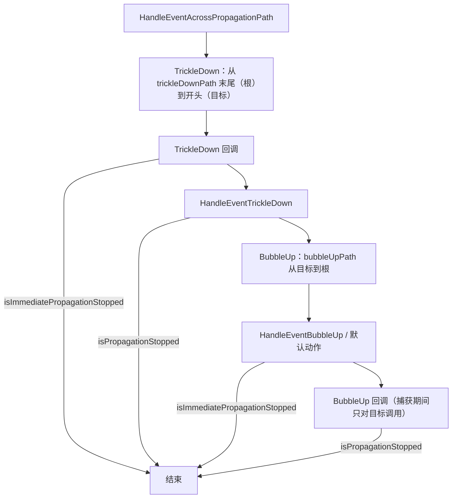

# UI Toolkit 事件分发

本页说明一个事件进入面板后的处理过程：分发器如何用“闸门”把嵌套产生的事件排队，传播路径如何构造，TrickleDown 和 BubbleUp 两个阶段如何执行，以及 `StopPropagation` 等标志在哪里生效。

父页面：[UI Toolkit 架构](index.md) · 相关：[窗口系统 §3.3](../editor/window-system.md#33-事件进入)、[IMGUI](../editor/imgui.md)

## 相关源码文件

- [`Modules/UIElements/Core/EventDispatcher.cs`](../../Modules/UIElements/Core/EventDispatcher.cs)
- [`Modules/UIElements/Core/Events/EventDispatchUtilities.cs`](../../Modules/UIElements/Core/Events/EventDispatchUtilities.cs)
- [`Modules/UIElements/Core/Events/PropagationPaths.cs`](../../Modules/UIElements/Core/Events/PropagationPaths.cs)
- [`Modules/UIElements/Core/Events/EventBase.cs`](../../Modules/UIElements/Core/Events/EventBase.cs) 及各类事件文件

## 1. 分发器：立即处理还是入队

`EventDispatcher.Dispatch(evt, panel, mode)` [`EventDispatcher.cs:206-236`](../../Modules/UIElements/Core/EventDispatcher.cs#L206-L236)：

1. 标记事件已被分发器接收。
2. **丢弃 IMGUI Repaint 事件**：它们不经过 UI Toolkit 的事件分发。
3. 闸门计数为 0，或者调用方要求 `DispatchMode.Immediate` 时，立即处理。
4. 否则先检查递归深度，然后 `Acquire` 事件并放入队列；面板有调试器连接时，还会记录调用栈。

**闸门（gate）**：处理每个事件时都会用 `EventDispatcherGate` 关闭一次闸门 [`EventDispatcher.cs:395-420`](../../Modules/UIElements/Core/EventDispatcher.cs#L395-L420)。因此，事件处理期间新产生的事件，例如 `MouseDown` 引起的焦点事件，会进入队列，而不是递归处理。闸门计数回到 0 时，`OpenGate` 会处理队列 [`EventDispatcher.cs:303-325`](../../Modules/UIElements/Core/EventDispatcher.cs#L303-L325)。

**队列交换保证因果顺序**：`ProcessEventQueue` 处理前先换上一个新队列，所以某个事件派生出的事件会在它处理完成后、队列中其余事件之前处理。注释用 MouseDown → FocusOut/FocusIn/Blur/Focus → ValueChanged 的例子说明了这一点 [`EventDispatcher.cs:337-393`](../../Modules/UIElements/Core/EventDispatcher.cs#L337-L393)。每个事件处理后都会 `Dispose`，与入队时的 `Acquire` 配对。

**`ExitGUIException`**：队列处理期间捕获到的 `ExitGUIException` 会先保存，等整个队列处理完再重新抛出 [`EventDispatcher.cs:357-392`](../../Modules/UIElements/Core/EventDispatcher.cs#L357-L392)。这样 IMGUI 的“退出本轮 GUI”语义不会打断其它排队事件。

**已释放的面板**：`ProcessEvent` 直接跳过已经 `disposed` 的面板（UUM-83486）[`EventDispatcher.cs:395-399`](../../Modules/UIElements/Core/EventDispatcher.cs#L395-L399)。

### 分发上下文

`PushDispatcherContext` 先清空当前队列，再保存闸门计数和队列，并开启一个新的空上下文；`PopDispatcherContext` 要求新上下文中的闸门已全部打开且队列为空，然后恢复旧上下文 [`EventDispatcher.cs:280-301`](../../Modules/UIElements/Core/EventDispatcher.cs#L280-L301)。注释说明，先清空队列是为了在显示模态窗口前处理 AttachToPanel 等重要事件。编辑器切换标签页时也使用它，以便失焦事件生效 [`HostView.cs:683-687`](../../Editor/Mono/HostView.cs#L683-L687)。

## 2. 传播

### 2.1 阶段

现在只有两个传播阶段：`TrickleDown`（从根到目标）和 `BubbleUp`（从目标到根）。`AtTarget`、`DefaultAction`、`DefaultActionAtTarget` 已被标为过时，注释说明默认动作现在属于 BubbleUp 阶段 [`EventDispatchUtilities.cs:27-59`](../../Modules/UIElements/Core/Events/EventDispatchUtilities.cs#L27-L59)。

### 2.2 路径构造与“事件兴趣”剪枝

`PropagationPaths.Build` 从池中取出路径对象，按以下规则构造路径 [`PropagationPaths.cs:38-72`](../../Modules/UIElements/Core/Events/PropagationPaths.cs#L38-L72)：

- 目标元素对该事件类别有 TrickleDown 或 BubbleUp 兴趣时，才加入相应路径。
- 向上遍历时使用 `nextParentWithEventInterests`，跳过对任何事件都没有兴趣的祖先；一旦某个祖先链对这个类别没有兴趣，就提前结束。
- 只有 `evt.tricklesDown`/`evt.bubbles` 为真时，祖先才会加入对应路径。

这种兴趣标记让大量没有回调的元素完全不参与分发。在传播开始前，如果目标的父链对该类别没有兴趣，`HandleEventAcrossPropagationPath` 会直接返回 [`EventDispatchUtilities.cs:151-158`](../../Modules/UIElements/Core/Events/EventDispatchUtilities.cs#L151-L158)。

### 2.3 执行顺序

证据：[`EventDispatchUtilities.cs:158-229`](../../Modules/UIElements/Core/Events/EventDispatchUtilities.cs#L158-L229)。几个容易忽略的细节：

- **指针捕获**：存在捕获目标时，TrickleDown 只在目标本身执行，其它元素被跳过 [`EventDispatchUtilities.cs:171-173`](../../Modules/UIElements/Core/Events/EventDispatchUtilities.cs#L171-L173)；BubbleUp 回调也只对目标调用 [`EventDispatchUtilities.cs:214-217`](../../Modules/UIElements/Core/Events/EventDispatchUtilities.cs#L214-L217)。
- **同一元素上，默认动作先于 BubbleUp 回调**：每个元素先执行 `HandleEvent_BubbleUpAllDefaultActions`，再执行回调 [`EventDispatchUtilities.cs:202-221`](../../Modules/UIElements/Core/Events/EventDispatchUtilities.cs#L202-L221)。
- **禁用元素**：处理函数会收到 `Disabled(evt, element)` 参数，由它们决定如何对待禁用元素 [`EventDispatchUtilities.cs:191`](../../Modules/UIElements/Core/Events/EventDispatchUtilities.cs#L191)、[`EventDispatchUtilities.cs:208`](../../Modules/UIElements/Core/Events/EventDispatchUtilities.cs#L208)。
- **防递归**：同一个事件对象不能递归传播，`finally` 会复位 `currentTarget`、`propagationPhase` 和 `dispatch` [`EventDispatchUtilities.cs:160-163`](../../Modules/UIElements/Core/Events/EventDispatchUtilities.cs#L160-L163)、[`EventDispatchUtilities.cs:223-228`](../../Modules/UIElements/Core/Events/EventDispatchUtilities.cs#L223-L228)。
- **兼容鼠标事件**：指针事件可以带一个兼容的鼠标事件；此时两者的事件类别会合并，并在同一条路径上一起传播 [`EventDispatchUtilities.cs:64-76`](../../Modules/UIElements/Core/Events/EventDispatchUtilities.cs#L64-L76)、[`EventDispatchUtilities.cs:231-260`](../../Modules/UIElements/Core/Events/EventDispatchUtilities.cs#L231-L260)。

`SendEventDirectlyToTarget` 是不经过队列和路径的捷径，只在目标本身执行 TrickleDown 和默认阶段；文档注释列出了调用前提：面板与目标一致、已检查兴趣、事件尚未处理 [`EventDispatchUtilities.cs:78-96`](../../Modules/UIElements/Core/Events/EventDispatchUtilities.cs#L78-L96)。

## 3. 局限

- `EventBase.Dispatch` 及各类事件的 `PreDispatch`/`PostDispatch` 覆盖（如指针捕获、焦点处理）没有逐个分析。
- 运行时输入如何转换为事件（`DefaultEventSystem`、`InputForUI` 模块）只在 [UI Toolkit 架构](index.md) 中提到。
