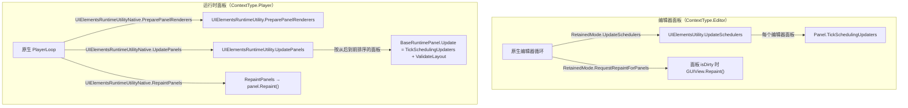

# UI Toolkit 架构

UI Toolkit（代码中称 UIElements）是保留模式 UI 框架，编辑器窗口和运行时游戏 UI 都使用它。与多数引擎子系统不同，它的大部分逻辑是 **C# 实现**：元素树、样式匹配、事件分发和渲染数据生成都在仓库中；布局计算（Yoga）、文本和 GPU 提交交给原生。本页介绍核心概念、面板更新阶段，以及编辑器和运行时分别如何驱动面板。

父页面：[仓库概览](../overview.md) · 子页面：[事件分发](events.md)、[样式、布局与渲染](styles-layout-rendering.md) · 相关：[窗口系统](../editor/window-system.md)、[IMGUI](../editor/imgui.md)

## 相关源码文件

- [`Modules/UIElements/Core/VisualElement.cs`](../../Modules/UIElements/Core/VisualElement.cs)、[`Panel.cs`](../../Modules/UIElements/Core/Panel.cs)
- [`Modules/UIElements/Core/VisualTreeUpdater.cs`](../../Modules/UIElements/Core/VisualTreeUpdater.cs)
- [`Modules/UIElements/Core/UIElementsUtility.cs`](../../Modules/UIElements/Core/UIElementsUtility.cs)、[`UIElementsRuntimeUtility.cs`](../../Modules/UIElements/Core/UIElementsRuntimeUtility.cs)
- [`Modules/UIElements/Core/Native/UIElementsUtility.bindings.cs`](../../Modules/UIElements/Core/Native/UIElementsUtility.bindings.cs)
- [`Modules/UIElements/Core/GameObjects/`](../../Modules/UIElements/Core/GameObjects/)：`UIDocument`、`PanelSettings`、`RuntimePanel`
- [`Modules/UIElementsEditor/RetainedMode.cs`](../../Modules/UIElementsEditor/RetainedMode.cs)、[`EditorPanel.cs`](../../Modules/UIElementsEditor/EditorPanel.cs)

## 1. 模块构成

| 模块 | 程序集 | 文件数 | 内容 |
| --- | --- | --- | --- |
| `UIElements` | UnityEngine | 665 | 核心：`Core/Controls`（109）、`Style`（106）、`Renderer`（72）、`StyleSheets`（47）、`Events`（34）、`Layout`（34）等 |
| `UIElementsEditor` | UnityEditor | 151 | 编辑器集成：窗口后端、`EditorPanel`、UXML 导入器、调试器 |
| `UIBuilder` | UnityEditor | 195 | UI Builder 可视化编辑工具 |
| `UIToolkitAuthoringEditor` | UnityEditor | 406 | 新的创作工具（命名空间 `Unity.UIToolkit.Editor`） |
| `StyleSheetsEditor` | UnityEditor | 13 | `GUISkin` 与样式表互相转换 |
| `UIElementsSamplesEditor` | UnityEditor | 59 | 示例窗口 |

数据来自目录统计和 [模块目录](../module-catalog.md)。此外，`Editor/Mono/UIElements`（63 个文件）包含 `InspectorElement`、USS 导入器等编辑器侧集成。

## 2. 核心概念

| 概念 | 说明 | 证据 |
| --- | --- | --- |
| `VisualElement` | 元素树节点，继承 `Focusable` | [`VisualElement.cs:252`](../../Modules/UIElements/Core/VisualElement.cs#L252) |
| 面板（Panel） | 一棵元素树的宿主，负责更新、事件和渲染。层级为 `BaseVisualElementPanel` → `Panel` → `BaseRuntimePanel`/`EditorPanel` | [`Panel.cs:480`](../../Modules/UIElements/Core/Panel.cs#L480)、[`Panel.cs:1217`](../../Modules/UIElements/Core/Panel.cs#L1217)、[`Panel.cs:2014`](../../Modules/UIElements/Core/Panel.cs#L2014)、[`EditorPanel.cs:13`](../../Modules/UIElementsEditor/EditorPanel.cs#L13) |
| `ContextType` | `Player=0` 或 `Editor=1`，决定由谁驱动面板 | [`Panel.cs:20-30`](../../Modules/UIElements/Core/Panel.cs#L20-L30) |
| `VersionChangeType` | 位标志，描述元素发生了哪类变化（层级、布局、样式、变换、重绘等），与原生 `VersionChangeType.h` 保持同步 | [`Panel.cs:32-120`](../../Modules/UIElements/Core/Panel.cs#L32-L120) |
| 运行时宿主 | `UIDocument : MonoBehaviour` 提供 UXML 内容；`PanelSettings : ScriptableObject` 拥有面板；`RuntimePanel : BaseRuntimePanel` | [`UIDocument.cs:106`](../../Modules/UIElements/Core/GameObjects/UIDocument.cs#L106)、[`PanelSettings.cs:169`](../../Modules/UIElements/Core/GameObjects/PanelSettings.cs#L169)、[`RuntimePanel.cs:287`](../../Modules/UIElements/Core/GameObjects/RuntimePanel.cs#L287) |

### 变化通知：版本号而不是立即重算

元素变化通常通过递增版本来通知，而不是立即重新计算：`IncrementVersion(changeType)` 转发给 `elementPanel.OnVersionChanged` [`VisualElement.cs:2497-2501`](../../Modules/UIElements/Core/VisualElement.cs#L2497-L2501)；`MarkDirtyRepaint` 就是 `IncrementVersion(VersionChangeType.Repaint)` [`VisualElement.cs:2713-2716`](../../Modules/UIElements/Core/VisualElement.cs#L2713-L2716)。面板递增自身版本，并把变化**广播给每个已安装阶段的更新器**，由各更新器记录自己关心的脏标记；层级变化还会递增层级版本 [`Panel.cs:1982-1994`](../../Modules/UIElements/Core/Panel.cs#L1982-L1994)、[`VisualTreeUpdater.cs:150-159`](../../Modules/UIElements/Core/VisualTreeUpdater.cs#L150-L159)。元素被移出面板（`elementPanel` 为空）时，`IncrementVersion` 不做任何事。

## 3. 更新阶段

`VisualTreeUpdater` 为每个面板维护一组按阶段排列的更新器 [`VisualTreeUpdater.cs:32-46`](../../Modules/UIElements/Core/VisualTreeUpdater.cs#L32-L46)、[`VisualTreeUpdater.cs:192-209`](../../Modules/UIElements/Core/VisualTreeUpdater.cs#L192-L209)：

| 阶段 | 默认更新器 | 职责 |
| --- | --- | --- |
| `ViewData` | `VisualTreeViewDataUpdater` | 持久化视图数据 |
| `Bindings` | `VisualTreeBindingsUpdater` | `SerializedObject` 绑定 |
| `DataBinding` | `VisualTreeDataBindingsUpdater` | 运行时数据绑定 |
| `Component` | `VisualTreeComponentUpdater` | 元素组件 |
| `Animation` | `VisualElementAnimationSystem` | 动画与过渡 |
| `Styles` | `VisualTreeStyleUpdater` | 样式匹配与计算样式 |
| `Layout` | `VisualTreeLayoutUpdater` | 布局 |
| `TransformClip` | `VisualTreeHierarchyFlagsUpdater` | 变换和裁剪标志 |
| `Accessibility` | 默认为空；只有可访问性桥接跟踪的面板才安装 | 无障碍 |
| `Repaint` | `UIRRepaintUpdater` | 生成渲染数据 |
| `Authoring` | `VisualTreeAuthoringUpdater` | 创作工具 |

面板不会每帧按顺序运行全部阶段，而是把它们分组到几个入口中 [`Panel.cs:1759-1873`](../../Modules/UIElements/Core/Panel.cs#L1759-L1873)：

| 面板方法 | 执行内容 |
| --- | --- |
| `TickSchedulingUpdaters()` | 重建脏样式表 → 调度器定时项 → 校验焦点 → 资源追踪 → `Bindings` → `DataBinding` → `Component` → `Animation` |
| `ValidateLayout()` | 重建脏样式表 → `Styles` → `Layout` → `TransformClip`；用标志防止重入 |
| `Repaint()` → `UpdateForRepaint()` | 如果层级版本变化后还没有 tick，先补一次 `TickSchedulingUpdaters`；然后执行 `ViewData` → `Styles` → `Layout` → `TransformClip` → `Accessibility` → `Repaint` → `Authoring` |
| `UpdateWithoutRepaint()` | Inspector 节流创建元素时使用，只执行绑定、样式、布局和创作阶段 |

`UpdateForRepaint` 的“补 tick”逻辑有注释说明：新加入面板的元素可能注册调度项、绑定或动画，如果同一帧没有 tick，就会闪烁 [`Panel.cs:1840-1859`](../../Modules/UIElements/Core/Panel.cs#L1840-L1859)。`ValidateLayout` 的防重入注释给出了实际调用链：TransformClip 阶段重新计算鼠标下的元素时会执行拾取，而拾取又会校验布局 [`Panel.cs:1759-1781`](../../Modules/UIElements/Core/Panel.cs#L1759-L1781)。

## 4. 谁驱动面板

图中证据：

- 编辑器：`RetainedMode.UpdateSchedulers` 和 `RequestRepaintForPanels` 是 `[RequiredByNativeCode]` 方法 [`RetainedMode.cs:78-93`](../../Modules/UIElementsEditor/RetainedMode.cs#L78-L93)。`UIElementsUtility.UpdateSchedulers` 先回收布局、组件和文本管理器的资源，再复制编辑器面板列表并逐个 tick；复制是因为用户代码可能在迭代中改变面板列表 [`UIElementsUtility.cs:268-302`](../../Modules/UIElements/Core/UIElementsUtility.cs#L268-L302)。`RequestRepaintForPanels` 跳过非编辑器面板，只为 dirty 的面板请求重绘 [`UIElementsUtility.cs:304-322`](../../Modules/UIElements/Core/UIElementsUtility.cs#L304-L322)。编辑器面板的 `Repaint` 由窗口重绘触发，具体路径见 [窗口系统](../editor/window-system.md)。
- 运行时：原生调用 `UIElementsRuntimeUtilityNative` 中的四个 `[RequiredByNativeCode]` 方法，它们只是转发到可替换的回调 [`UIElementsUtility.bindings.cs:12-60`](../../Modules/UIElements/Core/Native/UIElementsUtility.bindings.cs#L12-L60)。`UIElementsRuntimeUtility` 的静态构造函数注册更新回调 [`UIElementsRuntimeUtility.cs:34-41`](../../Modules/UIElements/Core/UIElementsRuntimeUtility.cs#L34-L41)，渲染回调由 `EnableRenderingAndInputCallbacks` 注册 [`UIElementsRuntimeUtility.cs:585-588`](../../Modules/UIElements/Core/UIElementsRuntimeUtility.cs#L585-L588)。`UpdatePanels` 先移除无用面板并回收共享管理器，然后预更新 `PanelRenderer`，按从后到前（世界空间先于屏幕覆盖层）调用 `panel.Update()`，再更新 `PanelRenderer` 和默认事件系统 [`UIElementsRuntimeUtility.cs:366-420`](../../Modules/UIElements/Core/UIElementsRuntimeUtility.cs#L366-L420)。`BaseRuntimePanel.Update` 就是 `TickSchedulingUpdaters()` 加 `ValidateLayout()` [`Panel.cs:2117-2122`](../../Modules/UIElements/Core/Panel.cs#L2117-L2122)；`RuntimePanel` 会先应用 `PanelSettings` [`RuntimePanel.cs:352-360`](../../Modules/UIElements/Core/GameObjects/RuntimePanel.cs#L352-L360)。`RepaintPanels` 对每个未释放的面板调用 `Repaint`；只重绘离屏面板时，只处理有 `targetTexture` 的面板 [`UIElementsRuntimeUtility.cs:303-315`](../../Modules/UIElements/Core/UIElementsRuntimeUtility.cs#L303-L315)。

PlayerLoop 中有名为 `PreUpdate.UIElementsPreparePanelRenderers`、`PreLateUpdate.UIElementsUpdatePanels`、`PostLateUpdate.UIElementsRepaintPanels` 的阶段 [`PlayerLoop.bindings.cs:186`](../../Runtime/Export/PlayerLoop/PlayerLoop.bindings.cs#L186)、[`PlayerLoop.bindings.cs:224`](../../Runtime/Export/PlayerLoop/PlayerLoop.bindings.cs#L224)、[`PlayerLoop.bindings.cs:253`](../../Runtime/Export/PlayerLoop/PlayerLoop.bindings.cs#L253)。根据名称可以推断，它们分别调用上面三个原生入口；`PreparePanelRenderers` 的注释也说它“在 PreUpdate 末尾运行” [`UIElementsRuntimeUtility.cs:353-355`](../../Modules/UIElements/Core/UIElementsRuntimeUtility.cs#L353-L355)。其余对应关系在原生侧确认。

## 5. 编辑器集成要点

- 编辑器窗口内容运行在 `EditorPanel` 中，根部有一个运行 `OnGUI` 的 `IMGUIContainer`（见 [窗口系统 §3](../editor/window-system.md#3-窗口后端接入-ui-toolkit)）。
- `RetainedMode` 在 `[OnCodeLoaded]` 中注入编辑器专用实现，例如面板资源加载、`SerializedObject` 绑定实现和光标 ID 解析 [`RetainedMode.cs:25-53`](../../Modules/UIElementsEditor/RetainedMode.cs#L25-L53)。
- UXML/USS 资源重新导入后，`RetainedModeAssetPostprocessor` 收集变化的资源并通知面板刷新 [`RetainedMode.cs:95-123`](../../Modules/UIElementsEditor/RetainedMode.cs#L95-L123)。

## 6. 局限

- `Core/Controls`（109 个文件）中的具体控件、`Collections`（ListView 等虚拟化列表）、`Bindings`/数据绑定、`DragAndDrop`、`Accessibility` 没有单独分析。
- UI Builder 和 `UIToolkitAuthoringEditor` 只在模块目录中列出。
