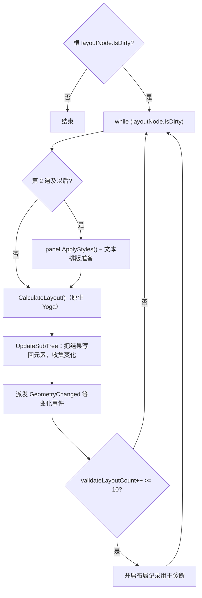

# 样式、布局与渲染

本页沿着一份 USS/UXML 从磁盘到屏幕的路径，说明 UI Toolkit 的几个阶段：编辑器导入器把文本转换为 `StyleSheet`/`VisualTreeAsset`；运行时的样式阶段匹配选择器并计算样式；布局阶段交给原生 Yoga 计算；重绘阶段生成渲染数据并提交。

父页面：[UI Toolkit 架构](index.md) · 相关：[资源导入](../editor/asset-pipeline.md)

## 相关源码文件

- 导入：[`Editor/Mono/UIElements/StyleSheets/StyleSheetImporter.cs`](../../Editor/Mono/UIElements/StyleSheets/StyleSheetImporter.cs)、[`StyleSheetImporterImpl.cs`](../../Editor/Mono/UIElements/StyleSheets/StyleSheetImporterImpl.cs)、[`Modules/UIElementsEditor/UIElementsViewImporter.cs`](../../Modules/UIElementsEditor/UIElementsViewImporter.cs)
- 样式：[`Modules/UIElements/Core/StyleSheets/`](../../Modules/UIElements/Core/StyleSheets/)、[`VisualTreeStyleUpdater.cs`](../../Modules/UIElements/Core/VisualTreeStyleUpdater.cs)
- 布局：[`VisualTreeLayoutUpdater.cs`](../../Modules/UIElements/Core/VisualTreeLayoutUpdater.cs)、[`Modules/UIElements/Core/Layout/`](../../Modules/UIElements/Core/Layout/)
- 渲染：[`Modules/UIElements/Core/Renderer/`](../../Modules/UIElements/Core/Renderer/)，特别是 `UIRRepaintUpdater.cs`、`UIRRenderTreeManager.cs`

## 1. 导入（仅编辑器）

| 资源 | 导入器 | 产物 | 证据 |
| --- | --- | --- | --- |
| `.uss` | `StyleSheetImporter`，`[ScriptedImporter(version: 24, ext: "uss", importQueueOffset: 1100)]` | `StyleSheet`（`ScriptableObject`） | [`StyleSheetImporter.cs:16-20`](../../Editor/Mono/UIElements/StyleSheets/StyleSheetImporter.cs#L16-L20) |
| `.uxml` | `UIElementsViewImporter`，`[ScriptedImporter(version: 36, ext: "uxml", importQueueOffset: 1102)]` | `VisualTreeAsset` | [`UIElementsViewImporter.cs:29-65`](../../Modules/UIElementsEditor/UIElementsViewImporter.cs#L29-L65) |

USS 导入细节：

- 读取文件失败时记录导入错误，但无论如何都会创建并添加一个 `StyleSheet` 对象，保证资源始终有主对象 [`StyleSheetImporter.cs:62-90`](../../Editor/Mono/UIElements/StyleSheets/StyleSheetImporter.cs#L62-L90)。
- 导入器定义了静态 `GatherDependenciesFromSourceFile`，解析失败时静默返回空数组，错误留到正式导入时报告 [`StyleSheetImporter.cs:43-60`](../../Editor/Mono/UIElements/StyleSheets/StyleSheetImporter.cs#L43-L60)。根据 [资源导入 §2.2](../editor/asset-pipeline.md#22-注册)，这个方法会让该导入器注册为支持依赖提示。
- 解析使用 ExCSS：`UnityStylesheetParser` 继承 ExCSS 的 `StylesheetParser`，用于捕获错误，并阻止 ExCSS 把 `margin: 1px 2px` 这类简写展开成四个属性；结果再交给 `StyleSheetBuilder` 生成 `StyleSheet` [`StyleSheetImporterImpl.cs:56-120`](../../Editor/Mono/UIElements/StyleSheets/StyleSheetImporterImpl.cs#L56-L120)、[`StyleSheetImporterImpl.cs:1164-1167`](../../Editor/Mono/UIElements/StyleSheets/StyleSheetImporterImpl.cs#L1164-L1167)。ExCSS 以预编译 DLL 引用 [`UnityEditor.csproj:18054`](../../Projects/CSharp/UnityEditor.csproj#L18054)。

播放器中没有这些导入器，运行时只使用已经序列化的 `StyleSheet` 和 `VisualTreeAsset`。

## 2. 样式阶段

`VisualTreeStyleUpdater.Update()` 在版本没有变化时直接返回，并有自己的重入保护。注释说明，`ApplyStyles` 会派发 `CustomStyleResolvedEvent`，而事件处理函数可能进入 `ValidateLayout` [`VisualTreeStyleUpdater.cs:137-183`](../../Modules/UIElements/Core/VisualTreeStyleUpdater.cs#L137-L183)。主要步骤：

1. `ApplyStyles()` 以面板的缩放像素密度准备遍历，并从根开始遍历元素树 [`VisualTreeStyleUpdater.cs:197-202`](../../Modules/UIElements/Core/VisualTreeStyleUpdater.cs#L197-L202)。遍历器使用 `StyleMatchingContext` 匹配选择器 [`VisualTreeStyleUpdater.cs:206-306`](../../Modules/UIElements/Core/VisualTreeStyleUpdater.cs#L206-L306)。
2. 样式解析会整体替换计算样式，因此之后要重新应用动画绑定器最后采样的值，并取消已失去过渡属性的过渡动画 [`VisualTreeStyleUpdater.cs:150-177`](../../Modules/UIElements/Core/VisualTreeStyleUpdater.cs#L150-L177)。

**计算样式缓存**：注释说明，同一组匹配规则会得到相同的指定样式，所以先用匹配规则的哈希查缓存，命中时跳过解析。缓存由卸载时的 `ClearStyleCache` 清理，因为它需要先释放 `ComputedStyle` 的原生引用计数 [`VisualTreeStyleUpdater.cs:18-30`](../../Modules/UIElements/Core/VisualTreeStyleUpdater.cs#L18-L30)。

## 3. 布局阶段

### 3.1 数据在 C#，计算在原生

布局节点、样式和计算结果的数据结构在 `Core/Layout` 中定义（`LayoutNode`、`LayoutManager` 等），实际计算通过 `ILayoutProcessor` 完成。默认实现是 `LayoutProcessorNative`，它调用 `LayoutNative.CalculateLayout`；该绑定的头文件是 `External/Yoga/LayoutNative.h` [`LayoutProcessor.cs:12-46`](../../Modules/UIElements/Core/Layout/LayoutProcessor.cs#L12-L46)、[`LayoutProcessorNative.cs:30-44`](../../Modules/UIElements/Core/Layout/Native/LayoutProcessorNative.cs#L30-L44)、[`LayoutNative.bindings.cs:13-26`](../../Modules/UIElements/Core/Layout/Native/LayoutNative.bindings.cs#L13-L26)。处理器可以替换，设为 `null` 时恢复原生实现 [`LayoutProcessor.cs:32-38`](../../Modules/UIElements/Core/Layout/LayoutProcessor.cs#L32-L38)。

### 3.2 多遍布局

`VisualTreeLayoutUpdater.Update()` [`VisualTreeLayoutUpdater.cs:251-360`](../../Modules/UIElements/Core/VisualTreeLayoutUpdater.cs#L251-L360)：

变化事件的处理函数可能修改样式或尺寸，从而让布局再次变脏，所以布局是循环直到稳定。注释说明，滚动视图等控件可能需要多遍才能稳定，嵌套时需要更多遍，因此上限设为 `kMaxValidateLayoutCount = 10` [`VisualTreeLayoutUpdater.cs:24-30`](../../Modules/UIElements/Core/VisualTreeLayoutUpdater.cs#L24-L30)。超过上限后，代码开始记录布局信息用于诊断 [`VisualTreeLayoutUpdater.cs:346-360`](../../Modules/UIElements/Core/VisualTreeLayoutUpdater.cs#L346-L360)。超出更多遍数后的处理（报错或中止）在本页引用范围之后，没有展开。

## 4. 重绘与渲染

- **Repaint 阶段**由 `UIRRepaintUpdater` 实现，它同时是面板的 `IPanelRenderer` [`UIRRepaintUpdater.cs:28-40`](../../Modules/UIElements/Core/Renderer/UIRRepaintUpdater.cs#L28-L40)。`Update()` 在需要时初始化 `RenderTreeManager`，然后调用 `ProcessChanges()`，把元素变化转换为渲染数据；`Render()` 调用 `RenderRootTree()` 提交绘制 [`UIRRepaintUpdater.cs:171-194`](../../Modules/UIElements/Core/Renderer/UIRRepaintUpdater.cs#L171-L194)。
- `RenderTreeManager` 是 partial 类，变化处理分布在 `UIRRenderTreeManager.cs` 和 `UIRVisualChangesProcessor.cs` 中 [`UIRRenderTreeManager.cs:43`](../../Modules/UIElements/Core/Renderer/UIRRenderTreeManager.cs#L43)、[`UIRVisualChangesProcessor.cs:14`](../../Modules/UIElements/Core/Renderer/UIRVisualChangesProcessor.cs#L14)；GPU 资源由 `UIRenderDevice` 管理 [`UIRenderDevice.cs:51`](../../Modules/UIElements/Core/Renderer/UIRenderer/UIRenderDevice.cs#L51)。
- “更新渲染数据”和“提交绘制”分开：面板 `Repaint()` 走到 Repaint 阶段，`Render()` 再调用 `panelRenderer.Render()` [`Panel.cs:1096`](../../Modules/UIElements/Core/Panel.cs#L1096)。运行时离屏面板的渲染由 `RenderOffscreenPanels` 单独驱动 [`UIElementsRuntimeUtility.cs:185-205`](../../Modules/UIElements/Core/UIElementsRuntimeUtility.cs#L185-L205)。

## 5. 局限

- `Core/Style`（106 个文件，包括大量生成的样式属性代码）、选择器加速缓存（`SelectorAccelerationCache*.cs`）、文本（`TextCoreTextEngine` 模块）和 UIR 渲染器内部（72 个文件）没有逐一分析。
- Yoga 原生实现不在仓库中。
